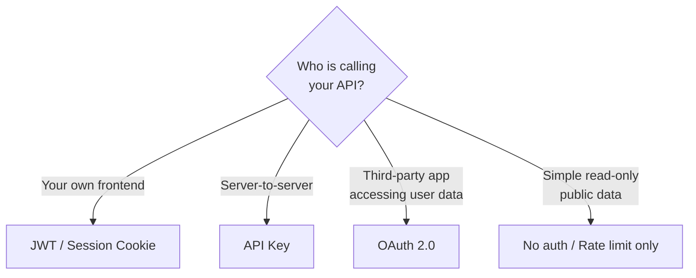

## Definition

API authentication is the process of verifying the identity of a client making an API request. Different methods suit different use cases — from simple API keys for server-to-server calls to OAuth 2.0 flows for user-facing applications that access third-party data.

## How It Works

| Method       | How It Works                                     | Security | Best For                        |
| ------------ | ------------------------------------------------ | -------- | ------------------------------- |
| API Key      | Static secret sent in header or query param      | Low-Med  | Server-to-server, internal APIs |
| OAuth 2.0    | Token exchange via authorization server           | High     | Third-party access to user data |
| JWT          | Self-contained signed token                       | Medium   | Stateless auth for own apps     |
| Bearer Token | Opaque token validated by the issuing server      | Medium   | Session-based API access        |

**OAuth 2.0 flow (simplified):**
1. User clicks "Login with Google" on your app.
2. Your app redirects to Google's authorization server.
3. User grants permission. Google returns an authorization code.
4. Your server exchanges the code for an access token (and optionally a refresh token).
5. Your server uses the access token to call Google APIs on behalf of the user.

## PM Implications

- **Auth method choice affects integration complexity** — API keys are simple but insecure if exposed. OAuth 2.0 is secure but adds onboarding friction for developer partners.
- **OAuth unlocks platform plays** — "Login with [Your Product]" and third-party integrations require OAuth. It is the foundation of API-as-a-product strategies.
- **Key management is a product feature** — developers need dashboards to create, rotate, and revoke API keys. Rate limits and usage analytics build trust.
- **Compliance requirements** — regulated industries (healthcare, finance) may mandate specific auth standards. Know your obligations before choosing.
- **Security incidents** — leaked API keys are one of the most common security breaches. Implement key rotation, environment-specific keys, and automated secret scanning.

## Example

A CRM platform offers three levels of API access:
- **Internal dashboard** (React SPA) — uses [[JWT-Authentication]] with short-lived access tokens and refresh tokens.
- **Partner integrations** (e.g., an email marketing tool syncing contacts) — uses OAuth 2.0 so the CRM user authorizes access without sharing their password.
- **Zapier / no-code integrations** — uses API keys for simplicity, with per-key rate limits and scoped permissions (read-only vs. read-write).

## Related Concepts

- [[JWT-Authentication]] — One specific token-based auth mechanism
- [[REST-API]] — API auth secures REST endpoints
- [[GraphQL]] — GraphQL APIs use the same auth mechanisms as REST
- [[Webhooks]] — Signature verification is a form of webhook authentication
- [[HTTP-Protocol]] — Auth tokens are sent in HTTP headers
