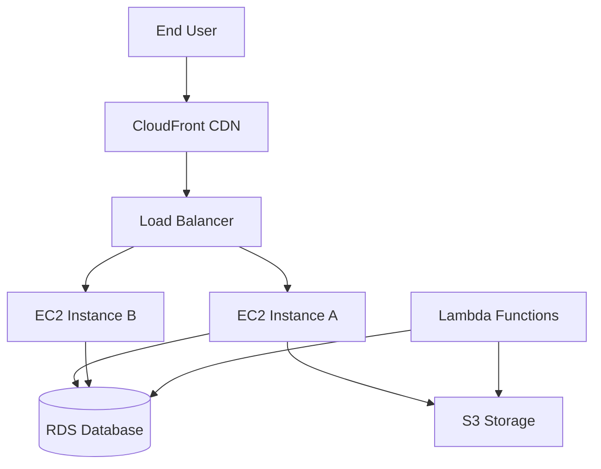

## Definition

Amazon Web Services (AWS) is the world's largest cloud computing platform, holding approximately 31% global market share (ahead of Azure at ~25% and GCP at ~11%). Launched in 2006, AWS offers 200+ services spanning compute, storage, databases, machine learning, analytics, and more across 30+ geographic regions.

## How It Works

AWS provides on-demand cloud services organized into categories. The most foundational services every PM should know:

| Service | What It Does | Analogy |
|---------|-------------|---------|
| **EC2** (Elastic Compute Cloud) | Virtual servers | Renting a computer |
| **S3** (Simple Storage Service) | Object/file storage | Unlimited hard drive in the cloud |
| **RDS** (Relational Database Service) | Managed databases (Postgres, MySQL) | Database without the DBA |
| **Lambda** | Serverless functions — run code without servers | Pay-per-function-call |
| **CloudFront** | CDN — delivers content from edge locations | Local copies of your site worldwide |

AWS pricing is usage-based: you pay for compute hours, storage gigabytes, data transfer, and API calls. Reserved instances and savings plans offer discounts for committed usage.

## PM Implications

- **Cost awareness**: AWS bills can spiral quickly. PMs should understand which features drive infrastructure cost (e.g., video processing is expensive, text storage is cheap).
- **Region selection**: Deploying in specific AWS regions affects latency, data residency compliance ([[GDPR]], [[DPDP-Act]]), and cost.
- **Service selection shapes architecture**: Choosing Lambda (serverless) vs. EC2 (servers) has implications for scalability, cost, and team skills.
- **Vendor lock-in**: Deep AWS integration makes switching providers expensive. PMs should weigh this in platform strategy.
- **Reliability**: AWS offers SLAs (e.g., 99.99% uptime for S3) but outages do happen — PMs should plan for them.

## Example

Netflix runs almost entirely on AWS. Their architecture uses EC2 for video encoding, S3 for storing millions of video files, CloudFront for streaming content from edge servers close to users, and RDS/DynamoDB for user data. When you press play, content is served from the nearest AWS edge location, and Lambda functions handle real-time personalization. Netflix reportedly spends $1B+ annually on AWS.

## Related Concepts

- [[Cloud-Computing]] — AWS is the leading cloud computing provider
- [[IaaS-PaaS-SaaS]] — AWS offers services across all three models
- [[Deployment-Pipeline]] — AWS is a common deployment target
- [[Environment-Variables]] — AWS uses env vars and IAM for configuration/secrets
- [[Database-Scaling]] — AWS RDS supports read replicas and auto-scaling
