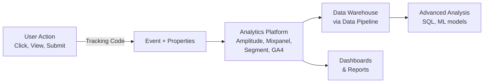

## Definition

Analytics instrumentation is the practice of embedding tracking code into a product to capture user behavior as **events with properties**. A well-instrumented product generates the data needed to measure feature adoption, diagnose funnels, and make evidence-based product decisions.

## How It Works

Every tracked interaction is recorded as an **event** with **properties**:

```
Event: "Product Added to Cart"
Properties:
  product_id: "SKU-4821"
  product_name: "Running Shoes"
  category: "Footwear"
  price: 129.99
  source: "search_results"
  user_id: "u_abc123"
  timestamp: "2024-10-14T09:32:00Z"
```



**The Golden Rule of Instrumentation:** Track actions, not pages. "User Clicked Checkout" is more useful than "User Visited /checkout" because it captures intent.

**Tracking Plan** — a living document that defines every event, its properties, where it fires, and who owns it:

| Event Name          | Trigger              | Key Properties               | Owner    |
| ------------------- | -------------------- | ---------------------------- | -------- |
| Signup Completed    | After email verified | method, referral_source      | Growth   |
| Feature Activated   | First use of feature | feature_name, plan_tier      | Product  |
| Payment Failed      | Charge declined      | error_code, retry_count      | Payments |

**Naming conventions** matter: use `Object Action` format (e.g., `Cart Item Added`, `Search Performed`) consistently. Mixed naming creates chaos in analytics tools.

## PM Implications

- **You cannot measure what you do not instrument** — every feature launch should include a tracking plan. If analytics is an afterthought, you cannot prove the feature's impact.
- **Instrument before launch, not after** — retroactive instrumentation means lost data for the critical first weeks of a launch.
- **Over-tracking is costly** — each event costs storage, processing, and cognitive overhead. Track what you will actually analyze. If nobody queries it in 6 months, remove it.
- **Client-side vs. server-side tracking** — client-side (JavaScript SDK) captures UI interactions but is blocked by ad blockers. Server-side captures reliable backend events (purchases, API calls). Use both.
- **Data quality is your responsibility** — if `product_id` is sometimes a string and sometimes an integer, analysis breaks. Enforce schemas with tools like Segment Protocols or Amplitude's Govern.

## Example

A PM launching a new search feature instruments:
1. `Search Performed` — fires on submit, with properties: `query`, `results_count`, `filters_applied`.
2. `Search Result Clicked` — fires on click, with: `query`, `result_position`, `product_id`.
3. `Search Result Not Found` — fires when results_count is 0, with: `query`.

After launch, the PM queries [[Data-Pipelines|the data warehouse]] to measure conversion rate (searches leading to purchases), zero-result rate (content gaps), and position bias (ranking quality).

## Related Concepts

- [[Data-Pipelines]] — Analytics events flow through pipelines to warehouses
- [[SQL-Basics]] — PMs query event data with SQL for ad-hoc analysis
- [[Webhooks]] — Server-side events complement client-side instrumentation
- [[State-Management]] — Client state determines what properties are available at event time
- [[REST-API]] — Server-side tracking hooks into API endpoint handlers
- [[Frontend-Frameworks]] — Client-side SDKs integrate with React, Vue, etc.
