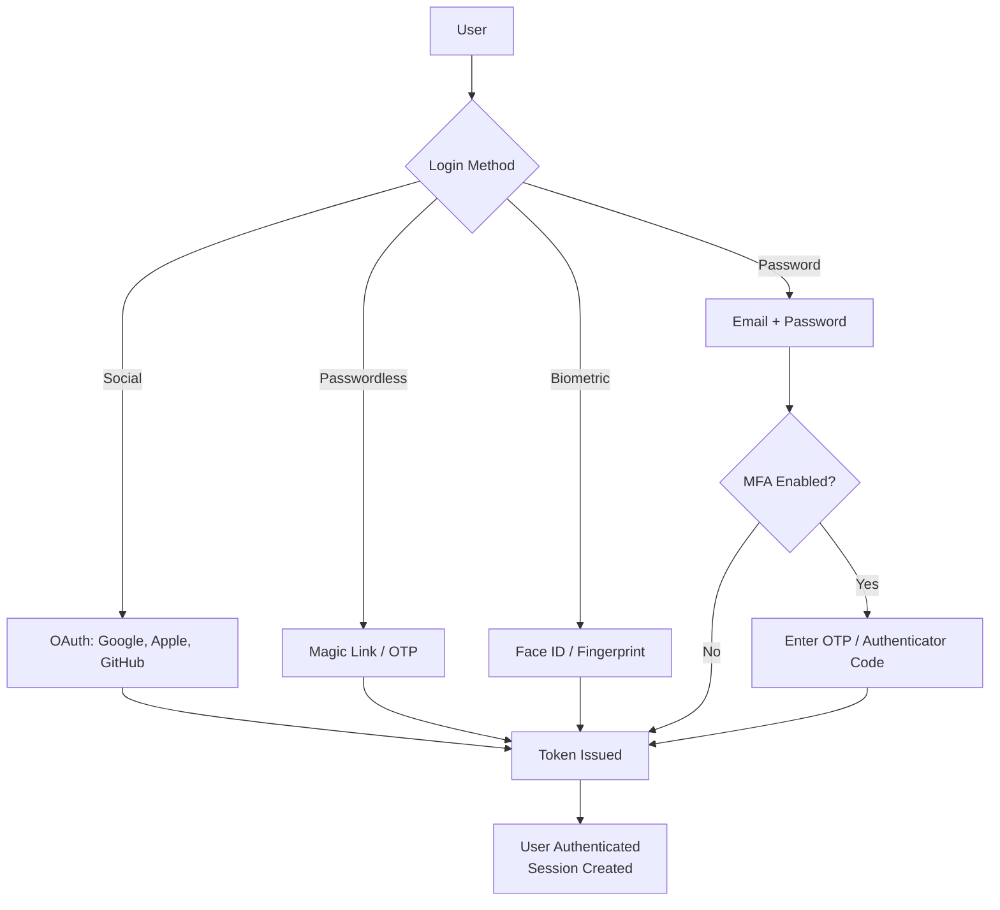

## Definition

Authentication (AuthN) is the process of verifying that a user is who they claim to be. It answers the question "Who are you?" — distinct from [[Authorization]], which answers "What are you allowed to do?" Authentication is the front door of every product.

## How It Works

Common authentication methods:

| Method | How It Works | UX Trade-off |
|--------|-------------|--------------|
| **Email + Password** | User creates credentials | Familiar but friction-heavy; password fatigue |
| **OAuth / Social Login** | Delegate to Google, Apple, etc. | Low friction; dependency on third party |
| **Magic Links** | Email a one-time login link | No password needed; requires email access |
| **OTP (One-Time Password)** | SMS or app-based code | Adds security; SMS is phishable |
| **Biometrics** | Fingerprint, Face ID | Seamless UX; device-dependent |
| **Passkeys (FIDO2)** | Cryptographic key on device | Most secure; still gaining adoption |

**Multi-Factor Authentication (MFA)** combines two or more factors:
- Something you **know** (password)
- Something you **have** (phone, security key)
- Something you **are** (biometrics)

## PM Implications

- **Conversion vs. security trade-off**: Every added authentication step reduces conversion. Social login can boost signup rates by 20-50%.
- **Password policy decisions**: Too strict (16 chars, special chars, rotated monthly) frustrates users; too loose creates security risks.
- **MFA strategy**: Mandatory MFA for enterprise/B2B products; optional for consumer (but strongly encouraged).
- **Account recovery**: The "forgot password" flow is used by ~30% of users monthly. A poor recovery flow causes permanent churn.
- **Compliance requirements**: [[GDPR]] and [[DPDP-Act]] require secure storage of authentication data (hashed passwords, encrypted tokens).
- **Build vs. buy**: Most teams should use auth providers (Auth0, Firebase Auth, Clerk) rather than building custom authentication.

## Example

Slack offers multiple authentication methods based on context:
- **Free teams**: Email + password, Google OAuth, Apple Sign-In
- **Enterprise**: SAML SSO (single sign-on with corporate identity provider like Okta)
- **All tiers**: Optional MFA via authenticator app
- **Mobile**: Biometric unlock after initial login

This layered approach serves both individual users (low friction) and enterprise security teams (strict control via SSO + enforced MFA).

## Related Concepts

- [[Authorization]] — What happens after authentication: permission checks
- [[OWASP-Top-10]] — Broken authentication is a top-10 security risk
- [[Environment-Variables]] — Auth secrets (OAuth client IDs, JWT signing keys) are stored as env vars
- [[GDPR]] — Authentication data is personal data subject to GDPR
- [[DPDP-Act]] — Indian data protection applies to authentication data
