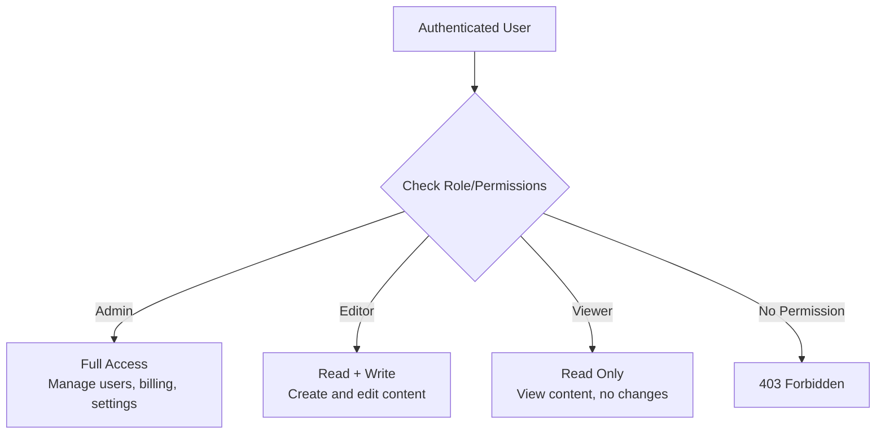

## Definition

Authorization (AuthZ) is the process of determining what an authenticated user is allowed to do. While [[Authentication]] verifies identity ("Who are you?"), authorization enforces permissions ("What can you access?"). It governs every action in a product — viewing, editing, deleting, sharing, and administering.

## How It Works

Two dominant authorization models:

**RBAC (Role-Based Access Control)**
- Users are assigned roles (Admin, Editor, Viewer)
- Roles have predefined permission sets
- Simple, widely used (Google Workspace, Slack, Notion)

**ABAC (Attribute-Based Access Control)**
- Permissions based on attributes: user department, resource owner, time of day, IP address
- More flexible, more complex
- Example: "Doctors in the cardiology department can view cardiac patient records during business hours"

| Model | Best For | Example |
|-------|---------|---------|
| **RBAC** | Products with clear role hierarchies | Admin > Editor > Viewer |
| **ABAC** | Complex, context-dependent permissions | Healthcare, finance, government |
| **ACL (Access Control List)** | Per-resource permissions | Google Drive sharing per file |
| **ReBAC (Relationship-Based)** | Social or collaborative apps | "Friends can see my posts" |

Permission design patterns:
- **Principle of least privilege**: Users get the minimum permissions needed
- **Permission inheritance**: Team permissions cascade to team members
- **Explicit deny**: A deny rule always overrides an allow rule

## PM Implications

- **Permission design is product design**: The authorization model directly shapes the user experience. Complex permission systems confuse users.
- **Role definition**: PMs must define roles and their permissions — this is a product decision, not just a technical one.
- **Enterprise readiness**: B2B products need granular permissions (custom roles, team hierarchies). This is often a prerequisite for enterprise contracts.
- **Support burden**: "I can't access X" is one of the most common support tickets. Clear permission UIs reduce support volume.
- **Audit trails**: Regulated industries require logs of who accessed what and when ([[GDPR]], [[DPDP-Act]]).
- **Feature gating**: Authorization can be used for plan-based feature access (free vs. pro vs. enterprise).

## Example

Notion uses a layered authorization model:
- **Workspace level**: Owner, Admin, Member, Guest
- **Page level**: Full Access, Can Edit, Can Comment, Can View
- **Inheritance**: A page inherits its parent's permissions by default but can be overridden
- **Sharing**: Any page can be shared publicly with a link (viewer only) or with specific users

A PM at Notion had to design the logic for what happens when a user has "Editor" at workspace level but a specific page is restricted to "Viewer." The decision: page-level permissions override workspace-level, providing fine-grained control without breaking the simple role hierarchy.

## Related Concepts

- [[Authentication]] — Must happen before authorization; proves identity
- [[OWASP-Top-10]] — Broken access control is the #1 vulnerability in the OWASP Top 10
- [[GDPR]] — Right to access and right to be forgotten require authorization-aware systems
- [[DPDP-Act]] — Data access must be authorized and auditable
- [[Environment-Variables]] — Authorization configuration (role mappings, permission flags) may be env-driven
