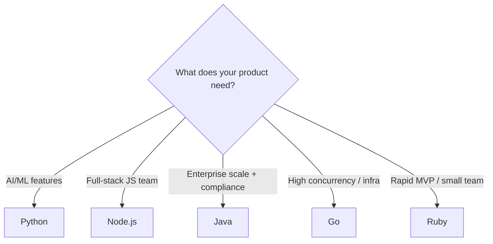

## Definition

Backend languages are programming languages used to build the logic tier of [[Client-Server-Architecture]]. They handle business logic, data processing, authentication, and API construction. The choice of language shapes team velocity, system performance, and hiring strategy.

## How It Works

Each language has distinct strengths that suit different product needs:

| Language  | Strengths                        | Weaknesses               | Common Frameworks    | Ideal For                    |
| --------- | -------------------------------- | ------------------------ | -------------------- | ---------------------------- |
| Python    | Readable, ML/AI ecosystem        | Slower runtime           | Django, FastAPI, Flask | Data products, MVPs, AI/ML  |
| Node.js   | Same language as frontend (JS)   | Callback complexity      | Express, NestJS      | Real-time apps, full-stack JS|
| Java      | Enterprise-grade, JVM performance| Verbose, slow startup    | Spring Boot          | Banking, large enterprise    |
| Go        | Fast, concurrent, small binaries | Smaller ecosystem        | Gin, Echo            | Microservices, infrastructure|
| Ruby      | Developer happiness, rapid dev   | Performance limits       | Rails                | Startups, rapid prototyping  |

## PM Implications

- **Hiring market matters** — Python and JavaScript (Node.js) have the largest talent pools. Go and Ruby developers are fewer but often more experienced.
- **Language choice is a 3-5 year commitment** — rewrites are expensive. Align with the team's expertise and the product's trajectory.
- **Performance vs. velocity tradeoff** — Python and Ruby optimize for developer speed; Go and Java optimize for runtime performance. Early-stage products usually need velocity.
- **Ecosystem drives feature cost** — Python's ML libraries (TensorFlow, scikit-learn) make AI features cheaper to build. Java's enterprise libraries simplify compliance and integration.
- **Monolith first, microservices later** — most startups should start with one language in a monolith. Microservices enable polyglot backends later but add operational complexity.

## Example

A health-tech company building a patient portal:
- **MVP phase** — Ruby on Rails for rapid iteration. Small team ships features weekly.
- **Growth phase** — API layer rewritten in Node.js (NestJS) to share TypeScript types with the React [[Frontend-Frameworks|frontend]].
- **AI features** — Python microservice added for symptom-checking ML model, communicating via [[REST-API]].

## Related Concepts

- [[Client-Server-Architecture]] — Backend languages power the logic tier
- [[REST-API]] — Backend languages implement API endpoints
- [[GraphQL]] — Alternative API layer built with backend frameworks
- [[SQL-Basics]] — Backend code queries databases
- [[Frontend-Frameworks]] — Node.js enables shared JS across frontend and backend
- [[Data-Pipelines]] — Python dominates the data engineering ecosystem
