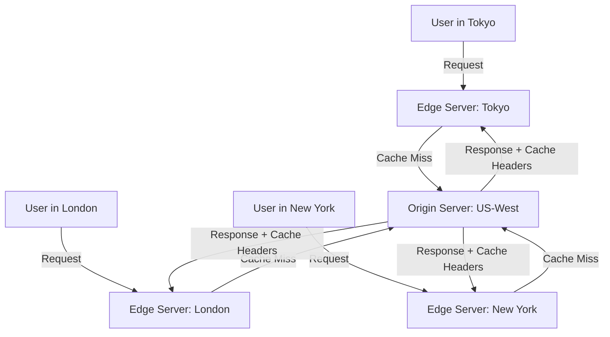

## Definition

A Content Delivery Network (CDN) is a geographically distributed network of servers (called edge servers or PoPs — Points of Presence) that cache and serve content close to users. Instead of every request traveling to a single origin server, the nearest edge server delivers cached assets, reducing latency and server load.

## How It Works

1. **User requests a resource** (image, JS bundle, API response).
2. **DNS routes the request** to the nearest edge server (via [[DNS]] anycast or geo-routing).
3. **Cache hit** — the edge server has a fresh copy and returns it immediately (fastest path).
4. **Cache miss** — the edge server fetches from the origin, caches it, then returns it to the user.
5. **Cache invalidation** — when content changes, the origin purges or expires cached copies.

Major CDN providers: Cloudflare, AWS CloudFront, Akamai, Fastly, Vercel Edge Network.

## PM Implications

- **Global performance without global infrastructure** — a CDN lets a small team deliver fast experiences worldwide without deploying servers in every region.
- **Cost management** — CDN bandwidth is typically cheaper than origin bandwidth. Caching reduces compute costs on [[Backend-Languages]] servers.
- **Launch readiness** — for viral moments or marketing campaigns, CDN absorbs traffic spikes that would crash the origin server.
- **SEO and Core Web Vitals** — faster load times improve Google rankings. [[Rendering-Strategies]] like SSG pair naturally with CDN caching.
- **Cache invalidation is a PM decision** — how quickly must content updates appear to users? Real-time vs. minutes-old content is a tradeoff between freshness and performance.

## Example

A news site publishes a breaking story. Without a CDN, 500,000 simultaneous readers would overwhelm the origin server. With a CDN:
- The first reader in each region triggers a cache miss; the edge fetches from origin.
- The next 499,999 readers in that region get the cached version in under 50ms.
- When the article is updated, the editorial CMS triggers a cache purge, and the next request fetches the fresh version.

## Related Concepts

- [[DNS]] — Routes users to the nearest CDN edge server
- [[HTTP-Protocol]] — Cache-Control headers govern CDN caching behavior
- [[Rendering-Strategies]] — SSG pages are ideal CDN candidates
- [[Frontend-Frameworks]] — Static builds from React/Vue are deployed to CDNs
- [[Client-Server-Architecture]] — CDN acts as a caching layer between client and server
