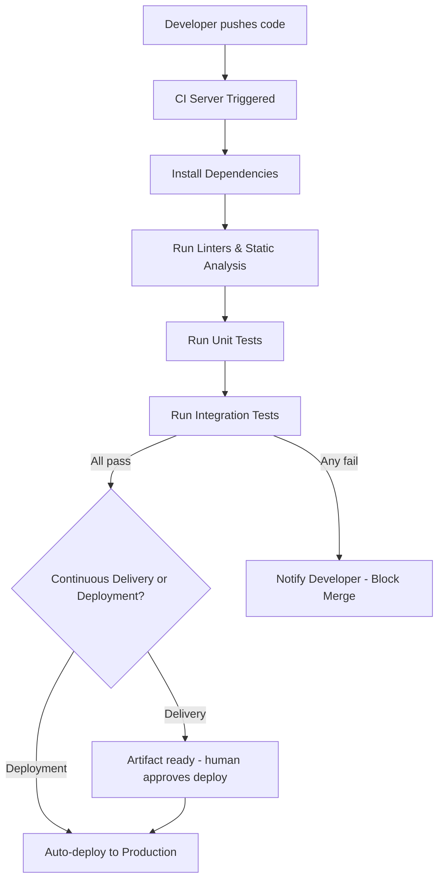

## Definition

**Continuous Integration (CI)** is the practice of automatically building and testing code every time a developer pushes changes to a shared repository. **Continuous Deployment (CD)** extends this by automatically deploying every change that passes tests to production. Together, CI/CD eliminates manual, error-prone release processes.

- **CI**: "Does the new code break anything?" — answered automatically on every commit.
- **CD (Delivery)**: Code is always in a deployable state; a human triggers the release.
- **CD (Deployment)**: Code is automatically deployed to production with no human gate.

## How It Works

Popular CI/CD tools:
- **GitHub Actions** — Built into GitHub, YAML-based workflows
- **Jenkins** — Open-source, highly configurable
- **CircleCI / Travis CI** — Cloud-hosted CI services
- **GitLab CI** — Integrated with GitLab repositories
- **AWS CodePipeline** — Native AWS CI/CD

A typical CI pipeline runs in 5-15 minutes and includes:
1. Dependency installation
2. Code linting and formatting checks
3. Unit tests (fast, isolated)
4. Integration tests (slower, test components together)
5. Security scans
6. Build artifact creation

## PM Implications

- **Faster feedback loops**: Developers know within minutes if their code works, not days.
- **Reduced release risk**: Small, frequent releases are safer than big-bang quarterly releases.
- **Quality gates**: PMs can request specific test coverage thresholds or security scans as CI requirements.
- **Deployment frequency as a metric**: High-performing teams deploy multiple times per day (DORA metrics).
- **Flaky tests are a real problem**: Unreliable tests slow the entire team; PMs should care about test infrastructure health.

## Example

GitHub itself practices continuous deployment. Every pull request triggers CI — running thousands of tests in parallel across multiple environments. When tests pass and a reviewer approves, the code is automatically deployed to production. GitHub deploys to production over 100 times per day. If a deployment causes issues, their CI/CD system enables rollback within minutes.

## Related Concepts

- [[Deployment-Pipeline]] — CI/CD is the automation backbone of the deployment pipeline
- [[Environment-Variables]] — CI/CD systems inject different env vars per environment
- [[Database-Migration]] — Migrations must be CI/CD-safe (backward compatible)
- [[Cloud-Computing]] — CI/CD pipelines typically deploy to cloud infrastructure
- [[Tracking-Plan]] — Analytics events can be validated in CI
