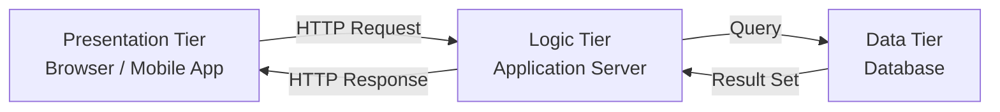

## Definition

Client-server architecture is a computing model that divides functionality into three distinct layers (tiers): the **presentation tier** (what the user sees), the **logic tier** (business rules and processing), and the **data tier** (storage and retrieval). The client makes requests; the server processes them and returns responses.

## How It Works

1. **Presentation Tier** — The user interface rendered in a browser or native app. Handles layout, user input, and display.
2. **Logic Tier** — The application server (e.g., Node.js, Django, Spring Boot) that enforces business rules, validates data, and orchestrates workflows.
3. **Data Tier** — The database (e.g., PostgreSQL, MongoDB) responsible for persistent storage, retrieval, and data integrity.

The request-response cycle is the core interaction pattern: the client sends a request (usually over [[HTTP-Protocol]]), the server processes it, and returns a structured response.

## PM Implications

- **Tier separation enables parallel workstreams** — frontend, backend, and database teams can develop independently against agreed-upon [[REST-API]] or [[GraphQL]] contracts.
- **Scaling decisions map to tiers** — if the logic tier is the bottleneck, you can horizontally scale app servers without touching the database.
- **Vendor and technology choices** — each tier can use different technology stacks (e.g., React frontend, Python backend, PostgreSQL database).
- **Cost estimation** — hosting costs break down by tier: [[CDN]] for static assets, compute for logic, managed database services for data.

## Example

A ride-sharing app like Uber:
- **Presentation** — The mobile app showing the map, ride options, and driver ETA.
- **Logic** — Servers matching riders to drivers, calculating surge pricing, and processing payments.
- **Data** — Databases storing user profiles, ride history, driver locations, and payment records.

## Related Concepts

- [[HTTP-Protocol]] — The transport protocol between client and server
- [[REST-API]] — Common pattern for structuring client-server communication
- [[Frontend-Frameworks]] — Tools for building the presentation tier
- [[Backend-Languages]] — Technologies powering the logic tier
- [[SQL-Basics]] — Querying the data tier
- [[DNS]] — How clients find the server's address
