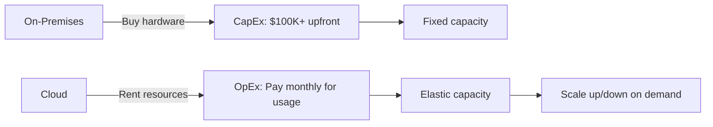

## Definition

Cloud computing is the delivery of computing resources — servers, storage, databases, networking, software — over the internet ("the cloud") on a pay-as-you-go basis, instead of buying and maintaining physical hardware on-premises.

## How It Works

Instead of purchasing servers, racking them in a data center, and hiring staff to maintain them, a company rents capacity from a cloud provider (e.g., [[AWS]], Azure, GCP). Resources can be provisioned in minutes and scaled up or down based on demand. Billing is typically usage-based — you pay for what you consume.

Key characteristics (per NIST):
- **On-demand self-service** — Provision resources without human interaction with provider
- **Broad network access** — Available over the internet from any device
- **Resource pooling** — Provider serves multiple tenants from shared infrastructure
- **Rapid elasticity** — Scale out/in quickly to match demand
- **Measured service** — Usage is metered and billed transparently

## PM Implications

- **Faster time-to-market**: No waiting weeks for hardware procurement; spin up environments in minutes.
- **Cost model shift**: CapEx (capital expenditure) becomes OpEx (operating expenditure), making costs variable and more predictable per unit.
- **Scalability conversations**: PMs must understand that "can we handle 10x traffic?" is now a cost question, not a capacity question.
- **Vendor lock-in risk**: Choosing a cloud provider is a strategic decision; migrating later is expensive.
- **Global reach**: Deploy to multiple regions to reduce latency for international users.

## Example

A startup launches its MVP on [[AWS]] using a single EC2 instance ($30/month). After a TechCrunch feature drives 50x traffic, the team auto-scales to 20 instances within minutes and scales back down the next week. Total cost for the spike: ~$600. On-premises, they would have needed $50K+ in hardware that sits idle 99% of the time.

## Related Concepts

- [[IaaS-PaaS-SaaS]] — The three service models of cloud computing
- [[AWS]] — The leading cloud provider with 31% market share
- [[Database-Scaling]] — Cloud enables elastic database scaling
- [[Deployment-Pipeline]] — Cloud is the deployment target for modern pipelines
- [[Environment-Variables]] — Cloud services use env vars for configuration and secrets
