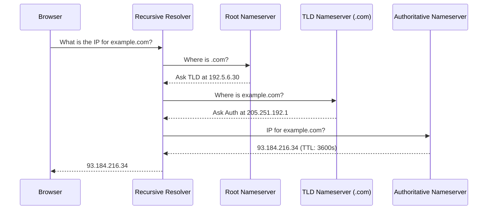

## Definition

The Domain Name System (DNS) is the internet's phone book. It translates human-readable domain names (e.g., `www.example.com`) into machine-readable IP addresses (e.g., `93.184.216.34`) so browsers know which server to contact.

## How It Works

Key concepts:
- **Recursive Resolver** — Usually your ISP or a service like Cloudflare (1.1.1.1) or Google (8.8.8.8). It walks the hierarchy on your behalf.
- **Root Nameservers** — 13 clusters that direct queries to the correct TLD (.com, .org, .io).
- **TTL (Time to Live)** — How long (in seconds) a DNS answer can be cached before it must be re-queried. Low TTL enables fast changes; high TTL reduces lookup latency.
- **DNS Records** — A (IPv4 address), AAAA (IPv6), CNAME (alias), MX (mail), TXT (verification).

## PM Implications

- **Domain migrations require planning** — changing domains or providers means updating DNS records. A high TTL means some users see the old site for hours.
- **TTL strategy before launches** — lower the TTL days before a migration, so when you flip the record, propagation is fast.
- **Uptime monitoring** — DNS failures make your entire product unreachable, even if servers are healthy. Redundant DNS providers mitigate this.
- **Custom domains for enterprise clients** — if your SaaS offers white-label domains, you need CNAME or A-record setup flows.

## Example

A startup rebranding from `oldname.io` to `newbrand.com`:
1. Two days before launch, TTL on `oldname.io` is lowered from 86400s (24h) to 300s (5min).
2. At launch, the A record for `newbrand.com` is pointed to the same server IP.
3. `oldname.io` gets a 301 redirect to `newbrand.com`.
4. Within 5 minutes, most users resolve the new domain correctly.

## Related Concepts

- [[HTTP-Protocol]] — DNS resolution happens before the first HTTP request
- [[CDN]] — CDNs use DNS to route users to the nearest edge server
- [[Client-Server-Architecture]] — DNS connects clients to the right server
- [[Rendering-Strategies]] — DNS prefetch hints can improve page load speed
