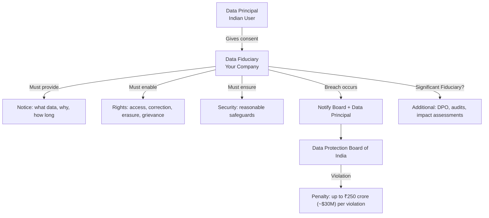

## Definition

The Digital Personal Data Protection Act, 2023 (DPDP Act) is India's comprehensive data protection law, passed in August 2023. It governs how organizations (called "Data Fiduciaries") collect and process personal data of Indian residents ("Data Principals"). Penalties for non-compliance can reach up to 250 crore INR (approximately $30 million USD) per violation.

## How It Works

The DPDP Act establishes a consent-based framework for personal data processing:

| Concept | DPDP Act Term | Equivalent in [[GDPR]] |
|---------|--------------|----------------------|
| Individual whose data is collected | **Data Principal** | Data Subject |
| Organization collecting data | **Data Fiduciary** | Data Controller |
| Third party processing data | **Data Processor** | Data Processor |
| Consent notice | **Notice** | Privacy Notice |
| User rights | **Rights of Data Principal** | Data Subject Rights |
| Oversight body | **Data Protection Board of India** | Supervisory Authority (per country) |

Key provisions:
- **Consent**: Must be free, specific, informed, unconditional, and unambiguous. Consent can be withdrawn at any time.
- **Purpose limitation**: Data collected for one purpose cannot be used for another without fresh consent.
- **Data localization**: The government can restrict transfer of personal data to certain countries (blacklist approach, unlike GDPR's whitelist).
- **Children's data**: Stricter protections; verifiable parental consent required for users under 18. No behavioral tracking or targeted advertising for children.
- **Significant Data Fiduciaries**: Large processors face additional obligations — data audits, Data Protection Officer appointment, impact assessments.
- **Right to erasure**: Data Principals can request deletion of their data.
- **Breach notification**: Data Fiduciaries must notify the Board and affected individuals of breaches.

## PM Implications

- **Consent UX for India**: Products serving Indian users must implement clear, granular consent flows — similar to GDPR but with India-specific requirements.
- **Age verification**: The under-18 parental consent requirement is stricter than GDPR's under-16 threshold. EdTech and social products are heavily impacted.
- **Data localization planning**: If the government restricts data transfers to certain countries, you may need India-based infrastructure ([[AWS]] Mumbai region).
- **Children's advertising ban**: No targeted ads or behavioral tracking for minors — impacts revenue models for products with young users.
- **Grievance redressal**: Products must provide a mechanism for users to raise complaints about data handling — this is a product feature PMs must build.
- **Startup impact**: Even small companies are covered. The "Significant Data Fiduciary" designation brings additional compliance overhead for larger players.

## Example

An Indian EdTech startup serving students aged 14-18 must:
1. Implement verifiable parental consent (not just a checkbox) before collecting student data.
2. Completely disable behavioral tracking and targeted advertising for student users.
3. Store data in India or in government-approved countries.
4. Provide a grievance mechanism within the app.
5. Appoint a Data Protection Officer if designated as a Significant Data Fiduciary.

Failure to obtain parental consent could result in fines up to 200 crore INR per instance, potentially exceeding the company's entire valuation.

## Related Concepts

- [[GDPR]] — The EU law that inspired much of DPDP's framework
- [[Authentication]] — Age verification and parental consent require robust authentication
- [[Tracking-Plan]] — Analytics events must comply with DPDP consent requirements
- [[Authorization]] — Data access must be limited to authorized purposes
- [[AWS]] — AWS Mumbai region supports data localization requirements
