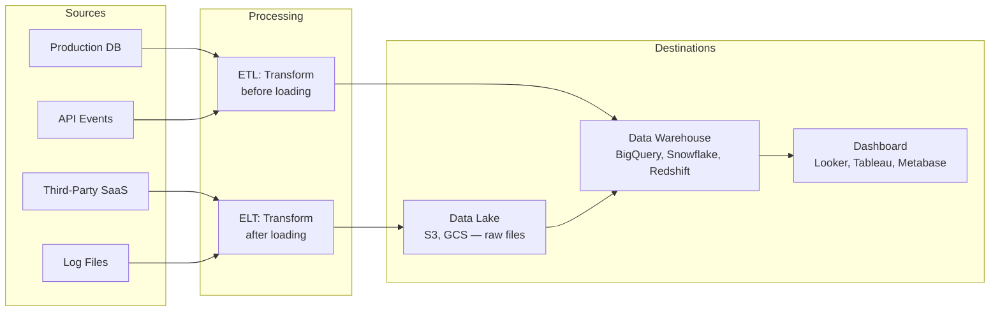

## Definition

A data pipeline is an automated workflow that extracts data from sources, transforms it, and loads it into a destination for analysis. The two patterns are ETL (Extract-Transform-Load) and ELT (Extract-Load-Transform), differing in where transformation happens.

## How It Works

**Key distinctions:**

| Concept         | Definition                                        | Example                              |
| --------------- | ------------------------------------------------- | ------------------------------------ |
| ETL             | Transform data before loading into destination    | Clean and aggregate logs, then load into warehouse |
| ELT             | Load raw data first, transform inside destination | Dump raw JSON into BigQuery, transform with SQL |
| Batch           | Process data on a schedule (hourly, daily)        | Nightly revenue rollup               |
| Streaming       | Process data in real time as events arrive         | Live fraud detection                 |
| Data Warehouse  | Structured, schema-on-write, optimized for queries | Snowflake, BigQuery, Redshift       |
| Data Lake       | Raw files, schema-on-read, stores everything      | S3 bucket with JSON, CSV, Parquet   |

## PM Implications

- **Data freshness is a product decision** — "How old can the data be?" determines batch vs. streaming. Daily batch is simpler and cheaper; streaming is complex but enables real-time dashboards and alerts.
- **Pipeline reliability affects trust** — if the daily revenue dashboard is stale or wrong because a pipeline failed, stakeholders lose confidence in data-driven decisions.
- **Build vs. buy** — tools like Fivetran, Airbyte, and Stitch automate extraction from common sources (Salesforce, Stripe, Google Analytics). Building custom pipelines is justified only for unique sources.
- **Warehouse costs scale with query volume** — BigQuery charges per query scan; Snowflake charges per compute-second. PMs should understand cost implications of adding new dashboards or reports.
- **Data governance** — pipelines must handle PII correctly (masking, anonymizing, excluding sensitive fields) to meet privacy regulations.

## Example

A subscription SaaS company's data stack:
1. **Extract** — Fivetran pulls from Stripe, HubSpot, and the production PostgreSQL database nightly.
2. **Load** — Raw data lands in Snowflake (warehouse) and S3 (data lake for archival).
3. **Transform** — dbt runs [[SQL-Basics]] transformations: joins charges with users, calculates MRR, flags churn.
4. **Serve** — Looker dashboards query transformed tables. The product team queries directly for ad-hoc analysis.

## Related Concepts

- [[SQL-Basics]] — SQL is the primary language for transforming data in warehouses
- [[Analytics-Instrumentation]] — Event tracking generates the raw data pipelines process
- [[NoSQL-Databases]] — Source systems may include MongoDB, Redis, or DynamoDB
- [[Normalization]] — Warehouses often denormalize data for query performance
- [[Backend-Languages]] — Python dominates data pipeline tooling (Airflow, dbt, Pandas)
- [[Webhooks]] — Real-time events can feed streaming pipelines