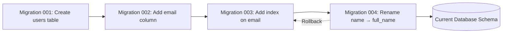

## Definition

A database migration is a controlled, versioned change to a database's structure (schema) — adding tables, renaming columns, changing data types, or modifying indexes. Migration scripts ensure that schema changes are repeatable, trackable, and reversible, allowing teams to evolve their database alongside application code.

## How It Works

Each migration is a script with two parts:
- **Up**: Apply the change (e.g., `ALTER TABLE users ADD COLUMN email VARCHAR(255)`)
- **Down**: Reverse the change (e.g., `ALTER TABLE users DROP COLUMN email`)

Migration frameworks (Rails ActiveRecord, Django Migrations, Flyway, Alembic) track which migrations have been applied using a `schema_migrations` table in the database itself.

Key practices:
- **Forward-only in production**: Rollbacks are risky with live data; prefer writing a new forward migration to fix issues.
- **Backward-compatible changes**: A migration should not break the currently running application version (critical for zero-downtime deploys).
- **Data migrations vs. schema migrations**: Changing structure (add column) is different from transforming data (backfill values).
- **Lock awareness**: Some migrations lock tables, blocking reads/writes — dangerous on large production tables.

## PM Implications

- **Deployment risk**: Schema changes are among the riskiest parts of any release. PMs should ask about migration plans during sprint reviews.
- **Downtime potential**: A poorly planned migration on a large table can lock the database for minutes or hours, causing outages.
- **Data integrity**: Migrations that transform data (e.g., splitting a name field into first/last) can lose information if not carefully designed.
- **Feature planning**: Some features require significant schema changes; PMs should involve engineering early to assess migration complexity.
- **Rollback planning**: "Can we undo this?" is harder for data changes than code changes.

## Example

An e-commerce platform needs to support multiple shipping addresses per user. The current schema has `address` as a column on the `users` table. The migration plan:
1. Create a new `addresses` table with a foreign key to `users`.
2. Write a data migration to copy existing addresses from `users.address` to the new table.
3. Update application code to read from `addresses` table.
4. Deploy code + migration together.
5. After confirming success, a later migration drops the old `users.address` column.

This multi-step approach avoids data loss and allows rollback at each stage.

## Related Concepts

- [[Deployment-Pipeline]] — Migrations run as part of the deployment pipeline
- [[CI-CD]] — Migrations must be tested in CI before reaching production
- [[Database-Scaling]] — Schema changes interact with replication and sharding
- [[Polyglot-Persistence]] — Different databases may require different migration strategies
