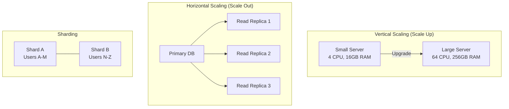

## Definition

Database scaling is the set of strategies used to handle growing data volumes and increasing query loads. The two fundamental approaches are **vertical scaling** (bigger machine) and **horizontal scaling** (more machines). As a product grows, the database is often the first bottleneck.

## How It Works

| Strategy | How It Works | Pros | Cons |
|----------|-------------|------|------|
| **Vertical scaling** | Upgrade to a bigger machine (more CPU, RAM, SSD) | Simple, no code changes | Has a ceiling; single point of failure |
| **Read replicas** | Copy data to read-only replicas; route reads there | Handles read-heavy workloads | Replication lag; writes still hit one server |
| **Sharding** | Split data across multiple databases by a key (e.g., user ID) | Near-infinite horizontal scale | Complex; cross-shard queries are hard |
| **Caching** | Store frequent queries in Redis/Memcached | Dramatic read speedup | Cache invalidation is hard |
| **Connection pooling** | Reuse database connections | Reduces connection overhead | Does not solve core scaling issues |

Typical scaling journey:
1. Single database (works up to ~100K users)
2. Add read replicas (works up to ~1M users)
3. Add caching layer (works up to ~10M users)
4. Shard the database (works up to ~1B+ users)

## PM Implications

- **Cost conversations**: Scaling is expensive. PMs should understand whether a feature requires a 10x or 100x increase in database load.
- **Feature design affects scaling**: A "trending posts" feature requires very different queries than a "my recent orders" feature.
- **Read vs. write ratio matters**: Most apps are 90%+ reads — read replicas solve a lot. Write-heavy features (real-time chat, IoT telemetry) need different strategies.
- **Consistency trade-offs**: Read replicas have replication lag (typically milliseconds). A user might save a profile change and not see it for a second — PMs must decide if that is acceptable.
- **Sharding changes product behavior**: If data is sharded by user, cross-user queries (e.g., "show all users who bought X") become expensive.

## Example

Instagram scaled from 0 to 1 billion users primarily using PostgreSQL. Their journey: single Postgres instance, then read replicas, then aggressive caching with Memcached/Redis, and finally sharding by user ID. They delayed sharding as long as possible because it adds enormous complexity. When they finally sharded, they split users across dozens of database clusters, each holding a subset of user data. Cross-shard operations (e.g., a feed pulling posts from users on different shards) required custom infrastructure.

## Related Concepts

- [[Cloud-Computing]] — Cloud enables elastic scaling without buying hardware
- [[AWS]] — AWS RDS supports read replicas and vertical scaling natively
- [[Database-Migration]] — Schema changes must account for replicas and shards
- [[Polyglot-Persistence]] — Using specialized databases avoids scaling a single DB for everything
