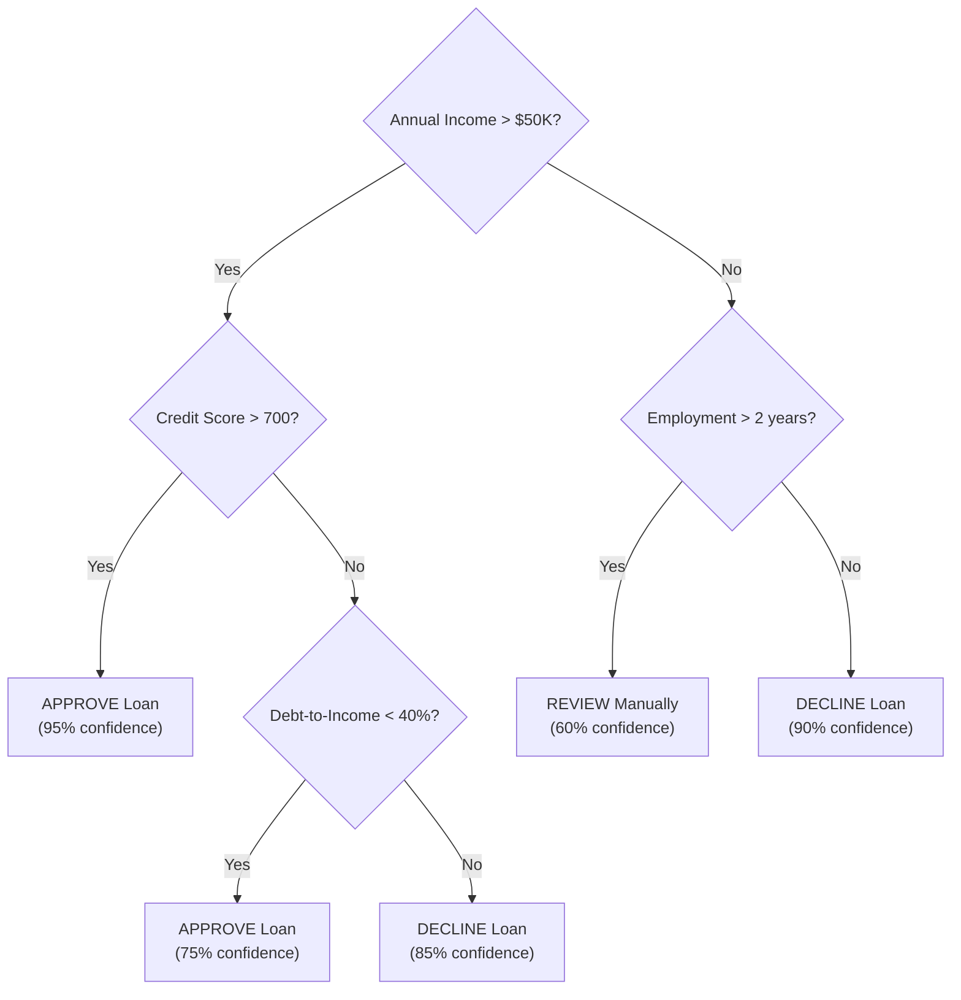

## Definition

A decision tree is a [[Supervised-Learning]] algorithm that makes predictions by learning a series of if-then-else rules from data, organized in a tree structure. Each internal node represents a decision on a feature, each branch represents the outcome of that decision, and each leaf node represents a prediction. Decision trees are prized for their interpretability — you can trace exactly why the model made a particular decision.

## How It Works

The algorithm works by recursively splitting the data on the feature that best separates the outcomes, measured by metrics like Gini impurity or information gain.

Key characteristics:
- **Splitting**: At each node, the algorithm chooses the feature and threshold that best separates the target classes
- **Depth**: Deeper trees capture more complex patterns but risk overfitting
- **Pruning**: Cutting back branches that add complexity without improving accuracy
- **Feature importance**: The algorithm naturally ranks which features matter most (features used in top splits are most important)

| Strength | Weakness |
|----------|----------|
| Highly interpretable — explain any decision | Prone to overfitting (memorizing noise) |
| No data scaling needed | Unstable — small data changes can alter the whole tree |
| Handles both numerical and categorical data | Greedy algorithm — may miss globally optimal splits |
| Fast training and prediction | Generally lower accuracy than ensemble methods |

Types:
- **Classification tree**: Predicts categories (approve/decline, churn/retain)
- **Regression tree**: Predicts continuous values (price, revenue, duration)
- **CART**: Classification and Regression Trees — the most common implementation

## PM Implications

- **Explainability for stakeholders**: When a VP asks "why did the model decline this customer?", a decision tree provides a clear answer: "Income below $50K and less than 2 years of employment." This is invaluable in regulated industries.
- **Feature importance for product insight**: Decision trees reveal which features matter most — a PM might discover that "time since last login" is the strongest churn predictor, informing re-engagement strategies.
- **Overfitting awareness**: A tree that is too deep may perform perfectly on historical data but fail on new users. PMs should ask about overfitting when reviewing model performance.
- **Baseline model**: Decision trees serve as an excellent first model for any problem — easy to build, easy to understand, and they reveal data issues quickly before investing in complex approaches.
- **Regulatory compliance**: Industries like finance and healthcare may require explainable models. Decision trees (or [[Random-Forests]] with feature importance) satisfy this requirement.

## Example

A SaaS product manager uses a decision tree to predict customer churn. The trained tree reveals:
1. **Top split**: "Logged in within last 7 days?" (most important feature)
2. **Second split**: "Used core feature in last 30 days?"
3. **Third split**: "On annual vs. monthly plan?"

The tree shows that users who have not logged in for 7+ days AND have not used the core feature in 30 days AND are on monthly plans have a 78% churn rate. This directly informs the PM's retention strategy: trigger an engagement email after 5 days of inactivity, highlighting the core feature, and offer annual plan discounts.

## Related Concepts

- [[Random-Forests]] — An ensemble of decision trees that reduces overfitting
- [[Supervised-Learning]] — Decision trees are a supervised learning algorithm
- [[Machine-Learning]] — Decision trees are one of the most fundamental ML algorithms
- [[Unsupervised-Learning]] — Decision trees can be combined with clustering results
