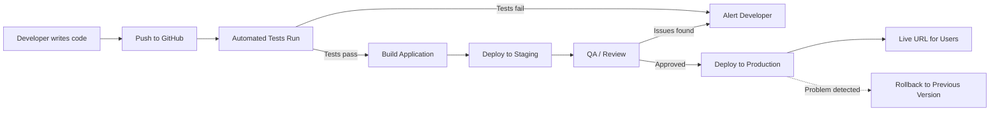

## Definition

A deployment pipeline is the automated pathway that takes code from a developer's machine to a live production URL. It encompasses version control, automated testing, building, staging, and deployment — ensuring that every code change is validated before reaching users.

## How It Works

The typical flow:

1. **Code** — Developer writes code locally and commits changes.
2. **Push** — Code is pushed to a Git repository (GitHub, GitLab, Bitbucket).
3. **Build & Test** — [[CI-CD]] system automatically runs tests and builds the app.
4. **Staging** — Deploy to a staging environment that mirrors production for QA review.
5. **Production** — After approval (manual or automated), deploy to the live environment.
6. **Rollback** — If something goes wrong, revert to the last known good version within minutes.

Modern pipelines support multiple deployment strategies:
- **Blue-green deployment**: Two identical environments; switch traffic between them.
- **Canary release**: Roll out to a small % of users first, then expand.
- **Feature flags**: Deploy code but keep features hidden until toggled on.

## PM Implications

- **Release cadence**: A mature pipeline enables daily (or even hourly) releases instead of painful monthly deploys.
- **Risk reduction**: Automated tests and staged rollouts catch bugs before they reach all users.
- **Rollback capability**: PMs should always ask "how fast can we roll back?" before any launch.
- **Environment awareness**: Understand that dev, staging, and production are separate environments with different data and configurations ([[Environment-Variables]]).
- **Deploy != Release**: Code can be deployed (in production) but not released (behind a feature flag). This decouples engineering work from business launches.

## Example

Shopify deploys to production approximately 40 times per day across thousands of developers. Each change goes through automated tests, is deployed to a staging environment, and then rolls out to production using canary deploys. If error rates spike after a deploy, an automated system rolls back the change within minutes — often before any customer notices.

## Related Concepts

- [[CI-CD]] — The automation engine that powers the deployment pipeline
- [[Cloud-Computing]] — The deployment target for modern pipelines
- [[AWS]] — Common cloud target for deployment pipelines
- [[Environment-Variables]] — Configuration that differs across pipeline stages
- [[Database-Migration]] — Schema changes that must be coordinated with deployments
