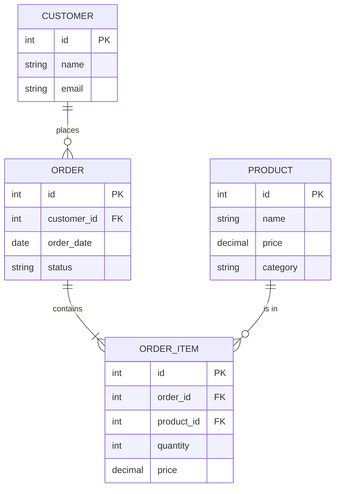

## Definition

An Entity-Relationship (ER) diagram is a visual representation of a database's structure. It shows **entities** (the things you store data about), their **attributes** (the data fields), and the **relationships** between them (how entities connect). ER diagrams are the blueprint PMs and engineers use to align on data modeling before writing code.

## How It Works

**Reading the notation (Crow's Foot):**

| Symbol | Meaning        | Example                           |
| ------ | -------------- | --------------------------------- |
| `\|\|` | Exactly one    | An order belongs to exactly one customer |
| `o{`   | Zero or many   | A customer may have zero or many orders  |
| `\|{`  | One or many    | An order contains one or more items      |

**Key concepts:** **Entity** = a table (Customer, Order). **Attribute** = a field (name, email). **PK** = unique row identifier. **FK** = link to another entity's PK. **Cardinality** = the "how many" (one-to-one, one-to-many, many-to-many).

## PM Implications

- **ER diagrams are a communication tool** — they help PMs, designers, and engineers agree on what data the product stores and how it connects before development starts.
- **Cardinality shapes features** — "Can a user belong to multiple organizations?" is a data model question with huge product implications. The ER diagram makes this explicit.
- **Scope creep detection** — if a feature requires adding a new entity or changing a relationship, the ER diagram reveals the ripple effects across the system.
- **API design follows data models** — [[REST-API]] endpoints and [[GraphQL]] schemas mirror the entities and relationships in the ER diagram.
- **Migration planning** — changing the ER diagram after launch (e.g., making a one-to-one relationship one-to-many) requires database migrations, which carry risk and downtime.

## Example

A project management tool: **User** belongs to many **Organizations** (many-to-many via join table), an **Organization** has many **Projects**, a **Project** has many **Tasks**, and a **Task** is assigned to zero or one **User**. Drawing this ER diagram before sprint planning reveals "We need a `user_organizations` join table" — easy to miss in a PRD but obvious in the diagram.

## Related Concepts

- [[SQL-Basics]] — SQL queries operate on the tables and relationships ER diagrams define
- [[Normalization]] — Rules for structuring the entities in an ER diagram
- [[NoSQL-Databases]] — Document databases often bypass formal ER modeling
- [[REST-API]] — API resources map to entities in the ER diagram
- [[GraphQL]] — GraphQL schemas mirror entity relationships
