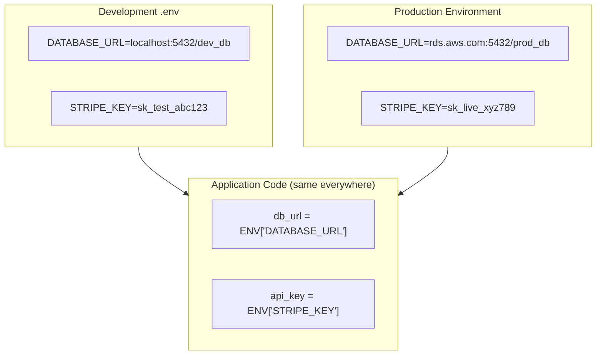

## Definition

Environment variables are key-value pairs stored outside the application code that configure how software behaves in different environments (development, staging, production). They are the standard way to manage secrets (API keys, database passwords) and environment-specific settings without hardcoding them into source code.

## How It Works

Instead of writing `DATABASE_PASSWORD = "s3cret123"` directly in code (dangerous — anyone with code access sees it), developers reference an environment variable: `DATABASE_PASSWORD = os.environ["DB_PASS"]`. The actual value is set in the environment where the code runs.

Common patterns:
- **`.env` files**: Local files (never committed to Git) storing dev variables
- **Cloud provider dashboards**: AWS, Heroku, Vercel provide UI to set production vars
- **Secrets managers**: AWS Secrets Manager, HashiCorp Vault for sensitive credentials
- **CI/CD secrets**: GitHub Actions Secrets, Jenkins Credentials for pipeline variables

What goes in environment variables:
- Database connection strings
- API keys and tokens (Stripe, Twilio, SendGrid)
- Feature flag configurations
- Environment identifiers (dev/staging/production)
- Third-party service URLs

## PM Implications

- **Security incidents**: Leaked API keys (e.g., committed to public GitHub) are among the most common security breaches. PMs should ensure the team has proper secrets management.
- **Environment parity**: Bugs that appear only in production often trace to configuration differences between environments.
- **Vendor management**: Each third-party integration typically requires API keys stored as env vars — PMs should track which services the product depends on.
- **Onboarding friction**: New developers need the right env vars to run the app locally. Poor documentation here slows team velocity.
- **Cost implications**: Test vs. live API keys (e.g., Stripe test mode vs. live mode) prevent accidental charges during development.

## Example

A fintech startup's `.env` file for local development contains `STRIPE_KEY=sk_test_xxx` (test mode — no real charges). In production on [[AWS]], the variable is `STRIPE_KEY=sk_live_yyy` (live mode — real transactions). A junior developer accidentally commits the production `.env` file to GitHub. Within hours, bots scrape the key and make fraudulent charges. The team must rotate all keys, audit transactions, and implement a secrets scanner in their [[CI-CD]] pipeline. Total cost: $15K in fraud + 2 weeks of engineering time.

## Related Concepts

- [[CI-CD]] — CI/CD systems manage env vars across environments
- [[Deployment-Pipeline]] — Different pipeline stages use different env var sets
- [[Authentication]] — API keys and OAuth secrets are stored as env vars
- [[AWS]] — AWS provides Secrets Manager and Parameter Store for env vars
- [[OWASP-Top-10]] — Exposed secrets are a common security vulnerability
