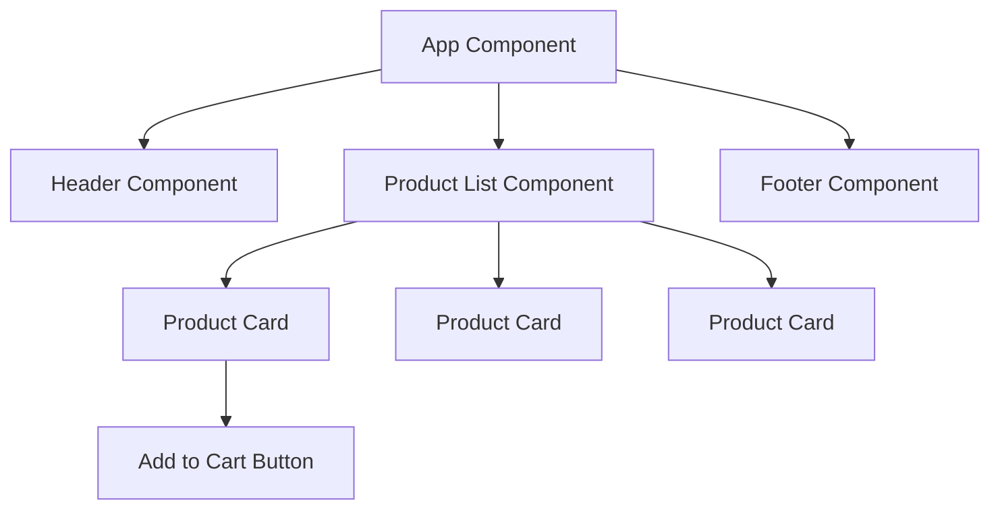

## Definition

Frontend frameworks are libraries and toolsets for building user interfaces in the browser. They provide component-based architecture, reactive data binding, and ecosystem tooling that make it practical to build complex, interactive web applications. The major players are React, Angular, Vue, and Svelte.

## How It Works

All modern frontend frameworks share a core idea: **components** — self-contained, reusable pieces of UI that manage their own state and rendering.

| Framework | Creator   | Key Trait                        | Learning Curve | Ecosystem    |
| --------- | --------- | -------------------------------- | -------------- | ------------ |
| React     | Meta      | Virtual DOM, JSX, hooks          | Moderate       | Largest      |
| Angular   | Google    | Full framework, TypeScript-first | Steep          | Enterprise   |
| Vue       | Community | Progressive adoption, templates  | Gentle         | Growing      |
| Svelte    | Community | Compile-time, no virtual DOM     | Gentle         | Emerging     |

**Virtual DOM** (React, Vue) — a lightweight copy of the real DOM. When state changes, the framework diffs the virtual DOM against the real one and applies only the necessary updates. Svelte skips this step by compiling components into efficient imperative code at build time.

## PM Implications

- **Hiring and team velocity** — React dominates the job market. Choosing Angular or Svelte may slow hiring but could be the right technical fit.
- **Framework choice is a multi-year commitment** — migrations are expensive. Ensure alignment between engineering leadership and product roadmap.
- **Component libraries accelerate delivery** — frameworks pair with [[CSS-Frameworks]] and design systems to ship consistent UI faster.
- **Performance tradeoffs** — framework bundle size affects load time. Svelte ships the smallest bundles; Angular the largest. Pair with [[Rendering-Strategies]] decisions.
- **Mobile strategy** — React enables React Native for mobile; Vue has Ionic/Capacitor options. Framework choice can extend to cross-platform.

## Example

A fintech startup building a customer dashboard chooses React because:
- Large talent pool for rapid hiring.
- Rich ecosystem (Redux for [[State-Management]], React Query for API caching).
- Next.js enables [[Rendering-Strategies|SSR]] for SEO on public pages.
- Component library (Radix UI + [[CSS-Frameworks|Tailwind CSS]]) accelerates UI development.

## Related Concepts

- [[Rendering-Strategies]] — CSR, SSR, SSG decisions depend on framework capabilities
- [[CSS-Frameworks]] — Styling systems paired with frontend frameworks
- [[State-Management]] — How frameworks handle application state
- [[REST-API]] — Frameworks consume APIs to render dynamic content
- [[GraphQL]] — Alternative API pattern often paired with React (Apollo Client)
- [[Client-Server-Architecture]] — Frameworks build the presentation tier
