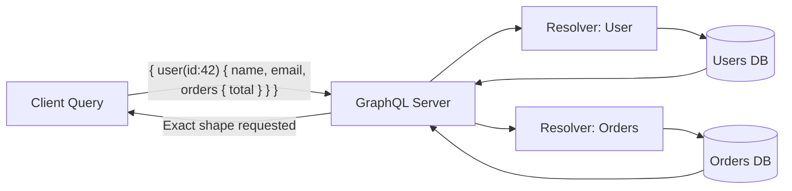

## Definition

GraphQL is a query language for APIs and a runtime for executing those queries. Developed by Facebook (2012, open-sourced 2015), it lets clients request **exactly the data they need** in a single request, solving the over-fetching and under-fetching problems of [[REST-API]].

## How It Works

GraphQL uses a **schema-first** approach. The server defines a typed schema; clients write queries against it.



**Key differences from REST:**

| Aspect          | REST                          | GraphQL                         |
| --------------- | ----------------------------- | ------------------------------- |
| Endpoints       | Many (`/users`, `/orders`)    | Single (`/graphql`)             |
| Data shape      | Fixed by server               | Defined by client query         |
| Over-fetching   | Common                        | Eliminated                      |
| Under-fetching  | Requires multiple requests    | One query gets nested data      |
| Versioning      | URL-based (`/v1`, `/v2`)      | Schema evolution, no versions   |

**Core concepts:**
- **Queries** — read data (like GET)
- **Mutations** — write data (like POST/PUT/DELETE)
- **Subscriptions** — real-time data via WebSockets
- **Schema** — the contract defining all available types and operations

## PM Implications

- **Mobile performance** — GraphQL shines when bandwidth is constrained. Mobile apps fetch exactly what each screen needs, reducing payload size and battery drain.
- **Faster frontend iteration** — frontend teams can request new field combinations without waiting for backend changes. This decouples team roadmaps.
- **Complexity on the backend** — resolvers, N+1 query problems, and query depth limits add backend complexity. Not every team has the expertise.
- **Caching is harder** — REST endpoints map naturally to HTTP caching ([[CDN]], browser). GraphQL POST requests are harder to cache without tools like Apollo or Relay.
- **Not always the right choice** — simple CRUD APIs, public APIs with diverse consumers, and cache-heavy use cases may be better served by [[REST-API]].

## Example

GitHub's API v4 is GraphQL. A developer building a dashboard can fetch a repository's name, star count, and last 5 issues in one query:
```graphql
{
  repository(owner: "facebook", name: "react") {
    name
    stargazerCount
    issues(last: 5) {
      nodes { title, state }
    }
  }
}
```
With REST, this would require 2-3 separate API calls.

## Related Concepts

- [[REST-API]] — The alternative API paradigm GraphQL often replaces or complements
- [[Frontend-Frameworks]] — React + Apollo Client is the most common GraphQL stack
- [[Backend-Languages]] — GraphQL servers are built in Node.js, Python, Java, Go, etc.
- [[API-Authentication]] — GraphQL endpoints need the same auth as REST
- [[State-Management]] — Apollo Client doubles as a client-side state manager
