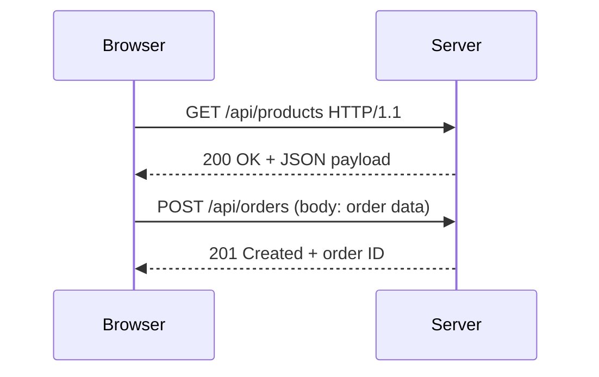

## Definition

HTTP (Hypertext Transfer Protocol) is the foundational request-response protocol of the web. HTTPS adds TLS encryption for secure communication. Every interaction between a browser and a web server — loading a page, submitting a form, calling an API — uses HTTP.

## How It Works

**HTTP Methods** map to actions:

| Method   | Purpose         | CRUD Equivalent | Example                     |
| -------- | --------------- | --------------- | --------------------------- |
| `GET`    | Read data       | Read            | Fetch a product listing     |
| `POST`   | Create resource | Create          | Submit a new order          |
| `PUT`    | Replace/update  | Update          | Edit a user profile         |
| `DELETE` | Remove resource | Delete          | Cancel a subscription       |

**Status Codes** group by first digit:
- **2xx** — Success (200 OK, 201 Created)
- **3xx** — Redirect (301 Moved Permanently, 304 Not Modified)
- **4xx** — Client error (400 Bad Request, 401 Unauthorized, 404 Not Found)
- **5xx** — Server error (500 Internal Server Error, 503 Service Unavailable)

**TLS Encryption** (the S in HTTPS) creates an encrypted tunnel so data cannot be read or tampered with in transit. Modern browsers mark non-HTTPS sites as "Not Secure."

## PM Implications

- **Status codes are your debugging vocabulary** — when users report errors, knowing 401 vs 403 vs 500 helps you triage to the right team.
- **HTTPS is non-negotiable** — required for SEO ranking, browser trust indicators, and regulatory compliance (GDPR, PCI-DSS).
- **Method semantics matter for API design** — insisting on proper verb usage in [[REST-API]] specs prevents confusion and bugs.
- **Performance** — HTTP/2 and HTTP/3 enable multiplexing, reducing page load times alongside [[CDN]] strategies.

## Example

When a customer searches for shoes on an e-commerce site:
1. Browser sends `GET /api/products?category=shoes` to the server.
2. Server queries the database, returns `200 OK` with a JSON array of products.
3. Customer adds to cart: `POST /api/cart` with the product ID.
4. Server responds `201 Created` confirming the item was added.

If the user's session expired, the server returns `401 Unauthorized`, prompting a login redirect.

## Related Concepts

- [[REST-API]] — API design pattern built on HTTP methods
- [[Client-Server-Architecture]] — The model HTTP operates within
- [[DNS]] — Resolves the domain name before the HTTP request is sent
- [[JWT-Authentication]] — Tokens often sent in HTTP Authorization headers
- [[CDN]] — Serves cached HTTP responses from edge locations
