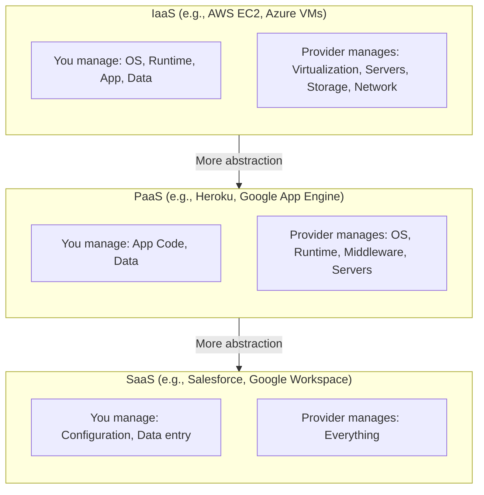

## Definition

IaaS, PaaS, and SaaS are three cloud service models that represent different levels of abstraction. Each trades control for convenience — the more the provider manages, the less the customer must maintain, but the less customization is possible.

| Model | You Manage | Provider Manages | Kitchen Analogy |
|-------|-----------|-----------------|-----------------|
| **IaaS** | OS, runtime, app, data | Servers, storage, networking | Empty kitchen — you buy ingredients, cook everything |
| **PaaS** | App code, data | OS, runtime, middleware, servers | Equipped kitchen — appliances provided, you cook |
| **SaaS** | Just use it | Everything | Restaurant — just order and eat |

## How It Works

- **IaaS**: Rent virtual machines, storage, and networking. You install and manage everything above the hardware layer. Maximum flexibility, maximum responsibility.
- **PaaS**: Push your application code; the platform handles servers, OS, scaling, and deployment. Ideal for teams that want to focus on code, not infrastructure.
- **SaaS**: Use a fully built application through a browser or API. No deployment, no servers, no code (unless customizing via APIs).

## PM Implications

- **Build vs. buy decisions**: Understanding the spectrum helps PMs evaluate when to build custom (IaaS), use a platform (PaaS), or buy existing software (SaaS).
- **Team capability matching**: A small team without DevOps expertise benefits from PaaS; a team needing fine-grained control may need IaaS.
- **Cost trade-offs**: IaaS is cheapest per unit but requires engineering time; SaaS is most expensive per unit but requires zero maintenance.
- **Migration complexity**: Moving from SaaS to custom-built (or vice versa) is a major strategic decision with long-term implications.

## Example

A food-delivery startup evolves through all three models:
1. **SaaS phase**: Uses Google Sheets for order tracking and Stripe for payments.
2. **PaaS phase**: Builds a custom order management app on Heroku — just pushes code, Heroku handles scaling.
3. **IaaS phase**: At scale, moves to [[AWS]] EC2 for fine-grained control over performance, networking, and cost optimization.

## Related Concepts

- [[Cloud-Computing]] — The umbrella concept for all three models
- [[AWS]] — Offers all three: EC2 (IaaS), Elastic Beanstalk (PaaS), WorkMail (SaaS)
- [[Deployment-Pipeline]] — PaaS simplifies the deployment pipeline significantly
- [[Database-Scaling]] — IaaS gives most control over database scaling strategies
