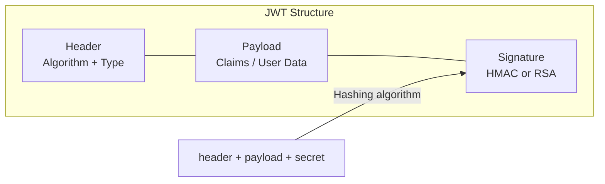

## Definition

A JSON Web Token (JWT) is a compact, self-contained token format for securely transmitting information between parties. It enables **stateless authentication** — the server does not need to store session data because all necessary information is encoded within the token itself.

## How It Works

A JWT has three Base64-encoded parts separated by dots: `header.payload.signature`



**Header** — declares the token type and signing algorithm:
```json
{ "alg": "HS256", "typ": "JWT" }
```

**Payload** — contains "claims" (data about the user):
```json
{ "sub": "user_42", "name": "Jane", "role": "admin", "exp": 1700000000 }
```

**Signature** — ensures the token has not been tampered with. The server hashes the header + payload with a secret key. Only the server can create a valid signature.

**Authentication flow:**
1. User logs in with credentials.
2. Server validates credentials, creates a JWT, returns it to the client.
3. Client stores the JWT (cookie or localStorage) and sends it with every request via the `Authorization: Bearer <token>` header.
4. Server verifies the signature on each request — no database lookup needed.

## PM Implications

- **Scalability advantage** — stateless auth means any server in a load-balanced cluster can verify the token. No shared session store needed.
- **Token expiration is a UX decision** — short-lived tokens (15 min) are more secure but cause frequent re-logins. Refresh token patterns solve this but add complexity.
- **JWTs are not encrypted by default** — the payload is Base64-encoded (readable by anyone), not encrypted. Never put sensitive data (passwords, SSNs) in a JWT payload.
- **Revocation is hard** — since tokens are stateless, you cannot "log out" a user server-side without a blocklist. This is a tradeoff PMs should understand when designing security features.
- **Mobile and SPA friendly** — JWTs work well with [[Frontend-Frameworks]] and mobile apps where traditional cookie-based sessions are awkward.

## Example

A project management SaaS:
1. User logs in via email + password. Server returns a JWT with `{ role: "editor", org_id: "acme", exp: <15 min> }` and a refresh token (24h expiry).
2. The React frontend stores the JWT in memory (not localStorage for security) and attaches it to every [[REST-API]] call.
3. When the JWT expires, the app silently uses the refresh token to get a new JWT without interrupting the user.
4. If the user's account is deactivated, the refresh token is revoked server-side, and the JWT expires naturally within 15 minutes.

## Related Concepts

- [[API-Authentication]] — JWT is one of several API authentication strategies
- [[HTTP-Protocol]] — JWTs travel in HTTP Authorization headers
- [[REST-API]] — JWTs are the dominant auth mechanism for RESTful APIs
- [[State-Management]] — Token storage (memory vs cookie vs localStorage) is a frontend decision
- [[Webhooks]] — Some webhook systems use JWT-style signatures for verification
