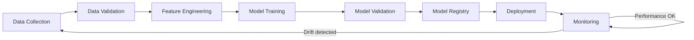

## Definition

MLOps (Machine Learning Operations) is the set of practices, tools, and organizational patterns for deploying, monitoring, and maintaining [[Machine-Learning]] models in production reliably and at scale. It applies [[CI-CD]] and DevOps principles to ML systems. The gap between a working Jupyter notebook and a production ML system is enormous — MLOps bridges it. Google estimates that only 5-10% of a real-world ML system is the model code; the rest is data pipelines, monitoring, serving infrastructure, and retraining automation.

## How It Works

The MLOps maturity ladder:

| Level | Description | Characteristics |
|-------|-------------|-----------------|
| **Level 0** | Manual | Data scientists train locally, hand off model files, manual deployment |
| **Level 1** | ML Pipeline | Automated training pipeline, but manual triggers and monitoring |
| **Level 2** | CI/CD for ML | Automated retraining on new data, automated testing, canary deployments |
| **Level 3** | Full Automation | Automated drift detection triggers retraining, A/B testing of models, automated rollback |

Key MLOps components:
- **Feature store**: Centralized repository of computed features (Feast, Tecton)
- **Model registry**: Version-controlled catalog of trained models (MLflow, Weights & Biases)
- **Model serving**: Infrastructure to serve predictions (TensorFlow Serving, SageMaker Endpoints)
- **Monitoring**: Track prediction quality, data distributions, latency ([[Model-Drift]] detection)
- **Experiment tracking**: Log hyperparameters, metrics, and artifacts for reproducibility

Popular MLOps platforms:
- **AWS SageMaker** — End-to-end ML platform on [[AWS]]
- **Google Vertex AI** — GCP's unified ML platform
- **MLflow** — Open-source experiment tracking and model registry
- **Kubeflow** — Kubernetes-native ML pipelines

## PM Implications

- **Models are not "set and forget"**: Unlike traditional software, ML models degrade over time as data distributions shift. Budget for ongoing monitoring and retraining.
- **Time to production is the real bottleneck**: Most ML projects fail not because the model does not work, but because it never reaches production. PMs should track "time from prototype to production" as a key metric.
- **Reproducibility matters**: Can the team retrain the exact same model from six months ago? MLOps ensures experiments and data are versioned.
- **A/B testing infrastructure**: MLOps includes the ability to route a percentage of traffic to a new model and compare performance against the current model in production.
- **Cost management**: ML training and serving can be expensive. PMs should understand compute costs and optimize for cost-performance tradeoffs (batch vs. real-time inference).

## Example

Uber's ML platform Michelangelo handles thousands of production models. When a data scientist trains a new surge pricing model, Michelangelo automatically versions the model, validates it against the current production model on holdout data, deploys it to a canary (5% of requests), monitors prediction latency and accuracy, and promotes it to 100% if metrics hold. If [[Model-Drift]] is detected, the platform triggers automatic retraining on the most recent data. This MLOps infrastructure lets Uber's 200+ data scientists deploy models without involving the platform engineering team.

## Related Concepts

- [[CI-CD]] — MLOps extends CI/CD principles to ML systems
- [[Machine-Learning]] — MLOps is the production lifecycle for ML
- [[Model-Drift]] — The primary reason ML models need ongoing MLOps
- [[Feature-Engineering]] — Feature stores are a key MLOps component
- [[Deployment-Pipeline]] — ML deployment pipelines have additional stages
- [[Cloud-Computing]] — MLOps platforms run on cloud infrastructure
