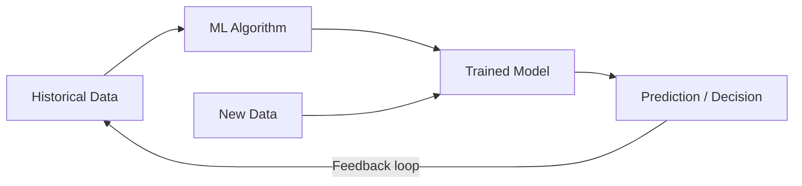

## Definition

Machine learning (ML) is a subset of artificial intelligence in which computers learn patterns from data to make predictions or decisions, without being explicitly programmed for each scenario. Instead of writing rules ("if temperature > 30 and humidity > 80, predict rain"), ML algorithms discover the rules themselves from historical examples.

## How It Works

The three main paradigms:

| Paradigm | Input | Goal | Example |
|----------|-------|------|---------|
| **[[Supervised-Learning]]** | Labeled data (input-output pairs) | Predict outcomes | Spam detection, price prediction |
| **[[Unsupervised-Learning]]** | Unlabeled data | Find hidden patterns | Customer segmentation, anomaly detection |
| **Reinforcement Learning** | Environment + rewards | Learn optimal actions | Game AI, robotics, ad bidding |

The ML workflow:
1. **Define the problem**: What decision should the model make?
2. **Collect and prepare data**: Clean, label, and split into training/test sets
3. **Choose an algorithm**: [[Decision-Trees]], [[Random-Forests]], neural networks, etc.
4. **Train the model**: Feed training data, let the algorithm learn patterns
5. **Evaluate**: Test on held-out data; measure accuracy, precision, recall
6. **Deploy**: Integrate the model into the product
7. **Monitor and retrain**: Model performance degrades over time ("model drift")

Key concepts every PM should know:
- **Training data**: The historical examples the model learns from — garbage in, garbage out
- **Features**: The input variables the model uses (e.g., user age, purchase history, time of day)
- **Overfitting**: Model memorizes training data but fails on new data
- **Bias**: Model reflects biases present in training data (e.g., hiring models that discriminate)

## PM Implications

- **Data is the moat**: ML models are only as good as their training data. Products that collect more/better data build stronger ML advantages over time.
- **Problem framing matters most**: The PM's job is to frame the right problem. "Predict which users will churn in 30 days" is an ML-solvable problem; "make users happy" is not.
- **Accuracy is not binary**: A model that is 85% accurate means 15% wrong predictions. PMs must decide if that error rate is acceptable for the use case.
- **Explainability vs. performance**: Simple models ([[Decision-Trees]]) are interpretable; complex models (deep learning) perform better but are harder to explain. Regulated industries may require explainability.
- **Ethical responsibility**: ML can automate discrimination at scale. PMs must audit for bias and define fairness metrics.
- **Cold start problem**: ML needs data, but new products have no data. PMs must plan for the bootstrapping phase.

## Example

Netflix's recommendation system is ML at scale. It uses supervised learning trained on billions of viewing events (what each user watched, rated, searched for, and abandoned). The model predicts a "match score" for every user-title pair. Key PM decisions: How much to weigh recent behavior vs. historical? How to handle new users with no history (cold start)? How to balance recommending popular content vs. niche content? Netflix estimates their recommendation system saves $1B/year by reducing churn.

## Related Concepts

- [[Supervised-Learning]] — The most common ML paradigm for product features
- [[Unsupervised-Learning]] — Pattern discovery without labels
- [[Decision-Trees]] — An interpretable ML algorithm
- [[Random-Forests]] — An ensemble method that improves on decision trees
- [[Tracking-Plan]] — Analytics events become training data for ML models
