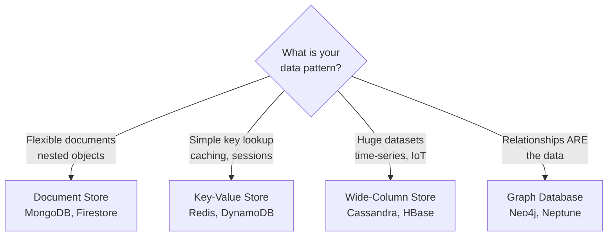

## Definition

NoSQL ("Not Only SQL") databases are non-relational data stores designed for specific access patterns that relational databases handle poorly — such as flexible schemas, massive horizontal scale, ultra-low latency, or highly connected data. They trade the rigid structure and ACID guarantees of SQL for flexibility and performance in targeted use cases.

## How It Works

| Type         | Data Model        | Strengths                        | Weaknesses                | Example Use Case            |
| ------------ | ----------------- | -------------------------------- | ------------------------- | --------------------------- |
| Document     | JSON-like objects  | Flexible schema, nested data     | Complex joins are hard    | Product catalogs, CMS       |
| Key-Value    | Key to blob       | Fastest reads, simple            | No complex queries        | Caching, session store      |
| Wide-Column  | Rows with dynamic columns | Massive write throughput  | Limited query flexibility | IoT sensor data, analytics  |
| Graph        | Nodes + edges      | Relationship traversal           | Not for bulk analytics    | Social networks, fraud detection |

## PM Implications

- **Schema flexibility accelerates iteration** — document databases let you add fields without migrations. Ideal for early-stage products where the data model is evolving rapidly.
- **Not a replacement for SQL** — most applications need a relational database as the primary store. NoSQL supplements it for specific needs (caching with Redis, search with Elasticsearch).
- **Scaling model differs** — SQL scales vertically (bigger server); NoSQL scales horizontally (more servers). This matters for cost projections at scale.
- **Consistency tradeoffs** — many NoSQL databases offer eventual consistency (data may be briefly stale). PMs must decide which features tolerate this (activity feeds: yes; payment balances: no).
- **Vendor lock-in risk** — DynamoDB (AWS), Firestore (Google), Cosmos DB (Azure) are cloud-specific. Migrating is expensive. MongoDB and Redis are cloud-agnostic.

## Example

A social media platform uses multiple database types:
- **PostgreSQL** ([[SQL-Basics]]) — user accounts, billing, and core relational data.
- **MongoDB** — user-generated content (posts with varying structures: text, images, polls, links).
- **Redis** — caching the home feed, storing real-time session data, rate-limiting API calls.
- **Neo4j** — powering "People You May Know" by traversing the follower graph.

## Related Concepts

- [[SQL-Basics]] — The relational alternative that NoSQL complements
- [[ER-Diagrams]] — Relational modeling that NoSQL databases often bypass
- [[Normalization]] — NoSQL typically denormalizes for read performance
- [[Data-Pipelines]] — NoSQL data is often exported to warehouses for analytics
- [[Backend-Languages]] — Each language has SDKs for popular NoSQL databases
- [[State-Management]] — Redis is often used for server-side session state
