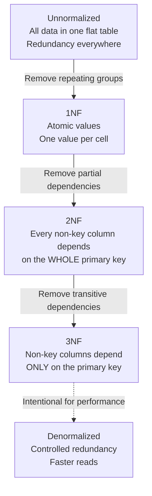

## Definition

Normalization is the process of organizing a relational database to reduce data redundancy and prevent update anomalies. It follows a series of "normal forms" (1NF, 2NF, 3NF) that progressively eliminate duplication. Denormalization is the intentional reversal of this process to improve read performance.

## How It Works

**The Normal Forms:**

| Form | Rule                                          | Violation Example                         |
| ---- | --------------------------------------------- | ----------------------------------------- |
| 1NF  | Every cell has one atomic value               | A "phone_numbers" column with "555-1234, 555-5678" |
| 2NF  | No partial dependency on a composite key      | Order item table storing the customer name (depends only on order_id, not the full composite key) |
| 3NF  | No transitive dependency                      | Storing both `zip_code` and `city` — city depends on zip, not on the primary key |

**Denormalization** adds controlled redundancy for read speed. Example: storing the customer's name directly on the order row so you do not need a JOIN to display it.

## PM Implications

- **Normalization prevents data corruption** — without it, updating a customer's address in one place but not another creates inconsistencies that erode trust.
- **Query complexity vs. data integrity** — normalized databases require more JOINs ([[SQL-Basics]]), which can slow queries. PMs should understand this tradeoff when discussing performance.
- **Denormalization is a deliberate choice, not laziness** — analytics dashboards, search indexes, and high-traffic read paths often benefit from denormalization. The engineering team should articulate why.
- **Schema changes are expensive** — renormalizing or denormalizing an existing production database requires migrations, testing, and potential downtime. Plan data modeling carefully early.
- **NoSQL sidesteps normalization** — [[NoSQL-Databases]] like MongoDB store denormalized documents by design. This is a feature, not a bug, for certain access patterns.

## Example

An e-commerce database evolving through normal forms:

**Unnormalized:** One table with `order_id, customer_name, customer_email, product1_name, product1_qty, product2_name, product2_qty` — repeating product groups, wasted columns.

**1NF:** Split into separate rows per product line item. Each cell has one value.

**2NF:** Move customer data to a `customers` table (it depends on `customer_id`, not the order-item composite key).

**3NF:** Move `city` out of the `customers` table into a `zip_codes` lookup table (city depends on zip, not on customer_id).

**Denormalized for analytics:** A `daily_sales_summary` table pre-aggregates revenue by category and date, avoiding expensive JOINs in the dashboard query.

## Related Concepts

- [[SQL-Basics]] — Normalization determines how many JOINs your queries need
- [[ER-Diagrams]] — ER diagrams visualize the normalized table structure
- [[NoSQL-Databases]] — NoSQL databases embrace denormalization by design
- [[Data-Pipelines]] — ETL pipelines often denormalize data for analytics
- [[Analytics-Instrumentation]] — Event data warehouses are typically denormalized
