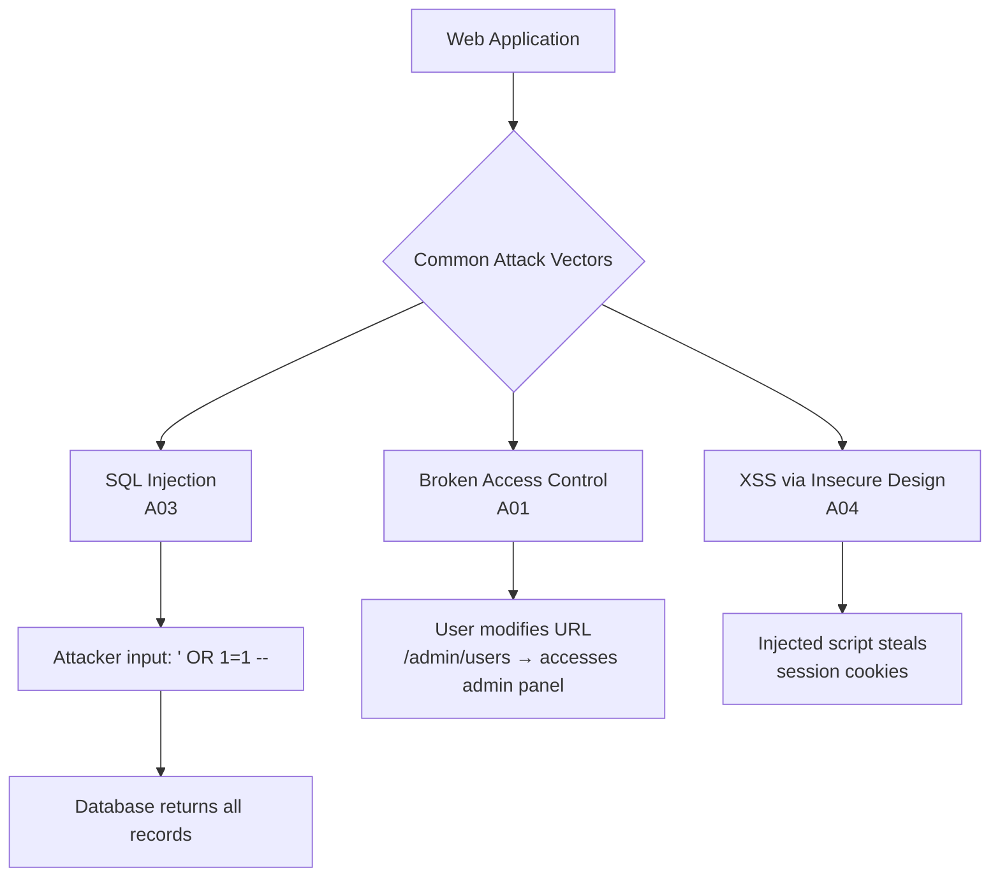

## Definition

The OWASP Top 10 is a regularly updated list of the ten most critical security risks to web applications, published by the Open Web Application Security Project. It is the industry-standard awareness document for web application security and is referenced by compliance frameworks, security audits, and engineering best practices worldwide.

## How It Works

The 2021 OWASP Top 10 (most recent edition):

| Rank | Vulnerability | What It Means |
|------|--------------|---------------|
| A01 | **Broken Access Control** | Users can act outside their intended permissions |
| A02 | **Cryptographic Failures** | Sensitive data exposed due to weak/missing encryption |
| A03 | **Injection** | Malicious input (SQL, NoSQL, OS commands) executed by the app |
| A04 | **Insecure Design** | Flaws in architecture, not just implementation |
| A05 | **Security Misconfiguration** | Default settings, open cloud storage, unnecessary features |
| A06 | **Vulnerable Components** | Using libraries/frameworks with known vulnerabilities |
| A07 | **Auth Failures** | Broken [[Authentication]] or session management |
| A08 | **Data Integrity Failures** | Untrusted data in CI/CD pipelines, insecure deserialization |
| A09 | **Logging & Monitoring Failures** | Breaches go undetected due to poor logging |
| A10 | **SSRF** | Server-Side Request Forgery — tricking server into making requests |

Key defenses:
- **Input validation**: Never trust user input; sanitize and parameterize all queries
- **Principle of least privilege**: Minimize what each user/service can access ([[Authorization]])
- **Encryption in transit and at rest**: HTTPS everywhere; encrypt stored sensitive data
- **Dependency scanning**: Automated tools (Snyk, Dependabot) flag vulnerable libraries
- **Security headers**: CSP, HSTS, X-Frame-Options
- **Regular penetration testing**: Hire ethical hackers to find vulnerabilities

## PM Implications

- **Regulatory requirement**: Many compliance frameworks (SOC 2, PCI-DSS, ISO 27001) reference OWASP Top 10 as baseline requirements.
- **Feature prioritization**: Security fixes for OWASP Top 10 vulnerabilities should be treated as P0/P1, not pushed to "later."
- **Vendor assessment**: When evaluating third-party tools, PMs should ask if they are OWASP-compliant.
- **Security by design**: PMs should involve security reviews early in feature design (A04 — Insecure Design), not just before launch.
- **Incident response planning**: PMs should know the team's response plan if a vulnerability is exploited.
- **User trust**: A single security breach can destroy years of user trust and cause churn.

## Example

In 2017, Equifax suffered a massive data breach exposing 147 million records. The root cause was A06 — Vulnerable Components: an unpatched Apache Struts library with a known vulnerability. The patch had been available for months, but Equifax failed to apply it. The result: $700M in settlements, executive resignations, and permanent brand damage. A simple dependency update would have prevented it.

## Related Concepts

- [[Authentication]] — Broken authentication (A07) is a top-10 risk
- [[Authorization]] — Broken access control (A01) is the #1 vulnerability
- [[Environment-Variables]] — Security misconfiguration (A05) often involves exposed secrets
- [[GDPR]] — OWASP compliance helps meet GDPR's security requirements
- [[CI-CD]] — Dependency scanning and security tests should run in CI pipelines
