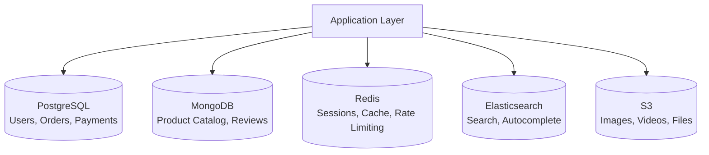

## Definition

Polyglot persistence is the architectural practice of using multiple database technologies within a single system, choosing the best-fit database for each specific use case rather than forcing all data into one general-purpose database.

## How It Works

Different data has different characteristics. Relational data (orders, users) benefits from SQL databases. Unstructured data (product catalogs) suits document stores. High-speed access patterns (sessions, caches) need in-memory stores. Graph relationships (social networks) need graph databases.

Common database types and their sweet spots:

| Database Type | Examples | Best For |
|--------------|---------|----------|
| **Relational (SQL)** | PostgreSQL, MySQL | Structured data, transactions, ACID compliance |
| **Document** | MongoDB, DynamoDB | Flexible schemas, nested objects, catalogs |
| **Key-Value** | Redis, Memcached | Caching, sessions, real-time counters |
| **Search** | Elasticsearch, Algolia | Full-text search, autocomplete, faceted search |
| **Graph** | Neo4j, Amazon Neptune | Relationships: social networks, recommendations |
| **Time-Series** | InfluxDB, TimescaleDB | IoT data, metrics, monitoring |
| **Object Storage** | S3, GCS | Files, images, videos, backups |

## PM Implications

- **Vendor and complexity costs**: Each database adds operational overhead — monitoring, backups, expertise. More databases means more things that can fail.
- **Team skills**: The team needs expertise in each database technology. Hiring for niche databases (Neo4j, InfluxDB) is harder.
- **Data consistency challenges**: Keeping data in sync across multiple databases requires careful design (eventual consistency, event-driven updates).
- **Feature-fit decisions**: PMs should participate in discussions about which database to use for new features — it directly impacts performance, cost, and development speed.
- **Migration difficulty**: Once data lives in a specialized database, moving it elsewhere is painful.

## Example

An e-commerce platform like Amazon uses polyglot persistence extensively:
- **PostgreSQL**: Customer accounts, orders, payments (needs ACID transactions)
- **DynamoDB**: Product catalog (flexible schema — each product category has different attributes)
- **Redis**: Shopping cart sessions, recommendation cache (needs sub-millisecond reads)
- **Elasticsearch**: Product search and autocomplete (needs full-text search with relevance ranking)
- **S3**: Product images and videos (needs cheap, unlimited file storage)

Each database is chosen for what it does best, rather than forcing PostgreSQL to handle search or Redis to handle transactions.

## Related Concepts

- [[Database-Scaling]] — Different databases scale differently; polyglot persistence can reduce scaling pressure
- [[Database-Migration]] — Each database type has its own migration strategy
- [[AWS]] — AWS offers managed versions of most database types (RDS, DynamoDB, ElastiCache)
- [[Cloud-Computing]] — Managed cloud databases make polyglot persistence practical
