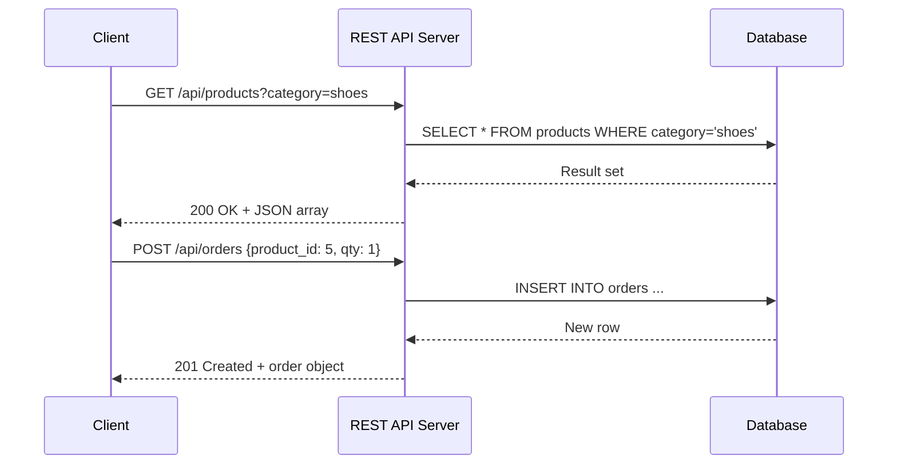

## Definition

REST (Representational State Transfer) is an architectural style for designing web APIs. A RESTful API uses standard [[HTTP-Protocol]] methods to perform CRUD operations on resources identified by URLs. It is stateless — each request contains all the information the server needs to process it.

## How It Works

REST maps HTTP verbs to database operations on resources:

| HTTP Verb | Action | URL Example            | Description              |
| --------- | ------ | ---------------------- | ------------------------ |
| GET       | Read   | `/api/users/42`        | Retrieve user #42        |
| POST      | Create | `/api/users`           | Create a new user        |
| PUT       | Update | `/api/users/42`        | Replace user #42's data  |
| PATCH     | Modify | `/api/users/42`        | Update specific fields   |
| DELETE    | Delete | `/api/users/42`        | Remove user #42          |

**Core RESTful Principles:**
1. **Stateless** — no session stored on the server; each request is independent.
2. **Resource-based URLs** — nouns, not verbs (`/users`, not `/getUsers`).
3. **Standard HTTP methods** — the verb defines the action.
4. **JSON as data format** — request and response bodies are typically JSON.
5. **HTTP status codes** — communicate success, failure, and error types.

## PM Implications

- **API design is a product decision** — public APIs are products themselves. Consistent, well-documented REST APIs improve developer adoption and partner integration.
- **Versioning strategy** — `/api/v1/users` vs `/api/v2/users`. Breaking changes without versioning alienate API consumers.
- **Rate limiting and quotas** — protect your backend and create monetization tiers (free: 100 req/min, pro: 10,000 req/min).
- **Documentation is part of the product** — tools like Swagger/OpenAPI auto-generate interactive docs from REST API definitions.
- **Over-fetching problem** — REST endpoints return fixed data shapes. If clients need flexibility, consider [[GraphQL]] as a complement.

## Example

Stripe's REST API is the gold standard:
- `POST /v1/charges` creates a payment.
- `GET /v1/charges/ch_123` retrieves a specific charge.
- Versioning via date-based API versions (`Stripe-Version: 2023-10-16`).
- Every endpoint is documented with request/response examples, error codes, and SDKs in 7+ languages.

## Related Concepts

- [[HTTP-Protocol]] — REST is built on HTTP methods and status codes
- [[GraphQL]] — Alternative API paradigm solving REST's over-fetching problem
- [[Webhooks]] — Push-based complement to REST's pull-based model
- [[JWT-Authentication]] — Common auth mechanism for REST APIs
- [[API-Authentication]] — Securing REST endpoints
- [[Client-Server-Architecture]] — REST defines the interface between client and server
