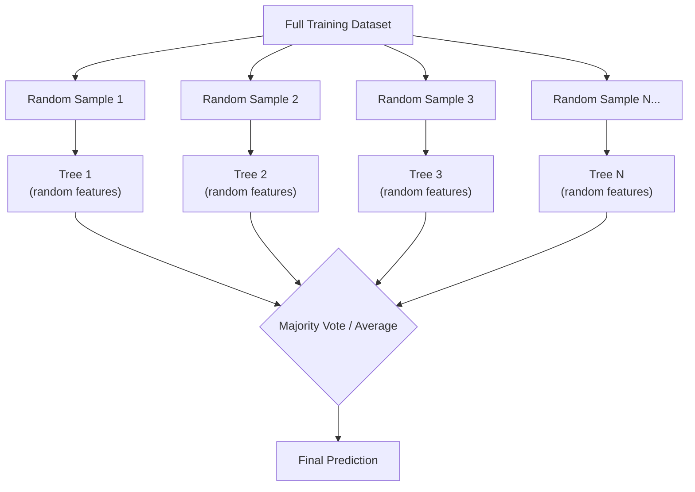

## Definition

A random forest is a [[Supervised-Learning]] ensemble algorithm that builds many [[Decision-Trees]] and combines their predictions to produce a more accurate and stable result. By training each tree on a random subset of data and features, random forests reduce overfitting — the main weakness of individual decision trees — while retaining much of their interpretability.

## How It Works

The core idea: instead of relying on one decision tree (which can be unstable and overfit), build hundreds of trees, each slightly different, and let them vote.

Two sources of randomness:
1. **Bagging (Bootstrap Aggregating)**: Each tree is trained on a random sample (with replacement) of the training data. Roughly 63% of data points appear in each sample.
2. **Feature randomness**: At each split, only a random subset of features is considered. This forces trees to be different from each other.

For classification, the forest takes a majority vote. For regression, it averages predictions.

| Aspect | Single Decision Tree | Random Forest |
|--------|---------------------|---------------|
| Accuracy | Moderate | High |
| Overfitting risk | High | Low (trees cancel each other's errors) |
| Interpretability | Very high (trace one path) | Moderate (feature importance, not single path) |
| Training speed | Fast | Slower (N trees to train) |
| Stability | Low (small data changes shift the tree) | High (ensemble smooths out variations) |

Key hyperparameters:
- **Number of trees**: Typically 100-1000; more trees = more stable but slower
- **Max depth**: How deep each tree can grow
- **Max features**: How many features each split considers
- **Min samples per leaf**: Prevents very small, overfitted branches

## PM Implications

- **Go-to production algorithm**: Random forests are often the first algorithm data scientists reach for in production. They work well out of the box with minimal tuning — PMs should know this is a solid default choice.
- **Feature importance is actionable**: Random forests rank which input features contribute most to predictions. A PM can use this to prioritize which product metrics to focus on (e.g., if "days since last login" is the top churn predictor, invest in re-engagement).
- **Accuracy vs. explainability trade-off**: Random forests are more accurate than single decision trees but harder to explain. A single prediction cannot be traced through one clean decision path — only aggregate feature importance is available.
- **Diminishing returns**: Going from 100 to 500 trees improves accuracy slightly but increases compute cost significantly. PMs should understand this trade-off when planning ML infrastructure budgets.
- **Handles messy real-world data**: Random forests handle missing values, outliers, and mixed data types (numerical + categorical) gracefully — important for products with imperfect data pipelines.

## Example

An e-commerce company builds a product recommendation engine using random forests:
- **Training data**: 2 million purchase records with user demographics, browsing history, time of day, device type, and previous purchases
- **Target**: Whether a user will buy a recommended product (yes/no)
- **Setup**: 500 decision trees, each trained on a bootstrap sample with random feature subsets
- **Result**: 89% accuracy (vs. 74% for a single decision tree)
- **Feature importance reveals**: (1) Previous purchases in same category, (2) Time spent on product page, (3) Items in cart, (4) Day of week. The PM uses this to redesign the recommendation widget — showing category-matched items prominently and triggering recommendations when cart items suggest complementary products.

## Related Concepts

- [[Decision-Trees]] — The building block of random forests
- [[Supervised-Learning]] — Random forests are a supervised learning algorithm
- [[Machine-Learning]] — Random forests are one of the most widely used ML algorithms in production
- [[Unsupervised-Learning]] — Random forests can use unsupervised clusters as input features
