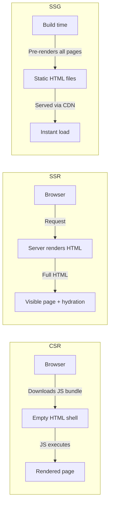

## Definition

Rendering strategies determine **where and when** HTML is generated for a web page. The three primary approaches are Client-Side Rendering (CSR), Server-Side Rendering (SSR), and Static Site Generation (SSG). Modern frameworks support hybrid approaches that mix strategies per route.

## How It Works

| Strategy | HTML Generated | First Paint | SEO     | Server Cost | Best For                    |
| -------- | -------------- | ----------- | ------- | ----------- | --------------------------- |
| CSR      | In browser     | Slow        | Poor    | Low         | Internal tools, dashboards  |
| SSR      | Per request    | Fast        | Great   | High        | Dynamic, personalized pages |
| SSG      | At build time  | Fastest     | Great   | Minimal     | Blogs, docs, marketing      |
| Hybrid   | Mixed per route| Varies      | Great   | Medium      | Most production apps        |

**Hydration** — after SSR delivers HTML, the browser downloads JavaScript that "hydrates" the page, attaching event listeners and making it interactive.

## PM Implications

- **SEO-critical pages need SSR or SSG** — Google can index CSR pages, but SSR/SSG are more reliable for search ranking. Product pages, landing pages, and blog posts should not be CSR-only.
- **Time to Interactive (TTI)** — CSR apps may show content late; SSR shows content fast but may delay interactivity during hydration. This affects conversion rates.
- **Infrastructure cost** — SSR requires compute per request; SSG serves from [[CDN]] at near-zero marginal cost. Choose based on traffic volume and content dynamism.
- **Build time matters at scale** — SSG with 100,000 product pages means long build times. Incremental Static Regeneration (ISR) is the modern compromise.
- **Framework alignment** — Next.js (React), Nuxt (Vue), and SvelteKit all support hybrid rendering. The choice of [[Frontend-Frameworks]] constrains rendering options.

## Example

An e-commerce platform uses hybrid rendering:
- **Marketing pages** (SSG) — pre-built at deploy time, served via [[CDN]] for sub-100ms load.
- **Product pages** (ISR) — statically generated but revalidated every 60 seconds for price/stock changes.
- **User dashboard** (CSR) — fully client-rendered behind login, no SEO needed.
- **Search results** (SSR) — server-rendered per query for SEO and personalized results.

## Related Concepts

- [[Frontend-Frameworks]] — Frameworks that implement these rendering strategies
- [[CDN]] — SSG pages are ideal CDN candidates
- [[HTTP-Protocol]] — Cache headers control how rendered pages are stored
- [[State-Management]] — Hydration must reconcile server-rendered state with client state
- [[CSS-Frameworks]] — Styling must work across all rendering strategies
