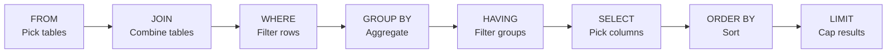

## Definition

SQL (Structured Query Language) is the standard language for interacting with relational databases. It lets you create, read, update, and delete data stored in tables with rows and columns. Every PM who touches data should be able to read a basic SQL query.

## How It Works

A SQL query follows a predictable anatomy. Here is a clause-by-clause breakdown:

| Clause     | Purpose                                    | Example                          |
| ---------- | ------------------------------------------ | -------------------------------- |
| `SELECT`   | Which columns to return                    | `SELECT name, email`             |
| `FROM`     | Which table to query                       | `FROM users`                     |
| `JOIN`     | Combine rows from related tables           | `JOIN orders ON users.id = orders.user_id` |
| `WHERE`    | Filter rows before aggregation             | `WHERE signup_date > '2024-01-01'` |
| `GROUP BY` | Group rows for aggregate functions         | `GROUP BY country`               |
| `HAVING`   | Filter groups after aggregation            | `HAVING COUNT(*) > 10`           |
| `ORDER BY` | Sort results                               | `ORDER BY revenue DESC`          |

**Aggregate functions:** `COUNT()`, `SUM()`, `AVG()`, `MIN()`, `MAX()`



## PM Implications

- **Data literacy is a PM superpower** — PMs who can write basic queries self-serve answers instead of waiting for analysts. "How many users signed up last week?" becomes a 2-minute task, not a 2-day ticket.
- **Query performance affects product** — a slow query behind an API endpoint creates a slow feature. Understanding JOINs and indexes helps PMs ask the right questions during technical discussions.
- **Schema design shapes features** — how tables are structured ([[Normalization]], [[ER-Diagrams]]) determines what queries are easy or hard. PMs should participate in data modeling discussions.
- **Analytics queries vs. production queries** — running heavy queries on the production database can slow the app. Use read replicas or [[Data-Pipelines]] to separate analytics from production.

## Example

A PM at an e-commerce company wants to find the top 5 product categories by revenue this quarter:

```sql
SELECT c.name, SUM(oi.price * oi.quantity) AS revenue
FROM order_items oi
JOIN products p ON oi.product_id = p.id
JOIN categories c ON p.category_id = c.id
WHERE oi.created_at >= '2024-10-01'
GROUP BY c.name ORDER BY revenue DESC LIMIT 5;
```

## Related Concepts

- [[NoSQL-Databases]] — Alternative to SQL for non-relational data
- [[ER-Diagrams]] — Visual representation of table relationships
- [[Normalization]] — Rules for structuring relational tables
- [[Data-Pipelines]] — SQL is used in ETL transformations
- [[Analytics-Instrumentation]] — Event data often lands in SQL-queryable warehouses
- [[Backend-Languages]] — Server code executes SQL queries via ORMs or raw queries
