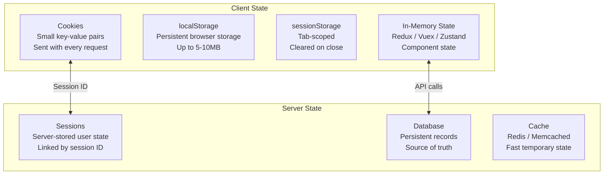

## Definition

State management is how an application tracks, stores, and synchronizes data that can change over time — from a user's login status to the contents of a shopping cart. State can live on the client (browser), the server, or both, and choosing where to manage it is a core architectural decision.

## How It Works

| Mechanism      | Lifetime          | Size Limit | Shared Across Tabs | Use Case                     |
| -------------- | ----------------- | ---------- | ------------------- | ---------------------------- |
| Cookies        | Configurable      | 4KB        | Yes                 | Auth tokens, preferences     |
| localStorage   | Until cleared     | 5-10MB     | Yes (same origin)   | Draft content, settings      |
| sessionStorage | Tab session       | 5-10MB     | No                  | Form wizards, temp data      |
| Redux/Vuex     | Page session      | Memory     | No                  | Complex UI state             |
| Server session | Configurable      | Unlimited  | Yes                 | Auth state, shopping carts   |

## PM Implications

- **State location affects UX** — storing a shopping cart in localStorage means it persists if the user closes the browser, but it is lost if they switch devices. Server-side state syncs across devices but requires authentication.
- **Offline capability** — client-side state enables offline-first features (draft emails, cached feeds). This is critical for mobile products in low-connectivity regions.
- **Performance tradeoffs** — global state libraries (Redux) add predictability but also boilerplate. Modern alternatives (Zustand, Jotai) reduce overhead. Over-engineering state management slows teams.
- **Privacy regulations** — cookies require consent banners under GDPR. localStorage is not subject to the same rules but has its own privacy implications. PMs must coordinate with legal.
- **Security** — sensitive data (tokens, PII) should never be stored in localStorage (vulnerable to XSS). Use httpOnly cookies for [[JWT-Authentication]] tokens.

## Example

An email client like Gmail manages multiple layers of state:
- **Server state** — all emails, folders, and labels stored in the database (source of truth).
- **Client cache** — recent emails cached in-memory for instant navigation between inbox and a thread.
- **Optimistic UI** — when you archive an email, the UI removes it immediately (client state update) before the server confirms. If the server call fails, the UI reverts.
- **localStorage** — draft emails saved locally so you do not lose work if the tab crashes.

## Related Concepts

- [[Frontend-Frameworks]] — Each framework has its own state management ecosystem
- [[JWT-Authentication]] — Token storage is a state management decision
- [[REST-API]] — REST is stateless; state lives in the client or database, not the API server
- [[Rendering-Strategies]] — SSR must serialize server state for client hydration
- [[CSS-Frameworks]] — UI state (theme, sidebar open/closed) affects styling
