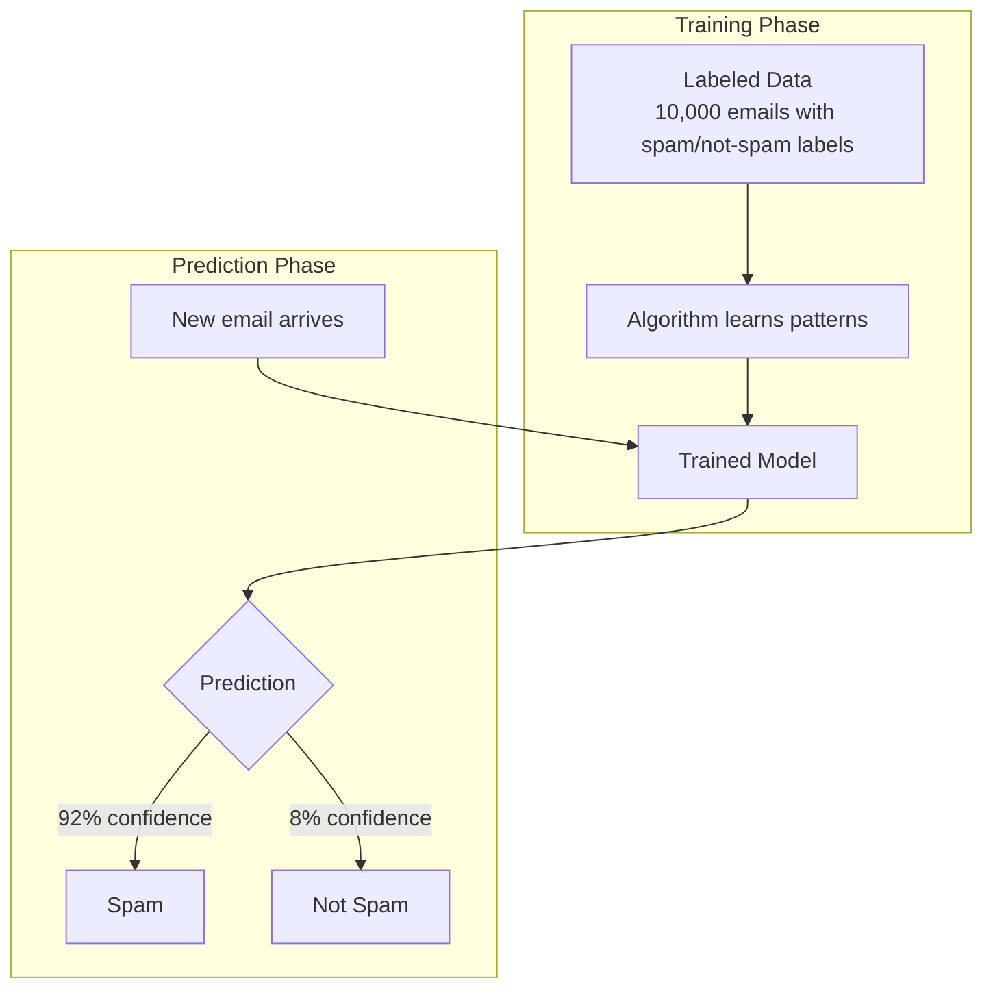

## Definition

Supervised learning is a [[Machine-Learning]] paradigm where the algorithm learns from labeled training data — examples where both the input and the correct output are known. The model learns the mapping from inputs to outputs and then applies that mapping to predict outcomes for new, unseen data.

## How It Works

The process works like learning from an answer key:
1. Give the model thousands of labeled examples (e.g., emails labeled "spam" or "not spam")
2. The algorithm finds patterns that distinguish the categories
3. Test on new examples the model has never seen
4. Measure how often it gets the right answer

Two main types of supervised learning:

| Type | Output | Examples |
|------|--------|---------|
| **Classification** | Category (discrete) | Spam/not spam, fraud/legitimate, churn/retain |
| **Regression** | Number (continuous) | House price, demand forecast, customer lifetime value |

Common algorithms:
- **[[Decision-Trees]]**: Interpretable, tree-shaped logic
- **[[Random-Forests]]**: Ensemble of decision trees for better accuracy
- **Logistic Regression**: Simple, fast classification
- **Support Vector Machines (SVM)**: Good for high-dimensional data
- **Neural Networks / Deep Learning**: Most powerful but least interpretable

Key evaluation metrics:
- **Accuracy**: % of correct predictions overall
- **Precision**: Of all "spam" predictions, how many were actually spam?
- **Recall**: Of all actual spam, how many did we catch?
- **F1 Score**: Harmonic mean of precision and recall

## PM Implications

- **Label quality is everything**: The model can only be as good as its labels. If humans mislabel training data, the model learns the wrong patterns.
- **Precision vs. recall trade-off**: Spam filter — high precision (never mark real email as spam) vs. high recall (catch every spam). PMs must decide which errors are more costly.
- **Data labeling is expensive**: Getting 10,000 labeled examples requires human effort. PMs must budget for data labeling in project plans.
- **Feature engineering**: Choosing the right input features is as important as choosing the algorithm. PMs should collaborate with data scientists on which product signals to use.
- **Model interpretability**: Stakeholders and regulators may ask "why did the model make this decision?" Simpler algorithms provide clearer answers.

## Example

A fintech company builds a credit scoring model using supervised learning:
- **Training data**: 500,000 historical loan applications with outcomes (repaid / defaulted)
- **Features**: Income, employment length, credit history, debt-to-income ratio, transaction patterns
- **Algorithm**: [[Random-Forests]] (good accuracy, some interpretability)
- **Output**: Probability of default (0-100%)
- **PM decision**: Set the threshold at 15% — applications with >15% default probability are declined. This threshold balances approval rates (business growth) against default rates (financial risk). Moving the threshold to 20% approves more loans but increases defaults.

## Related Concepts

- [[Machine-Learning]] — Supervised learning is the most widely used ML paradigm
- [[Unsupervised-Learning]] — The complementary paradigm using unlabeled data
- [[Decision-Trees]] — A common supervised learning algorithm
- [[Random-Forests]] — An ensemble method built from decision trees
- [[Tracking-Plan]] — Product events become labeled data for supervised learning
