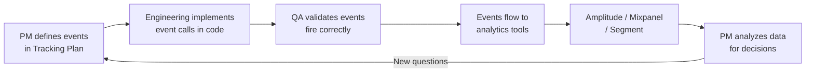

## Definition

A tracking plan is a structured specification document that lists every analytics event a product tracks, along with its properties, data types, naming conventions, and trigger conditions. It serves as the single source of truth for what data the product collects and ensures consistency between product, engineering, and data teams.

## How It Works

A tracking plan is typically a spreadsheet or structured document with the following columns:

| Event Name | Trigger | Properties | Type | Owner |
|-----------|---------|------------|------|-------|
| `page_viewed` | User loads any page | `page_name` (string), `referrer` (string) | Track | PM |
| `signup_completed` | User finishes signup | `method` (enum: email, google, apple), `plan` (string) | Track | Growth |
| `item_added_to_cart` | User adds item | `product_id` (string), `price` (float), `quantity` (int) | Track | Commerce |
| `checkout_started` | User enters checkout | `cart_value` (float), `item_count` (int) | Track | Commerce |

Naming conventions are critical:
- **Object-Action format**: `cart_item_added`, `profile_updated`, `search_performed`
- **Consistent casing**: `snake_case` or `camelCase` — pick one, enforce it
- **No abbreviations**: `button_clicked` not `btn_clk`
- **Namespaced**: `onboarding.step_completed` vs. `checkout.step_completed`

Tools for managing tracking plans: Segment Protocols, Amplitude Data, Avo, Iteratively.

## PM Implications

- **Data quality starts here**: If the tracking plan is messy, dashboards and analyses will be unreliable. Garbage in, garbage out.
- **PM ownership**: The tracking plan is one of the few technical documents that PMs typically own. You define *what* to track; engineering implements *how*.
- **Prioritize ruthlessly**: Track events that answer specific product questions. Do not track everything — it creates noise and maintenance burden.
- **Naming debt is real**: Inconsistent naming (e.g., `SignUp`, `sign_up`, `user_signup` for the same event) creates confusion that compounds over time.
- **Privacy compliance**: Every tracked event must comply with [[GDPR]] and [[DPDP-Act]]. The tracking plan should note which events contain PII.

## Example

Spotify's tracking plan for its "Wrapped" feature likely includes events such as:
- `wrapped_story_viewed` (properties: `story_index`, `story_type`, `year`)
- `wrapped_shared` (properties: `platform`: instagram/twitter/facebook, `share_type`: story/image)
- `wrapped_playlist_saved` (properties: `track_count`, `year`)

Before building Wrapped, the PM defines these events in the tracking plan. Engineering instruments them. After launch, the PM uses the data to measure engagement: "85% of users who opened Wrapped shared at least one story, with Instagram being the top platform."

## Related Concepts

- [[GDPR]] — Tracking plans must document PII and ensure consent compliance
- [[DPDP-Act]] — Indian data protection rules affect what can be tracked
- [[Authentication]] — User identity links events to specific users
- [[CI-CD]] — Event validation can be added to the CI pipeline
- [[Machine-Learning]] — Tracked events become training data for ML models
