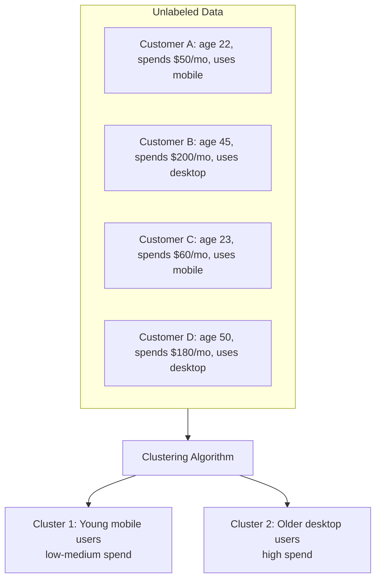

## Definition

Unsupervised learning is a [[Machine-Learning]] paradigm where the algorithm finds hidden patterns, structures, or groupings in data without labeled examples. Unlike [[Supervised-Learning]], there is no "correct answer" to learn from — the model discovers structure on its own.

## How It Works

Instead of learning from an answer key, unsupervised learning is like sorting a mixed pile of objects without being told the categories — the algorithm discovers the groupings itself.

Main types of unsupervised learning:

| Type | What It Does | Use Cases |
|------|-------------|-----------|
| **Clustering** | Groups similar data points together | Customer segmentation, content grouping |
| **Dimensionality Reduction** | Reduces features while preserving structure | Data visualization, noise removal |
| **Anomaly Detection** | Finds data points that do not fit any pattern | Fraud detection, system monitoring |
| **Association Rules** | Finds items that frequently co-occur | Market basket analysis ("bought X also bought Y") |

Common algorithms:
- **K-Means**: Partition data into K clusters (fast, simple)
- **DBSCAN**: Density-based clustering (handles irregular shapes)
- **PCA (Principal Component Analysis)**: Reduces dimensions
- **Hierarchical Clustering**: Creates a tree of nested clusters
- **Autoencoders**: Neural networks for dimensionality reduction

## PM Implications

- **Discovery, not prediction**: Unsupervised learning answers "What groups exist in our data?" rather than "What will happen next?" PMs use it for exploration and hypothesis generation.
- **Segmentation power**: Customer segmentation via clustering often reveals segments PMs did not know existed — informing persona development and targeting strategies.
- **No ground truth**: Without labels, there is no "accuracy" metric. Evaluating results requires domain judgment — PMs must validate that the discovered clusters make business sense.
- **Complement to supervised learning**: Unsupervised learning often feeds into supervised learning. First cluster users, then build a model to predict which cluster new users will fall into.
- **Anomaly detection for fraud/abuse**: Products handling payments, reviews, or user-generated content can use unsupervised anomaly detection to flag suspicious activity without manually labeling every fraudulent case.

## Example

Spotify uses unsupervised learning for music discovery. By clustering songs based on audio features (tempo, energy, acoustics, danceability) without using genre labels, Spotify discovers that certain songs are similar even if they are tagged with different genres. This powers the "Discover Weekly" playlist: the algorithm finds clusters of songs the user has not heard that are similar to clusters the user already enjoys. The approach works because music taste does not follow genre boundaries — a jazz-hip-hop fusion track might cluster with certain electronic songs rather than with traditional jazz.

## Related Concepts

- [[Machine-Learning]] — Unsupervised learning is one of the three ML paradigms
- [[Supervised-Learning]] — The complementary paradigm using labeled data
- [[Decision-Trees]] — A supervised method; unsupervised clustering can inform which features to split on
- [[Random-Forests]] — Supervised ensemble method; can be combined with unsupervised feature discovery
- [[Tracking-Plan]] — Product usage data is often unlabeled — ripe for unsupervised analysis
