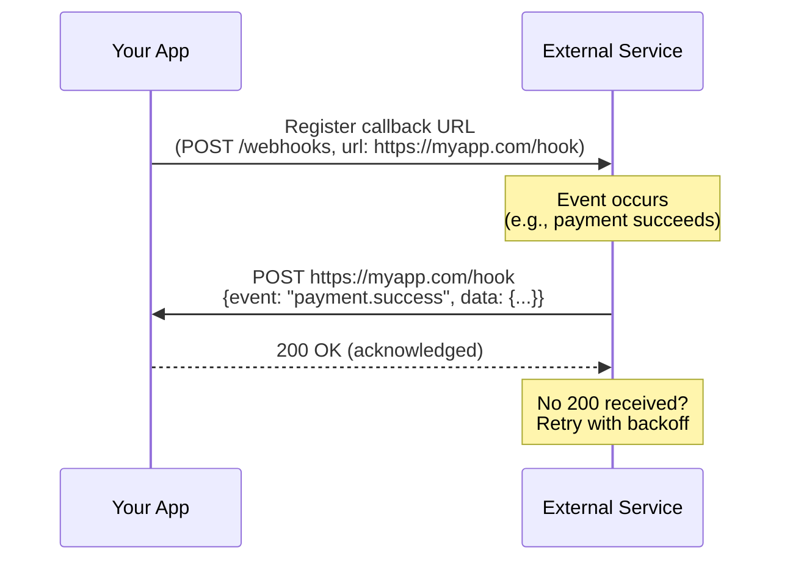

## Definition

Webhooks are a push-based event notification pattern. Instead of a client repeatedly polling an API for updates ([[REST-API]]), the server sends an HTTP POST request to a pre-registered callback URL when a specific event occurs. Think of it as "don't call us, we'll call you."

## How It Works

**The 3 Safety Rules** every PM should know:

1. **Retry logic** — webhook delivery can fail (network issues, server downtime). The sender retries with exponential backoff. Your app must handle duplicates gracefully.
2. **Idempotency** — because retries happen, your handler must produce the same result whether it processes an event once or five times. Use the event ID to deduplicate.
3. **Signature verification** — the sender signs the payload with a shared secret (HMAC). Your app must verify the signature to ensure the request is authentic, not a spoofed attack.

## PM Implications

- **Real-time integrations without polling** — webhooks enable instant reactions (send a confirmation email the moment a payment succeeds, update inventory the moment an order ships).
- **Integration partnerships** — if your product sends webhooks, partners can build on your platform without your team building each integration. Webhooks are the foundation of ecosystem plays.
- **Reliability requirements** — webhook failures are silent. Invest in logging, dead-letter queues, and retry dashboards so operations teams can debug failed deliveries.
- **Security is non-negotiable** — always require signature verification. A public callback URL without verification is an attack vector.
- **Developer experience** — provide a webhook testing tool (like Stripe's webhook CLI) so developers can test integrations locally.

## Example

Stripe payment webhooks:
1. Your e-commerce app registers `https://shop.com/stripe-hook` as a webhook endpoint.
2. A customer completes a purchase. Stripe fires `payment_intent.succeeded` to your URL.
3. Your server verifies the HMAC signature, checks the event ID against a processed-events table (idempotency), then triggers order fulfillment.
4. If your server was down, Stripe retries up to 3 days with exponential backoff.

## Related Concepts

- [[REST-API]] — Webhooks complement REST's pull-based model with push-based events
- [[API-Authentication]] — Signature verification is a form of request authentication
- [[JWT-Authentication]] — Some webhook systems use JWT for payload signing
- [[Data-Pipelines]] — Webhooks can feed real-time events into streaming pipelines
- [[Analytics-Instrumentation]] — Server-side events from webhooks complement client-side tracking
