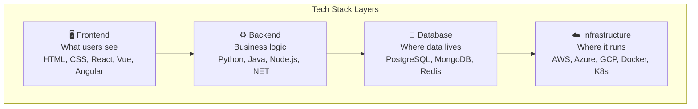
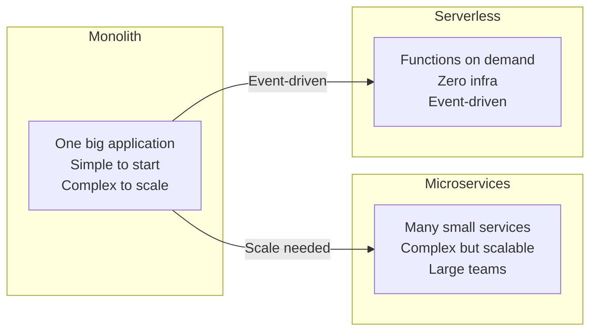

# Technology Stacks Reference Guide

> A PM's comprehensive reference to the modern technology landscape. Use this as a quick-lookup companion to [[Session-15-Build-vs-Buy]] and [[MOC-Tech-Stacks]].

---

## What Is a Tech Stack?

A [[Tech-Stacks|tech stack]] is the combination of technologies used to build and run a software product — programming languages, frameworks, databases, cloud services, and tools.

### The Four Layers

### Why PMs Must Understand Tech Stacks #pm-implication

| Dimension | Why It Matters |
|-----------|---------------|
| **Feasibility** | Know what's realistic for your team to build |
| **Timelines** | Stack choices directly affect time-to-market |
| **Cost** | Licensing, hosting, and hiring costs vary |
| **Hiring** | Stack determines which engineers you can recruit |

---

## Frontend Technologies

### The Foundation: HTML + CSS + JavaScript

| Technology | Role | Analogy |
|-----------|------|---------|
| **HTML** | Structure of every web page (content) | The skeleton |
| **CSS** | Styling and layout (colors, fonts, spacing) | The clothing |
| **JavaScript** | Interactivity and logic (clicks, animations) | The muscles |

### Frontend Frameworks — [[Frontend-Frameworks]]

| Framework | Language | Best For | Used By |
|-----------|----------|----------|---------|
| **React** | JS/TS | Most web UIs, interactive SPAs | Facebook, Netflix, Airbnb |
| **Next.js** | JS/TS | Full-stack React (SSR + CSR) | Vercel, TikTok, Hulu |
| **Vue.js** | JS/TS | Progressive enhancement, Asia market | Alibaba, GitLab, Nintendo |
| **Angular** | TypeScript | Large enterprise apps, strict structure | Google, Microsoft, Forbes |
| **Svelte** | JS/TS | Performance-critical, lightweight | Apple, Spotify, NYTimes |

### CSS Frameworks — [[CSS-Frameworks]]

| Framework | Style | Best For |
|-----------|-------|----------|
| **Tailwind CSS** | Utility-first | Most popular 2024+, rapid development |
| **Bootstrap** | Component library | Quick prototyping |
| **Material UI** | Google's design system | React components |
| **Shadcn/ui** | Copy-paste components | Tailwind + React |

---

## Backend Languages — [[Backend-Languages]]

| Language | Year | Primary Use | Killer Feature | Avoid For |
|----------|------|------------|----------------|-----------|
| **Python** | 1991 | AI/ML, data science, web | Ecosystem breadth, AI dominance | Mobile apps, high concurrency |
| **JavaScript** | 1995 | Web frontend + Node.js backend | Runs everywhere (browser+server) | CPU-intensive computation |
| **TypeScript** | 2012 | Superset of JS with static types | Type safety across full stack | Quick prototypes |
| **Java** | 1995 | Enterprise backend, Android | JVM maturity, enterprise ecosystem | Rapid prototyping |
| **C# / .NET** | 2000 | Windows, enterprise web, games | Microsoft ecosystem integration | Linux-native teams |
| **Go** | 2009 | High-perf APIs, infrastructure | Goroutines; single binary; fast startup | Feature-rich business apps |
| **Rust** | 2015 | Systems programming, WebAssembly | Memory safety without GC | Most web applications |
| **PHP** | 1994 | Web (WordPress, Laravel) | Powers 43% of web; Laravel elegance | High-performance APIs |
| **Ruby** | 1995 | Web (Rails) | Developer happiness; Rails convention | High concurrency at scale |
| **Kotlin** | 2011 | Android, JVM backend | Java interop; conciseness | Large existing Java teams |

### Backend Decision Guide

| Use Case | Best Language(s) | Why |
|----------|-----------------|-----|
| AI / Machine Learning | **Python** | TensorFlow, PyTorch, scikit-learn all Python-first |
| Full-stack web startup | **TypeScript / Node.js** | One language front + back; huge npm ecosystem |
| Enterprise B2B SaaS | **Java** or **C#** | Mature, battle-tested, strong hiring pool |
| High-performance APIs | **Go** or **Rust** | Fast execution, low memory |
| Content / CMS / e-commerce | **PHP** or **Ruby** | WordPress powers 43% of web; Rails is fast |
| Android mobile | **Kotlin** | Official Android language |
| Data pipelines | **Python** | Pandas, NumPy, Airflow ecosystem |

---

## Mobile Development

| Approach | Technology | Performance | Cost | Best For |
|----------|-----------|-------------|------|----------|
| **Native iOS** | Swift | 100% | 2x (two codebases) | Gaming, AR, complex UX |
| **Native Android** | Kotlin | 100% | 2x | Gaming, AR, complex UX |
| **React Native** | JavaScript | 90-95% | 1x (shared code) | Most business apps |
| **Flutter** | Dart | 90-95% | 1x | Beautiful UIs |
| **PWA** | Web | 80-85% | 0.5x | Content, simple tools |

> **PM Rule:** 80% of new mobile apps in 2024+ use cross-platform (React Native or Flutter). Go native only for cutting-edge device features. #pm-implication

---

## Database Technologies — [[SQL-Basics]] | [[NoSQL-Databases]]

| Database | Type | ACID | Best For | Cloud Options |
|----------|------|------|----------|---------------|
| **PostgreSQL** | Relational | Yes | Default choice for most apps | AWS RDS, Supabase, Neon |
| **MySQL** | Relational | Yes | PHP/Laravel, WordPress | AWS RDS, PlanetScale |
| **MongoDB** | Document | Limited | Flexible schemas, JSON apps | MongoDB Atlas |
| **Redis** | Key-Value | Limited | Caching, sessions, queues | ElastiCache, Redis Cloud |
| **Cassandra** | Wide-column | No | Billions of writes/day, IoT | AWS Keyspaces |
| **Neo4j** | Graph | Yes | Social graphs, recommendations | Neo4j AuraDB |
| **Pinecone** | Vector | — | AI semantic search | Managed |

### Newer Categories

| Category | Examples | Use Case |
|----------|----------|----------|
| **NewSQL** | CockroachDB, Spanner | SQL + horizontal scale |
| **Time-Series** | InfluxDB, TimescaleDB | Metrics & IoT data |
| **Vector DBs** | Pinecone, pgvector | AI semantic search |
| **Serverless DBs** | Neon, PlanetScale, Turso | Scale to zero, pay-per-query |

> **PM Default:** PostgreSQL for most apps. Add Redis for caching, MongoDB if schema flexibility matters, vector DB for AI features. Most apps need just 1-2 databases. #pm-implication

---

## Cloud Platforms — [[Cloud-Computing]] | [[AWS]]

### The Big Three

| Provider | Market Share | Best For | India Regions |
|----------|-------------|----------|---------------|
| **AWS** | ~31% | Most services, most popular | Mumbai |
| **Azure** | ~24% | Enterprise, Microsoft shops | Central, South, West India |
| **GCP** | ~12% | AI/data, BigQuery, Vertex AI | Mumbai, Delhi |

### Cloud Services Comparison

| Category | AWS | Azure | GCP |
|----------|-----|-------|-----|
| Virtual Machines | EC2 | Virtual Machines | Compute Engine |
| Serverless | Lambda | Azure Functions | Cloud Functions |
| Object Storage | S3 | Blob Storage | Cloud Storage |
| Managed Database | RDS / Aurora | Azure Database | Cloud SQL |
| Kubernetes | EKS | AKS | GKE |
| AI/ML Platform | Bedrock / SageMaker | Azure OpenAI | Vertex AI |
| CDN | CloudFront | Azure CDN | Cloud CDN |

### Developer-Friendly Platforms (Startups & MVPs)

| Platform | Best For |
|----------|----------|
| **Vercel** | Frontend + serverless |
| **Render** | Simple full-stack |
| **Railway** | One-click deploys |
| **Fly.io** | Edge deployment |
| **Supabase** | DB + API + Auth |

---

## Architecture Patterns

> **PM Rule:** Start monolith, extract microservices only when needed. "Premature microservices" is the #1 architecture mistake at startups. #pm-implication

---

## Popular Stack Combinations — [[Tech-Stacks]]

| Stack | Components | Best For |
|-------|-----------|----------|
| **LAMP** | Linux, Apache, MySQL, PHP | Traditional web apps, CMS |
| **MEAN** | MongoDB, Express, Angular, Node | Full-stack JavaScript (Angular) |
| **MERN** | MongoDB, Express, React, Node | Most popular JS stack 2024 |
| **T3** | TypeScript, tRPC, Tailwind, Next.js | Type-safe modern full-stack |
| **Jamstack** | JavaScript, APIs, Markup (CDN) | Static sites + APIs |
| **Django + React** | Python backend + React frontend | AI/ML products with rich UIs |
| **Spring + Angular** | Java backend + Angular frontend | Enterprise B2B |

### The Modern Startup Stack (2024+)

**Next.js** (React framework) + **TypeScript** (type safety) + **PostgreSQL** (via Supabase/Neon) + **Tailwind** (rapid styling) + **Vercel** (auto-deploy)

---

## DevOps & CI/CD — [[CI-CD]] | [[Deployment-Pipeline]]

| Practice | Key Tools | PM Value |
|----------|-----------|----------|
| Version Control | GitHub, GitLab, Bitbucket | Audit trail; code review |
| CI/CD | GitHub Actions, GitLab CI, Jenkins | Faster, safer deployments |
| Containers | Docker | Consistent environments |
| Orchestration | Kubernetes, ECS, Cloud Run | Scalable deployment |
| Infrastructure as Code | Terraform, AWS CDK, Pulumi | Reproducible infrastructure |
| Feature Flags | LaunchDarkly, Unleash | Decouple deploy from release |
| Monitoring | Datadog, New Relic, Grafana | Detect and diagnose incidents |
| Error Tracking | Sentry | Prioritize bugs by user impact |

---

## Cybersecurity & Compliance — [[OWASP-Top-10]]

### OWASP Top 5 Simplified

| # | Vulnerability | Prevention |
|---|--------------|------------|
| 1 | Broken Access Control | Role-based access, test permissions |
| 2 | Cryptographic Failures | HTTPS everywhere, encrypt at rest |
| 3 | Injection (SQL/XSS) | Parameterized queries, input validation |
| 4 | Insecure Design | Threat modeling in design phase |
| 5 | Security Misconfiguration | Security checklists, automated scans |

### Compliance Frameworks

| Framework | Scope | PM Relevance |
|-----------|-------|-------------|
| **SOC 2** | SaaS trust standard | Required by enterprise customers |
| **ISO 27001** | Global info security | International credibility |
| **PCI DSS** | Payment card data | Any app handling payments |
| **HIPAA** | US healthcare data | Health-related products |
| **[[GDPR]]** | EU data privacy | Any app with EU users |
| **[[DPDP-Act]]** | India data privacy | Any app with Indian users |

---

## Enterprise Systems & Legacy

| Platform | Focus | Key Strength |
|----------|-------|-------------|
| **SAP S/4HANA** | ERP (finance, supply chain, HR) | Deepest industry processes |
| **Oracle ERP Cloud** | ERP + database + cloud | Database integration |
| **Dynamics 365** | ERP + CRM (Microsoft) | Office 365 integration |
| **Salesforce** | CRM + platform | Customer 360, app ecosystem |
| **ServiceNow** | IT service management | Workflow automation |
| **Workday** | HR & finance | People analytics |

### Legacy Modernization Approaches

| Approach | Risk | Speed | Description |
|----------|------|-------|-------------|
| **Encapsulate** | Lowest | Fast | Wrap legacy in APIs |
| **Replatform** | Low | Medium | Move to cloud, minimal changes |
| **Refactor** | Medium | Slow | Rewrite core modules |
| **Replace** | Highest | Slowest | Full SaaS replacement |

> **PM Rule:** Don't propose "rewrite everything." Start by wrapping the old system in APIs. Migration takes years — plan incremental wins. #pm-implication

---

## 7 Dimensions of Stack Selection — [[Build-vs-Buy]]

| Dimension | Key Question |
|-----------|-------------|
| 1. Team Expertise | What does your team already know? |
| 2. Hiring Market | Can you find developers for this stack? |
| 3. Problem Fit | Does the tech match the problem domain? |
| 4. Scalability | How much growth must the stack support? |
| 5. Time to Market | How fast must you ship? |
| 6. Total Cost | Licensing, hosting, hiring, maintenance? |
| 7. Vendor Maturity | Is the technology stable and supported? |

### Decision by Stage

| Stage | Stack Guidance |
|-------|---------------|
| **Startup / MVP** | Python or TypeScript, PostgreSQL + Redis, Vercel or Railway |
| **Mid-Stage** | Add dedicated services, microservices where needed, AWS or GCP |
| **Enterprise** | Java or .NET core, Kubernetes orchestration, multi-region, compliance |

---

## Emerging Technologies

| Technology | What It Is | PM Relevance |
|-----------|-----------|-------------|
| **WebAssembly** | Run C/Rust in browser at near-native speed | Figma-like performance |
| **Edge Computing** | Code closer to users (Cloudflare Workers) | Lower latency |
| **AI-Native Dev** | AI writes code (Copilot, Cursor, v0) | 3-person team = old 10-person |
| **Serverless DBs** | Scale to zero (Neon, PlanetScale) | Cost savings |
| **No-Code / Low-Code** | Non-engineers build apps (Bubble, Retool) | Internal tools, prototypes |
| **Autonomous Agents** | AI that plans + executes multi-step tasks | Still early, advancing fast |

---

## Quick Decision Cheat Sheet

> **The best stack is the one your team ships with — optimize later.**

- Don't overthink the stack for an MVP — pick MERN or T3, ship fast
- Python & JS developers are abundant; Go & Rust talent is scarce and expensive
- Instagram runs Python (Django) at massive scale — the "right" language is the one your team knows
- Most rewrites fail or take 2x longer — modernize incrementally
- Start monolith, split later — premature microservices kill startups

---

*See also:* [[MOC-Tech-Stacks]] | [[Session-15-Build-vs-Buy]] | [[MOC-Build-vs-Buy]]
