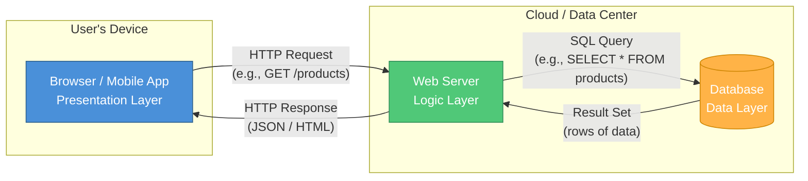
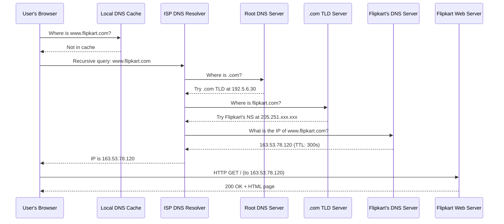
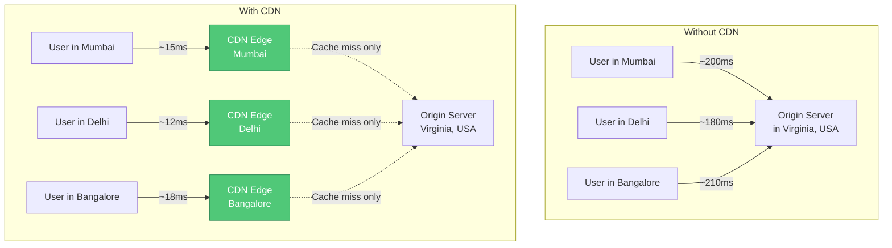
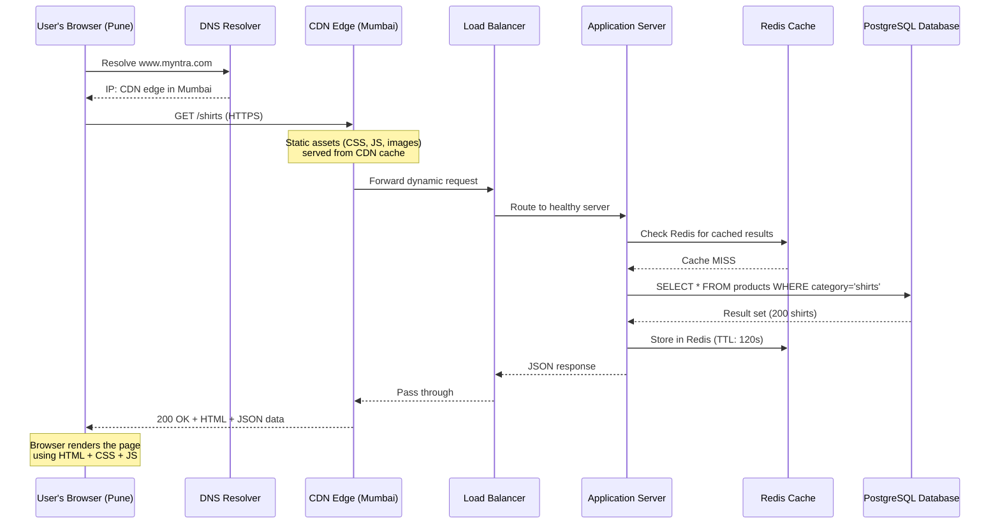

# Session 01 — The Technology Landscape

> **Core Question:** Why should a Product Manager — someone who will never write production code — invest time understanding technology? #pm-implication

---

## Why PMs Need to Understand Technology

### The PM Is Not a Developer — But a Translator

A Product Manager sits at the intersection of business, design, and engineering. You are not expected to write code, but you are expected to:

1. **Speak the language** — Communicate credibly with engineers without requiring them to "dumb it down"
2. **Make informed trade-off decisions** — Understand when an engineer says "that will take 3 sprints" whether it is genuine complexity or scope creep
3. **Debug user-reported issues** — When a user says "your app is slow," know where to start looking
4. **Evaluate technical proposals** — When the team proposes a rewrite vs. refactor, understand the implications
5. **Assess build-vs-buy decisions** — Know enough to evaluate vendor APIs and third-party integrations

> **Dr. Fadte's framing:** "You don't need to know how to build the engine. You need to know enough to have an opinion on whether we need a 4-cylinder or a V8." #definition

### The Cost of Tech Ignorance

| Scenario | What Happens Without Tech Literacy |
|---|---|
| Sprint planning | PM cannot challenge estimates or understand dependencies |
| User bug report | PM cannot triage severity or identify likely root cause |
| Vendor evaluation | PM cannot assess integration complexity or security risks |
| Architecture review | PM sits silent while engineers make product-impacting decisions |
| Stakeholder communication | PM cannot explain delays or trade-offs to leadership |

#pm-implication — The PM who understands technology earns engineering trust faster and makes better product decisions.

---

## The 3-Layer Client-Server Architecture

Every modern web application follows a fundamental pattern called [[Client-Server-Architecture]]. Think of it as a restaurant: #framework

| Layer | Restaurant Analogy | Tech Equivalent | Role |
|---|---|---|---|
| **Presentation** (Frontend) | The dining room, menu, table setting | HTML, CSS, JavaScript in the browser | What the user sees and interacts with |
| **Logic** (Backend) | The kitchen, chefs, recipes | Server-side code (Python, Node.js, Java) | Processes requests, applies business rules |
| **Data** (Database) | The pantry, inventory, recipe book | PostgreSQL, MongoDB, Redis | Stores and retrieves persistent information |

### How the Layers Communicate

### Why 3 Layers? The Separation of Concerns Principle

Separating concerns means each layer can:
- **Scale independently** — Need to handle more users? Add more backend servers without touching the database schema
- **Be replaced independently** — Swap React for Vue on the frontend without rewriting the backend
- **Be secured independently** — The database never talks directly to the internet

> **Case Study — Zomato's Architecture Evolution:** Zomato started as a monolithic PHP application. As they scaled to millions of users across India, they separated into microservices — letting the search team, the ordering team, and the delivery tracking team each own their own backend and database layer. This separation let them scale restaurant search independently from order processing during peak dinner hours. #case-study #india-context

---

## DNS Lookup Flow: From URL to Server

When a user types `www.flipkart.com` into their browser, a complex sequence unfolds before the page appears. This involves [[DNS]] — the Domain Name System, often called "the phonebook of the internet." #definition

### The Complete DNS Resolution Sequence

### Key DNS Concepts for PMs

| Concept | What It Means | PM Relevance |
|---|---|---|
| **TTL (Time to Live)** | How long DNS results are cached (e.g., 300 seconds) | During migrations, lower TTL first so users switch to the new server faster |
| **DNS Propagation** | Time for DNS changes to spread globally | Domain changes can take 24-48 hours; plan launches accordingly |
| **CNAME vs A Record** | Alias vs. direct IP mapping | Affects how custom domains work for your product |
| **DNS Failover** | Automatic switching to backup server if primary fails | Critical for high-availability products |

#pm-implication — When planning a domain migration or CDN switch, always ask: "What is our DNS TTL, and have we lowered it ahead of the switch?"

---

## Web Fundamentals: The Protocols That Power the Internet

### HTTP and HTTPS — The Language of the Web

[[HTTP-Protocol]] (HyperText Transfer Protocol) is the agreed-upon format for how browsers and servers communicate. Every web interaction is an HTTP conversation. #definition

**HTTP vs. HTTPS:**

| Feature | HTTP | HTTPS |
|---|---|---|
| Encryption | None — data sent in plaintext | TLS/SSL encryption on all data |
| Port | 80 | 443 |
| URL prefix | `http://` | `https://` |
| Security | Vulnerable to man-in-the-middle attacks | Encrypted end-to-end |
| SEO impact | Google penalizes HTTP sites | Google rewards HTTPS |
| Trust signals | Browser shows "Not Secure" warning | Browser shows padlock icon |

> **India Context:** RBI mandates that all payment gateways and banking applications use HTTPS. When [[Razorpay]] or [[Paytm]] processes a payment, every API call between your server and theirs must be over HTTPS. A PM building any fintech product in India must ensure HTTPS is non-negotiable from day one. #india-context

### TCP/IP — The Delivery System

If HTTP is the language, [[TCP-IP]] is the postal service. TCP/IP handles:
- **Breaking data into packets** — Large responses are split into small chunks
- **Routing packets** across networks — Each packet may take a different path
- **Reassembling packets** in the correct order at the destination
- **Retransmitting lost packets** — Ensures reliable delivery

### Ports — The Apartment Numbers

An IP address gets you to the building (server). A **port** gets you to the specific apartment (service). #definition

| Port | Service | Example |
|---|---|---|
| 80 | HTTP | `http://example.com:80` (default, usually hidden) |
| 443 | HTTPS | `https://example.com:443` (default, usually hidden) |
| 3000 | Development servers | React dev server |
| 5432 | PostgreSQL | Database connections |
| 27017 | MongoDB | NoSQL database connections |
| 6379 | Redis | In-memory cache |

---

## HTTP Status Codes: The Server's Vocabulary

Every HTTP response includes a numeric status code. PMs should know these because they appear in error logs, monitoring dashboards, and user-reported issues. #framework

### The Five Families

| Range | Category | Meaning |
|---|---|---|
| **1xx** | Informational | "Hold on, I'm working on it" |
| **2xx** | Success | "Here you go, everything worked" |
| **3xx** | Redirection | "What you want is actually over there" |
| **4xx** | Client Error | "You (the client/browser) did something wrong" |
| **5xx** | Server Error | "I (the server) broke something" |

### The Status Codes Every PM Must Know

**200 OK** — The request succeeded. The most common response. Page loaded, API returned data.

**201 Created** — A new resource was successfully created (e.g., user signed up, order placed).

**301 Moved Permanently** — The URL has permanently changed. Browsers and search engines will update their records. Critical for SEO during URL restructuring.

**302 Found (Temporary Redirect)** — The resource is temporarily at a different URL. Used for A/B tests or maintenance pages.

**400 Bad Request** — The server cannot process the request due to malformed syntax. Often means the frontend sent invalid data.

**401 Unauthorized** — Authentication required. The user is not logged in. See [[JWT-Authentication]].

**403 Forbidden** — Authenticated but not authorized. The user is logged in but does not have permission.

**404 Not Found** — The requested resource does not exist. The most user-visible error code.

**429 Too Many Requests** — Rate limiting. The client has sent too many requests in a given time. Critical when using third-party APIs.

**500 Internal Server Error** — Generic server-side failure. Something crashed on the backend.

**502 Bad Gateway** — A server acting as a gateway received an invalid response from an upstream server. Common in microservices architectures.

**503 Service Unavailable** — Server is temporarily overloaded or under maintenance.

> **PM Cheat Sheet — What to do when you see these in production:** #pm-implication
> - **Spike in 4xx errors** — Likely a frontend deployment broke something, or an API contract changed
> - **Spike in 5xx errors** — Backend is crashing; escalate to engineering immediately
> - **Spike in 429 errors** — You are hitting a third-party API rate limit; check your plan tier
> - **Spike in 503 errors** — Server capacity issue; may need to scale up

---

## State Management: Remembering the User

HTTP is **stateless** — each request is independent, with no memory of previous requests. But users expect websites to remember them (login sessions, shopping carts, preferences). This is solved through state management mechanisms. #definition

### Cookies

Small text files (max ~4KB) stored in the user's browser and sent with every request to the same domain.

**Use cases:** Session IDs, user preferences, tracking (analytics), "Remember me" checkboxes

**PM-relevant cookie attributes:**
- `HttpOnly` — Cannot be accessed by JavaScript (prevents XSS attacks)
- `Secure` — Only sent over HTTPS
- `SameSite` — Controls cross-site sending (prevents CSRF attacks)
- `Expires` / `Max-Age` — When the cookie dies

### Sessions (Server-Side)

The server stores user state (e.g., shopping cart contents) and gives the browser a **session ID** cookie. The browser sends the session ID with each request, and the server looks up the full state.

**Trade-off:** More secure (data stays on server), but requires server memory and does not scale easily across multiple servers without a shared session store (e.g., [[Redis]]).

### JWT Tokens (JSON Web Tokens)

[[JWT-Authentication]] is a modern, stateless approach. The server creates a digitally signed token containing user information and hands it to the client. The client sends this token with every request. The server verifies the signature without needing to look anything up. #definition

**Structure:** `header.payload.signature` (three Base64-encoded parts separated by dots)

**Advantages:** Stateless (no server-side storage), scales easily, works across microservices
**Risks:** Cannot be revoked once issued (until expiry), token theft grants full access

> **Case Study — Flipkart's Session Management at Scale:** During Big Billion Days sales, Flipkart handles millions of concurrent sessions. They moved from server-side sessions to JWT-based authentication to avoid the bottleneck of a centralized session store. However, they maintain a token blacklist in Redis for security-critical operations like forced logouts after password changes. #case-study #india-context

---

## CDNs and Caching: Making Things Fast

### Content Delivery Networks (CDNs)

A [[CDN]] is a globally distributed network of servers that cache and serve static content (images, CSS, JS files, videos) from the server closest to the user. #definition

**Major CDN providers:** Cloudflare, AWS CloudFront, Akamai, Fastly, Google Cloud CDN

### Caching Layers

Caching is storing a copy of data closer to where it is needed so future requests are faster. #definition

| Cache Layer | What It Caches | TTL Example | PM Relevance |
|---|---|---|---|
| **Browser cache** | Images, CSS, JS files | Hours to days | Users may see stale content after a deploy |
| **CDN cache** | Static assets, sometimes HTML | Minutes to hours | Need to "purge cache" after hotfixes |
| **Application cache** | API responses, computed results | Seconds to minutes | Stale data vs. freshness trade-off |
| **Database cache** (Redis/Memcached) | Query results, session data | Seconds to minutes | Reduces database load |

### Cache Invalidation — The Hard Problem

> "There are only two hard things in Computer Science: cache invalidation and naming things." — Phil Karlton

**The PM problem:** You push a critical price update, but users still see the old price because it is cached at multiple levels. What do you do?

**Strategies:**
1. **Cache busting** — Append version hashes to file names (`style.abc123.css`)
2. **Cache purging** — Manually clear the CDN cache (most CDN dashboards support this)
3. **Short TTLs for dynamic content** — Cache prices for 60 seconds, not 60 minutes
4. **Event-driven invalidation** — When a product is updated, actively purge its cached data

#pm-implication — Always ask: "When we update this content, how long until users see the change?" This is the cache latency question and it has real business impact.

---

## The Complete Request Lifecycle

Putting it all together — what happens when a user in Pune opens `https://www.myntra.com/shirts`: #framework

> **PM Exercise:** Trace through this diagram and identify every point where latency is added. Which layers could fail? What would the user experience be in each failure scenario? This is how you develop technical intuition. #pm-implication

---

## Key Takeaways for Day 1

1. PMs do not need to code, but must speak technology fluently enough to make informed decisions
2. Every web app follows the 3-layer architecture: Presentation, Logic, Data
3. [[DNS]] translates human-readable domains into machine-readable IP addresses
4. [[HTTP-Protocol]] status codes tell you what went wrong (4xx = client, 5xx = server)
5. State management ([[JWT-Authentication]], cookies, sessions) is how stateless HTTP "remembers" users
6. [[CDN]]s and caching make products fast but introduce the cache invalidation challenge
7. Understanding the full request lifecycle helps PMs debug issues and ask better questions

---

## Further Reading

- [[Client-Server-Architecture]] — Deep dive into architectural patterns
- [[HTTP-Protocol]] — Complete HTTP reference
- [[DNS]] — Domain Name System internals
- [[CDN]] — Content Delivery Networks in practice
- [[JWT-Authentication]] — Token-based authentication explained
- [[State-Management]] — Cookies, sessions, and tokens compared
