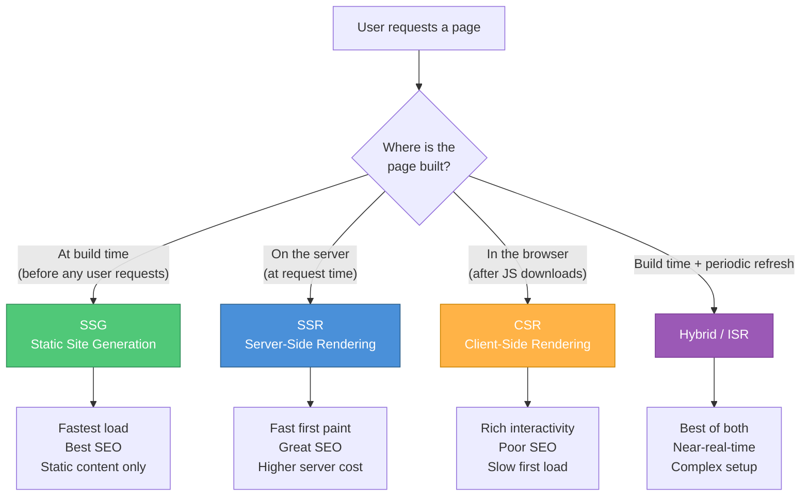
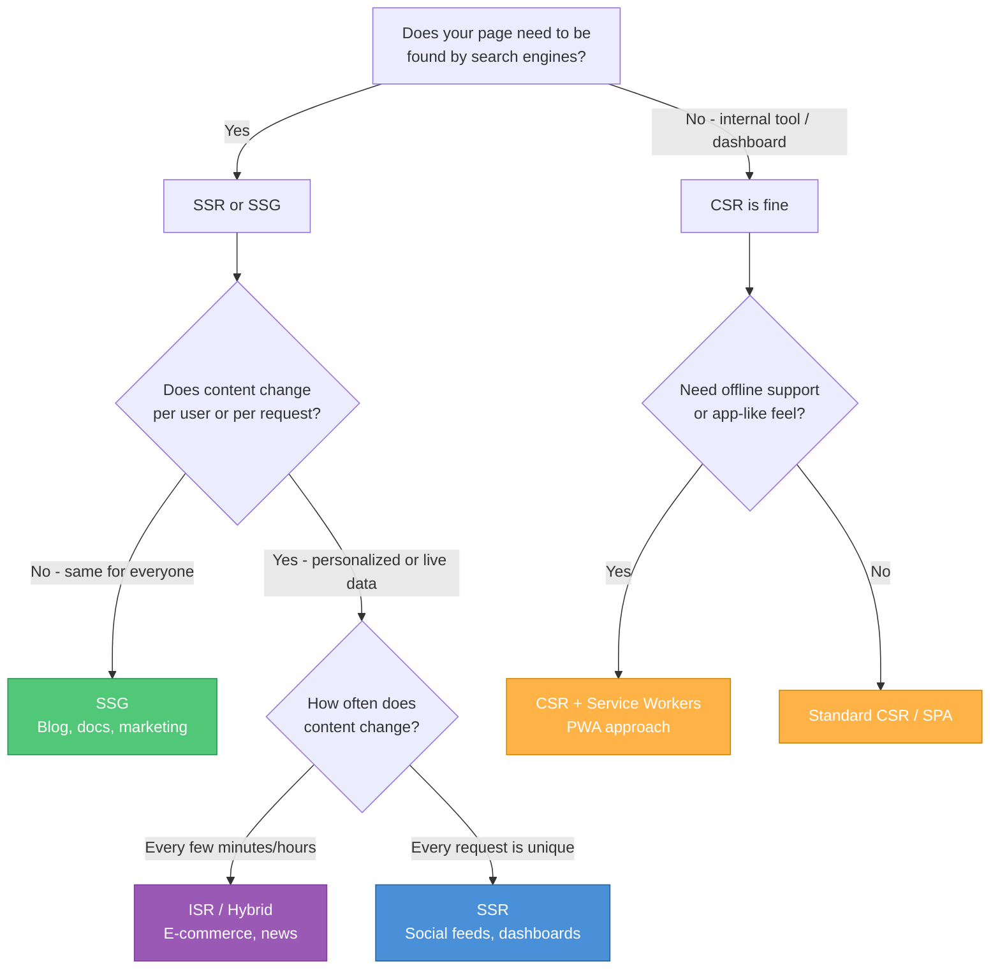

# Session 02 — Frontend & Backend Fundamentals

> **Core Question:** When your engineering team says "we're debating between SSR and CSR" or "we want to switch from Bootstrap to Tailwind," what are the product implications? #pm-implication

---

## The Frontend Stack: The Three Pillars

Every webpage you have ever seen is built from three fundamental technologies. Think of building a house: #framework

| Technology | House Analogy | Role | File Extension |
|---|---|---|---|
| **HTML** | The structure — walls, rooms, floors | Defines what content exists and its hierarchy | `.html` |
| **CSS** | The interior design — paint, furniture, lighting | Controls how content looks and is arranged | `.css` |
| **JavaScript** | The electrical wiring and plumbing — interactive systems | Makes the page dynamic and interactive | `.js` |

### HTML — HyperText Markup Language

HTML uses **tags** to create a structured document. Key concepts for PMs: #definition

- **Semantic HTML** — Using tags that describe meaning (`<nav>`, `<article>`, `<footer>`) rather than generic containers (`<div>`, `<span>`). This matters for accessibility and SEO.
- **Accessibility (a11y)** — Proper HTML enables screen readers, keyboard navigation, and assistive technologies. In India, the Rights of Persons with Disabilities Act (2016) increasingly pushes digital accessibility. #india-context
- **SEO impact** — Search engines parse HTML structure. Proper heading hierarchy (`<h1>` through `<h6>`), meta tags, and semantic elements directly affect search rankings.

### CSS — Cascading Style Sheets

[[CSS-Frameworks]] control the visual presentation. Key concepts: #definition

- **Responsive design** — CSS media queries adapt layouts to different screen sizes. Critical in India where mobile traffic exceeds 75% for most consumer apps. #india-context
- **CSS Specificity** — Rules about which styles "win" when multiple rules apply to the same element. A common source of bugs.
- **Flexbox and Grid** — Modern layout systems that replaced the old float-based layouts.

### JavaScript — The Programming Language of the Web

JavaScript (JS) makes pages interactive. It runs in the browser and can: #definition
- Respond to user actions (clicks, scrolls, form inputs)
- Fetch data from servers without reloading the page (AJAX / Fetch API)
- Manipulate the page content dynamically
- Run animations and transitions

> **Historical note:** JavaScript has nothing to do with Java. It was named "JavaScript" as a marketing decision in 1995 to ride the popularity of Java. This confusion persists to this day.

---

## The DOM and Virtual DOM

### The DOM (Document Object Model)

When a browser loads HTML, it creates an in-memory tree structure called the [[DOM]]. Every HTML element becomes a "node" in this tree. JavaScript can read, modify, add, or remove any node. #definition

```
document
 └── html
      ├── head
      │    ├── title
      │    └── meta
      └── body
           ├── header
           │    └── nav
           ├── main
           │    ├── h1
           │    └── p
           └── footer
```

**The problem:** Directly manipulating the DOM is slow. Every change triggers the browser to recalculate layouts, repaint pixels, and recompose layers. In a complex app with thousands of elements, this becomes a performance bottleneck.

### The Virtual DOM

The **Virtual DOM** is a lightweight JavaScript copy of the real DOM. Frameworks like React use it to: #definition

1. Make changes to the Virtual DOM first (fast, in-memory operation)
2. **Diff** the new Virtual DOM against the previous one to find what actually changed
3. **Batch** only the necessary changes to the real DOM (minimizing expensive browser operations)

> **Analogy:** Instead of redrawing the entire whiteboard every time you change one word, the Virtual DOM figures out which word changed and only erases and rewrites that one word.

#pm-implication — When engineers say "React's Virtual DOM makes our app faster," they mean updates are batched intelligently. However, this adds memory overhead. For very simple pages (marketing sites, blogs), the Virtual DOM is unnecessary weight.

---

## Frontend Frameworks: The Big Four

[[Frontend-Frameworks]] are libraries that provide structure, conventions, and tools for building complex user interfaces. #framework

### Comparison Table

| Feature | **React** | **Angular** | **Vue** | **Svelte** |
|---|---|---|---|---|
| **Created by** | Meta (Facebook) | Google | Evan You (independent) | Rich Harris |
| **Released** | 2013 | 2016 (v2+) | 2014 | 2019 (v3) |
| **Type** | Library (UI layer only) | Full framework | Progressive framework | Compiler |
| **Language** | JavaScript / JSX | TypeScript (required) | JavaScript / SFC | JavaScript / Svelte syntax |
| **Virtual DOM** | Yes | No (Incremental DOM) | Yes | No (compiles away) |
| **Learning curve** | Moderate | Steep | Gentle | Gentle |
| **Bundle size** | ~42KB (with ReactDOM) | ~143KB | ~33KB | ~1.6KB (runtime) |
| **State management** | External (Redux, Zustand) | Built-in (RxJS, Signals) | Built-in (Pinia) | Built-in (stores) |
| **Ecosystem** | Largest, most third-party libraries | Enterprise-grade, opinionated | Growing, flexible | Smallest but passionate |
| **Job market (India)** | Dominant (#1) | Strong in enterprise/IT services | Growing, startups | Emerging, niche |
| **Used by** | Meta, Netflix, Airbnb | Google, Microsoft, Samsung | Alibaba, GitLab, Nintendo | Apple (docs), NY Times |

### When to Choose Which — PM Decision Framework

**Choose React when:** #framework
- You need the largest hiring pool (especially in India's market)
- Your product requires a rich ecosystem of third-party components
- You want flexibility in architecture decisions
- You are building a mobile app too (React Native shares knowledge)

**Choose Angular when:**
- You are building a large enterprise application with strict conventions
- Your team values "one way to do things" over flexibility
- You need built-in solutions for routing, forms, HTTP, and testing
- Your organization is a large IT services company with Angular expertise

**Choose Vue when:**
- You want a gentle learning curve for a smaller team
- You are incrementally modernizing a legacy application
- You prefer clear, template-based syntax over JSX
- You are building for the Chinese market (Vue is dominant in China)

**Choose Svelte when:**
- Performance and bundle size are critical (low-bandwidth markets)
- You are building a content-heavy site or interactive visualization
- You want the simplest possible developer experience
- You are comfortable with a smaller ecosystem and hiring pool

> **Case Study — Swiggy's Frontend Journey:** Swiggy initially built with Angular but migrated critical user-facing flows to React for performance and developer velocity. Their internal admin tools remain on Angular where the structured, opinionated framework helps maintain consistency across teams. This hybrid approach is common in large Indian tech companies. #case-study #india-context

---

## TypeScript: JavaScript with Guardrails

[[TypeScript]] is a **superset** of JavaScript that adds static type checking. Every valid JavaScript program is also a valid TypeScript program, but TypeScript adds type annotations that catch bugs at compile time rather than runtime. #definition

```
// JavaScript — no type safety
function calculatePrice(price, quantity) {
    return price * quantity;  // What if someone passes a string?
}

// TypeScript — type-checked
function calculatePrice(price: number, quantity: number): number {
    return price * quantity;  // Compiler error if non-numbers are passed
}
```

**PM relevance:**
- TypeScript adoption has grown to ~78% of JavaScript projects (2024 State of JS Survey)
- It catches entire categories of bugs before code reaches production
- It adds development overhead but reduces production bugs
- Almost all new enterprise projects default to TypeScript

#pm-implication — If your team proposes adopting TypeScript, expect a short-term velocity dip (learning curve, migration) but a long-term reduction in bugs. This is a classic "invest now, benefit later" product decision.

---

## CSS Frameworks: Styling at Scale

[[CSS-Frameworks]] provide pre-built components and design systems so teams do not need to write CSS from scratch. #framework

| Framework | Approach | Best For | Pros | Cons |
|---|---|---|---|---|
| **Tailwind CSS** | Utility-first classes | Custom designs, any design system | Highly customizable, small production bundle, no context switching | HTML looks verbose, learning curve for utility classes |
| **Bootstrap** | Component library | Rapid prototyping, admin dashboards | Fastest to start, huge community, extensive docs | Sites can look generic, large bundle if not tree-shaken |
| **Material UI (MUI)** | React component library | Google Material Design look | Beautiful defaults, comprehensive components | Tied to React, opinionated aesthetics, heavier bundle |
| **Shadcn/ui** | Copy-paste component collection | Modern React apps (Next.js) | Full ownership of code, highly customizable, accessible | React + Tailwind required, newer and less documented |

> **Trend (2025):** Tailwind CSS has become the dominant choice for new projects in India's startup ecosystem. Its utility-first approach pairs well with component-based frameworks and gives developers full control over design without writing custom CSS files. #india-context

---

## Rendering Strategies: How Pages Get Built

This is one of the most PM-relevant frontend decisions because it directly impacts **SEO, performance, and user experience**. #pm-implication

### The Four Strategies

#### 1. CSR — Client-Side Rendering

The server sends a mostly empty HTML page plus a large JavaScript bundle. The browser downloads JS, executes it, and **builds the page in the user's browser**. #definition

**How it works:**
1. Browser requests page
2. Server sends minimal HTML + JS bundle
3. Browser downloads and executes JS
4. JS fetches data from APIs
5. JS builds and renders the full page

**Pros:** Rich interactivity, smooth page transitions (SPA feel)
**Cons:** Slow initial load (especially on low-end Indian mobile devices), poor SEO (search engines see empty HTML initially), loading spinner before content appears

#### 2. SSR — Server-Side Rendering

The server executes JavaScript, builds the full HTML page, and sends the **complete, ready-to-display page** to the browser. #definition

**How it works:**
1. Browser requests page
2. Server runs JS, fetches data, builds full HTML
3. Server sends complete HTML to browser
4. Browser displays page immediately (fast first paint)
5. Browser downloads JS and "hydrates" the page (makes it interactive)

**Pros:** Fast first paint, excellent SEO, works on slow devices
**Cons:** Higher server costs (server does more work), slightly slower interactivity (hydration delay)

#### 3. SSG — Static Site Generation

Pages are built at **compile/build time**, not at request time. The generated HTML files are served directly from a [[CDN]]. #definition

**Pros:** Fastest possible load time, cheapest to host, most secure (no server-side processing), perfect SEO
**Cons:** Content is static until the next build; not suitable for dynamic, personalized content

**Best for:** Blogs, documentation, marketing sites, product catalogs that change infrequently

#### 4. Hybrid / ISR (Incremental Static Regeneration)

Combines SSG with on-demand regeneration. Pages are statically generated but can be revalidated and rebuilt at set intervals or on demand. #definition

**Best for:** E-commerce product pages (static structure, periodically refreshed prices and stock)

### Rendering Strategy Flow



### CSR vs SSR — The Decision Flow for PMs



#pm-implication — Rendering strategy is not just a technical decision. It directly determines:
- **SEO performance** — Will Google index your pages?
- **Load time on 3G/4G** — Critical for Tier 2/3 India
- **Server costs** — SSR is more expensive than CSR or SSG
- **User experience** — Do users see a loading spinner or instant content?

> **Case Study — Nykaa's Rendering Strategy:** Nykaa uses SSR for product listing and detail pages (critical for SEO — users search "best moisturizer India" on Google). Their checkout flow uses CSR because it is behind authentication (no SEO needed) and requires rich interactivity. Their blog uses SSG for maximum speed and minimal server cost. This hybrid approach is the standard pattern for Indian e-commerce. #case-study #india-context

---

## The Build Pipeline: From Code to Production

Modern frontend projects do not simply serve raw HTML/CSS/JS files. A build pipeline transforms source code into optimized production assets. #definition

### Build Pipeline Steps


**Key build tools:** Vite (dominant in 2025), Webpack (legacy but widespread), esbuild, Turbopack

**Key concepts for PMs:**
- **Transpilation** — Converting modern code into browser-compatible code (e.g., TypeScript to JavaScript)
- **Bundling** — Combining hundreds of small files into a few optimized bundles
- **Tree-shaking** — Removing unused code to reduce bundle size
- **Minification** — Removing whitespace and shortening variable names to reduce file size
- **Code splitting** — Breaking the bundle into chunks loaded on demand (lazy loading)

---

## Backend Languages: The Engine Room

[[Backend-Languages]] run on the server and handle business logic, data processing, authentication, and API responses. #framework

| Language | Framework Ecosystem | Strengths | Common Use Cases | India Job Market |
|---|---|---|---|---|
| **Python** | Django, FastAPI, Flask | Rapid development, data science integration, readability | ML-powered products, APIs, automation | Growing rapidly |
| **Node.js** (JavaScript) | Express.js, NestJS, Fastify | Same language as frontend, great for I/O-heavy apps | Real-time apps, APIs, BFFs | Very strong |
| **Java** | Spring Boot, Micronaut | Enterprise-grade, battle-tested, strong typing | Banking, large enterprise, Android | Dominant in IT services |
| **Go** | Gin, Echo, standard library | High performance, built for concurrency, simple | Infrastructure, high-throughput APIs, DevOps tools | Growing in startups |
| **Ruby** | Ruby on Rails | Developer happiness, convention over configuration | MVPs, startups, content platforms | Declining in India |
| **C# / .NET** | ASP.NET Core | Microsoft ecosystem, enterprise | Enterprise apps, Windows-centric orgs | Steady in enterprise |

### Web Servers, ORMs, and API Frameworks

**Web Servers** handle incoming HTTP requests and route them to application code: #definition
- **Nginx** — High-performance reverse proxy and static file server
- **Apache** — The original web server, still widely used
- **Caddy** — Modern server with automatic HTTPS

**ORMs (Object-Relational Mappers)** translate between programming objects and database tables: #definition
- Instead of writing SQL: `SELECT * FROM users WHERE email = 'x@y.com'`
- You write code: `User.find_by(email: 'x@y.com')`
- Common ORMs: SQLAlchemy (Python), Prisma (Node.js), Hibernate (Java), ActiveRecord (Ruby)

**API Frameworks** provide the scaffolding for building [[REST-API]]s:
- Express.js (Node.js) — Minimal, flexible
- FastAPI (Python) — Modern, auto-generates API docs
- Django REST Framework (Python) — Batteries-included
- Spring Boot (Java) — Enterprise standard

---

## Key Takeaways for Day 2

1. The frontend is built from three pillars: HTML (structure), CSS (style), JavaScript (behavior)
2. The Virtual DOM is an optimization that batches DOM updates — used by React and Vue
3. [[Frontend-Frameworks]] choice (React, Angular, Vue, Svelte) impacts hiring, velocity, and ecosystem
4. [[TypeScript]] catches bugs at compile time — expect a short-term dip, long-term quality gain
5. [[CSS-Frameworks]] (Tailwind, Bootstrap, MUI, Shadcn/ui) shape developer velocity and design flexibility
6. [[Rendering-Strategies]] (CSR, SSR, SSG, Hybrid) directly impact SEO, performance, and server costs
7. The build pipeline transforms modern source code into optimized, deployable assets
8. [[Backend-Languages]] choice depends on product requirements, team expertise, and ecosystem needs

---

## Further Reading

- [[Frontend-Frameworks]] — Deep comparison of React, Angular, Vue, Svelte
- [[CSS-Frameworks]] — Tailwind CSS, Bootstrap, Material UI detailed guide
- [[Rendering-Strategies]] — CSR, SSR, SSG, ISR explained with examples
- [[Backend-Languages]] — Python, Node.js, Java, Go ecosystem comparison
- [[DOM]] — Document Object Model internals
- [[TypeScript]] — Why the industry moved to typed JavaScript
