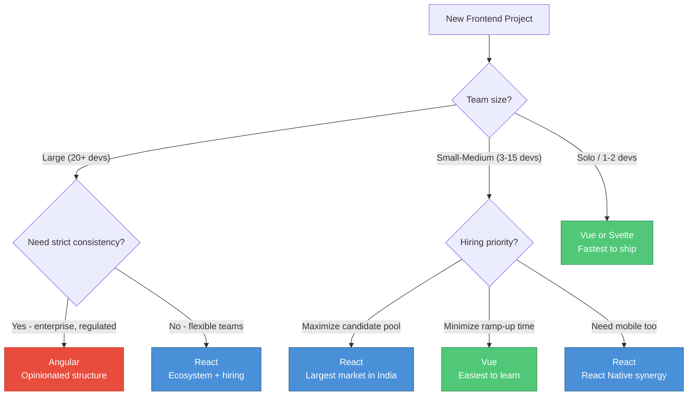
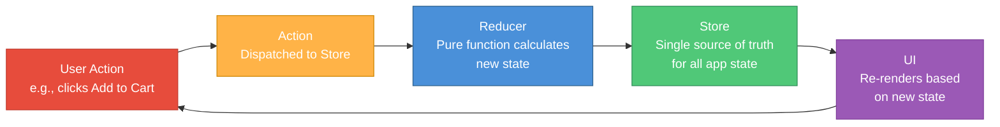
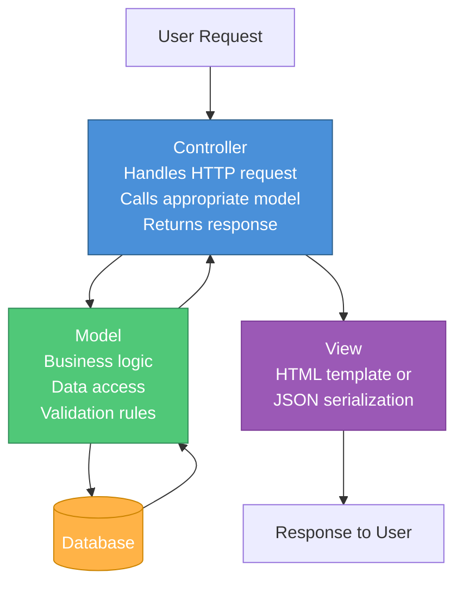

# Session 03 — Frontend & Backend Deep Dive (Continued)

> **Core Question:** How do frontend and backend architectural decisions made in the early stages of a product compound over time — and what should PMs know to prevent costly reversals? #pm-implication

---

## Deep Dive: React vs Angular vs Vue

In Session 02 we compared [[Frontend-Frameworks]] at a glance. Today we go deeper into the architectural philosophies and PM trade-offs. #framework

### React — The Unopinionated Library

**Philosophy:** React provides the View layer only. Everything else — routing, state management, data fetching — is chosen by the team from a rich ecosystem.

**Architecture:**
- **JSX** — Combines HTML-like markup and JavaScript logic in a single file
- **Hooks** — Functions like `useState`, `useEffect` that manage component state and side effects
- **One-way data flow** — Data flows from parent to child components via "props"

**PM Trade-offs:**
| Advantage | Risk |
|---|---|
| Flexibility to pick best-in-class tools for each concern | "Decision fatigue" — teams spend time choosing and debating libraries |
| Massive hiring pool (especially in India) | Every React codebase looks different — onboarding varies |
| React Native enables mobile code sharing | React Native != React for web — do not assume 100% reuse |
| Largest ecosystem of UI component libraries | Ecosystem churn — popular libraries get abandoned or replaced |

### Angular — The Opinionated Framework

**Philosophy:** Angular provides everything out of the box. One way to do routing, one way to do HTTP calls, one way to do forms. The framework makes the decisions so the team does not have to.

**Architecture:**
- **Modules and Dependency Injection** — Formal structure for organizing large codebases
- **RxJS Observables** — Reactive programming for handling async events
- **Two-way data binding** — Changes in the UI automatically update the model and vice versa
- **Angular CLI** — Code generation and scaffolding tools

**PM Trade-offs:**
| Advantage | Risk |
|---|---|
| Consistency across large teams and codebases | Steep learning curve (TypeScript + RxJS + DI + decorators) |
| All Angular projects look similar — easier to onboard or outsource | Heavier framework — larger bundle sizes |
| Enterprise support from Google | Slower iteration speed compared to React/Vue |
| Built-in testing infrastructure | Over-engineering for small/medium apps |

### Vue — The Progressive Framework

**Philosophy:** Vue is "progressive" — start with just the view layer and progressively adopt routing, state management, and build tools as your app grows.

**Architecture:**
- **Single File Components (SFC)** — HTML template, JavaScript logic, and CSS scoping in one `.vue` file
- **Composition API** (Vue 3) — Flexible logic reuse similar to React Hooks
- **Reactivity system** — Fine-grained dependency tracking without Virtual DOM diffing overhead (Vue 3)

**PM Trade-offs:**
| Advantage | Risk |
|---|---|
| Gentlest learning curve — fastest for small teams to become productive | Smaller ecosystem than React |
| Excellent documentation (widely praised) | Smaller hiring pool, especially in India |
| Can be incrementally adopted into existing projects | Less battle-tested in very large-scale applications |
| Community-driven (not tied to a single corporation) | Single creator dependency risk (mitigated by growing team) |

### When to Choose Which — The Decision Matrix for PMs



> **Case Study — CRED's Frontend Choice:** CRED chose React for their consumer-facing app (credit card bill payments), citing the large React talent pool in Bangalore and the ability to share component logic with their React Native mobile app. Their back-office admin tools use Angular for its structured, form-heavy approach. This dual-framework strategy is common when consumer-facing and internal products have fundamentally different needs. #case-study #india-context

---

## Component-Based Architecture

Modern frontend development is built on the principle of **components** — self-contained, reusable pieces of UI that manage their own rendering and behavior. #definition

### The Component Mental Model

Think of components like LEGO bricks:

```
Page (App Component)
├── Header Component
│   ├── Logo Component
│   ├── Navigation Component
│   │   ├── NavItem Component (Home)
│   │   ├── NavItem Component (Products)
│   │   └── NavItem Component (About)
│   └── SearchBar Component
├── Main Content Component
│   ├── ProductCard Component (repeated N times)
│   │   ├── ProductImage Component
│   │   ├── ProductTitle Component
│   │   ├── PriceTag Component
│   │   └── AddToCartButton Component
│   └── Pagination Component
└── Footer Component
```

### Component Architecture Principles

1. **Single Responsibility** — Each component does one thing well
2. **Reusability** — A `Button` component is used across the entire app, not recreated on each page
3. **Composition** — Complex UIs are built by combining simple components
4. **Encapsulation** — Component internals are hidden from the outside; interact only through defined interfaces (props/events)

### Design Systems as Component Libraries

A **design system** is a collection of reusable components with consistent styling and behavior guidelines. #definition

| Design System | Organization | Framework |
|---|---|---|
| Material Design (MUI) | Google | React |
| Ant Design | Alibaba | React |
| Atlassian Design System | Atlassian | React |
| Carbon | IBM | React, Vue, Angular |
| Polaris | Shopify | React |
| Lightning | Salesforce | Web Components |

#pm-implication — As a PM, advocate for a design system early. It pays off exponentially:
- **Consistency** — Every button, modal, and form looks the same across the product
- **Velocity** — Engineers assemble from pre-built components rather than designing from scratch
- **Accessibility** — Accessibility standards are built into the components once and applied everywhere
- **Handoff clarity** — Designers and engineers share a common vocabulary

---

## State Management: The Hardest Problem in Frontend

[[State-Management]] refers to how your application tracks and updates data that changes over time — user inputs, API responses, UI toggles, authentication status, shopping cart contents. #definition

### Why State Management Is Hard

In a simple app, data flows from parent to child. But in a complex app:
- A shopping cart badge in the header needs to update when a product is added on a different page
- User authentication status affects dozens of components across the app
- Real-time notifications need to appear anywhere in the UI
- Undo/redo requires tracking the entire history of state changes

### State Management Solutions

| Solution | Framework | Approach | Complexity | Best For |
|---|---|---|---|---|
| **Component State** (useState / data) | All | Local to one component | Low | Simple, isolated state |
| **Context API** | React | Shared state via provider/consumer tree | Medium | Theme, auth, language — infrequently changing global state |
| **Redux** | React (primarily) | Single global store with predictable actions/reducers | High | Large apps with complex state interactions |
| **Redux Toolkit (RTK)** | React | Simplified Redux with less boilerplate | Medium | Modern Redux projects |
| **Zustand** | React | Lightweight global store without Redux ceremony | Low-Medium | When Redux is too heavy |
| **Pinia** | Vue | Official Vue state management (replaced Vuex) | Medium | All Vue 3 applications |
| **NgRx** | Angular | Redux-inspired, RxJS-based reactive state | High | Large Angular applications |
| **Signals** | Angular, Solid, Svelte | Fine-grained reactivity primitives | Low-Medium | Performance-critical updates |

### The Redux Pattern (Conceptual)

Redux follows a strict unidirectional data flow: #framework



#pm-implication — State management complexity is a leading cause of frontend bugs. When your team reports "weird state bugs" or "data getting out of sync," ask about their state management strategy. Overly complex state management slows down development; too little leads to bugs in complex flows.

---

## Backend Frameworks: The Builder's Toolkit

Backend frameworks provide the scaffolding for building server-side applications — handling HTTP requests, connecting to databases, managing authentication, and defining business logic. #framework

### Framework Comparison

| Framework | Language | Philosophy | Learning Curve | Performance | Best For |
|---|---|---|---|---|---|
| **Express.js** | Node.js | Minimal, unopinionated | Low | Good (I/O-bound) | APIs, microservices, BFFs |
| **NestJS** | Node.js / TypeScript | Opinionated, Angular-inspired | Medium-High | Good | Enterprise Node.js, structured APIs |
| **FastAPI** | Python | Modern, async, auto-docs | Low-Medium | Excellent (for Python) | ML-serving APIs, modern Python backends |
| **Django** | Python | Batteries-included, ORM-first | Medium | Good | Full-stack web apps, admin-heavy products |
| **Spring Boot** | Java | Enterprise-grade, convention-based | High | Excellent | Banking, fintech, large enterprise |
| **Ruby on Rails** | Ruby | Convention over configuration | Medium | Moderate | MVPs, startups, content platforms |
| **Gin** | Go | Minimal, high-performance | Medium | Excellent | High-throughput APIs, infrastructure |

### Express.js — The Minimalist

The most popular Node.js framework. A "Hello World" API in Express is ~5 lines of code. It provides routing and middleware — everything else is an add-on.

**Used by:** Uber, IBM, Accenture, PayPal

### FastAPI — The Modern Python Choice

FastAPI leverages Python type hints to automatically generate API documentation (OpenAPI/Swagger). It is async-native and among the fastest Python frameworks. #definition

**Used by:** Microsoft, Uber, Netflix, many Indian AI/ML startups

### Django — The Full-Stack Python Framework

Django follows the "batteries included" philosophy: ORM, admin panel, authentication, forms, and templating are all built in. Its auto-generated admin interface is a superpower for internal tools. #definition

**Used by:** Instagram, Spotify, Pinterest, Razorpay #india-context

### Spring Boot — The Enterprise Standard

Spring Boot is the dominant Java framework in enterprise India. It provides dependency injection, security, data access, and cloud-native features out of the box. #definition

**Used by:** Most Indian banks, TCS, Infosys, Wipro clients

> **Case Study — PhonePe's Backend Stack:** PhonePe, India's largest UPI payments app, uses Java/Spring Boot for their core payment processing (where Java's mature ecosystem and thread handling provide the reliability banking requires) and Python/FastAPI for their data and ML services (where Python's data science libraries are essential). This polyglot approach — different languages for different services — is the norm in modern architecture. #case-study #india-context

---

## RESTful Architecture Principles

[[REST-API]] (Representational State Transfer) is an architectural style for designing networked applications. Most APIs today follow REST principles. #definition

### The Six REST Constraints

1. **Client-Server Separation** — Frontend and backend are independent; either can be replaced without affecting the other
2. **Statelessness** — Each request contains all information needed to process it; the server stores no client context between requests
3. **Cacheability** — Responses must define themselves as cacheable or non-cacheable
4. **Uniform Interface** — Resources are identified by URLs, manipulated through representations (JSON), with self-descriptive messages
5. **Layered System** — Client cannot tell whether it is connected to the end server or an intermediary (load balancer, CDN, proxy)
6. **Code on Demand (optional)** — Servers can extend client functionality by sending executable code (JavaScript)

### RESTful URL Design

Good REST APIs treat URLs as **nouns** (resources) and HTTP methods as **verbs** (actions): #framework

| Operation | HTTP Method | URL Pattern | Example |
|---|---|---|---|
| List all | GET | `/resources` | `GET /api/products` |
| Get one | GET | `/resources/:id` | `GET /api/products/42` |
| Create | POST | `/resources` | `POST /api/products` |
| Update (full) | PUT | `/resources/:id` | `PUT /api/products/42` |
| Update (partial) | PATCH | `/resources/:id` | `PATCH /api/products/42` |
| Delete | DELETE | `/resources/:id` | `DELETE /api/products/42` |

**Anti-patterns to watch for:**
- `GET /getProducts` — Verb in the URL (redundant with HTTP method)
- `POST /deleteProduct/42` — Using POST for deletion
- `GET /api/v1/product-list-all` — Inconsistent naming

---

## Middleware and the Request Processing Pipeline

**Middleware** is software that sits between the incoming HTTP request and your application logic. Each middleware function can inspect, modify, or reject the request before passing it to the next step. #definition

### The Request Pipeline


### Common Middleware Functions

| Middleware | Purpose | PM Relevance |
|---|---|---|
| **Authentication** | Verifies user identity (JWT, session tokens) | Without this, anyone can access protected endpoints |
| **Authorization** | Checks user permissions (role-based access) | Ensures users only see what they should |
| **Rate Limiting** | Caps requests per user/IP per time window | Prevents abuse, protects from DDoS |
| **Logging** | Records each request (method, URL, status, latency) | Essential for debugging and analytics |
| **CORS** | Controls which domains can make cross-origin requests | Misconfigured CORS blocks legitimate frontend calls |
| **Body Parsing** | Parses JSON/form data from request body | Without it, the server cannot read POST data |
| **Compression** | gzip/brotli compresses responses | Reduces bandwidth, improves load times |
| **Validation** | Checks request data against schema | Catches bad input before it hits business logic |

#pm-implication — When an API returns unexpected errors, ask: "At which middleware step is the request failing?" This mental model helps you triage issues faster. A 401 error means authentication middleware rejected the request. A 429 means rate limiting middleware kicked in.

---

## Monolith vs Microservices

This is one of the most consequential architectural decisions a team makes, and PMs should understand the trade-offs because it affects velocity, hiring, and operational complexity. #framework

### Monolith Architecture

All code runs as a single, unified application. One codebase, one deployment, one database. #definition

**Advantages:**
- Simple to develop, test, and deploy initially
- No network latency between components (everything is in-process)
- Easy to debug (single log stream, single process)
- Transaction management is straightforward (single database)

**Disadvantages:**
- Becomes harder to understand as it grows ("the big ball of mud")
- A bug in one module can crash the entire application
- Cannot scale components independently
- Technology lock-in (entire app must use the same language/framework)
- Deployments become risky (any change redeploys everything)

### Microservices Architecture

The application is decomposed into small, independent services. Each service owns its own data, runs its own process, and communicates over the network. #definition

**Advantages:**
- Independent deployment (ship the checkout service without touching search)
- Independent scaling (scale the payment service during sale events)
- Technology diversity (Python for ML, Java for payments, Node.js for real-time)
- Fault isolation (one service crashing does not take down the entire app)
- Team autonomy (each team owns their service end-to-end)

**Disadvantages:**
- Significant operational complexity (service discovery, load balancing, monitoring)
- Network latency between services
- Distributed transactions are hard (two-phase commit, saga pattern)
- Debugging across services requires distributed tracing
- Requires mature DevOps practices (CI/CD, containerization, orchestration)

> **Martin Fowler's advice:** "Don't start with microservices. Start with a monolith, identify the boundaries, and extract services only when you have a good reason." #framework

> **Case Study — Razorpay's Monolith-to-Microservices Journey:** Razorpay started as a Ruby on Rails monolith. As they grew to process millions of transactions, they faced scaling bottlenecks: the payment processing code and the merchant dashboard code were entangled, and a bug in the dashboard could affect payment reliability. They gradually extracted critical paths — payment processing, settlement calculation, merchant onboarding — into independent Go and Java microservices. The lesson: they did not rewrite from scratch; they surgically extracted services where the pain was greatest. #case-study #india-context

---

## Backend Design Patterns

### MVC — Model-View-Controller

The most widely used backend architecture pattern. It separates an application into three interconnected components: #definition



| Component | Responsibility | Example |
|---|---|---|
| **Model** | Business logic and data access | `Order` model with methods like `calculateTotal()`, `applyDiscount()` |
| **View** | Presentation and response formatting | JSON serializer or HTML template |
| **Controller** | Request handling and orchestration | Receives HTTP request, calls model, returns response |

### Repository Pattern

The Repository pattern adds an abstraction layer between the business logic and the data access layer: #definition

- **Without Repository:** Business logic directly contains SQL queries — tightly coupled to the database
- **With Repository:** Business logic calls `userRepository.findByEmail(email)` — the repository handles how and where the data is retrieved

**PM Relevance:** The Repository pattern makes it possible to switch databases (e.g., PostgreSQL to MongoDB) or add caching (Redis layer) without changing business logic. If your team is discussing a database migration, ask whether they have a repository layer — it dramatically affects the migration effort.

### Other Patterns Worth Knowing

| Pattern | What It Does | When It Matters to PMs |
|---|---|---|
| **Service Layer** | Encapsulates business logic separate from controllers | Clean separation makes features easier to estimate |
| **Event-Driven** | Components communicate via events, not direct calls | Enables features like "send email after order placed" without coupling |
| **CQRS** | Separates read and write operations | Optimizes read-heavy products (e.g., product catalogs) |
| **Saga Pattern** | Manages distributed transactions across microservices | Ensures consistency in multi-step processes (order + payment + inventory) |

---

## Key Takeaways for Day 3

1. React (flexibility), Angular (structure), Vue (simplicity) each serve different product and team contexts
2. Component-based architecture enables reusability — advocate for a design system early
3. [[State-Management]] is the hardest frontend problem; the solution must match app complexity
4. Backend framework choice (Express, FastAPI, Django, Spring Boot) shapes development velocity
5. [[REST-API]] design follows resource-based URLs with HTTP verbs — watch for anti-patterns
6. Middleware pipelines process every request through authentication, validation, and logging layers
7. Monolith-first is the safe default; extract microservices only when pain justifies the complexity
8. MVC and Repository patterns create clean separations that make future changes cheaper

---

## Further Reading

- [[Frontend-Frameworks]] — React, Angular, Vue, Svelte deep comparison
- [[State-Management]] — Redux, Pinia, NgRx, and when to use each
- [[REST-API]] — Designing clean, consistent APIs
- [[Backend-Languages]] — Choosing the right language for your backend
- [[Microservices-Architecture]] — When and how to decompose a monolith
- [[Design-Patterns]] — MVC, Repository, CQRS, Event-Driven, Saga
