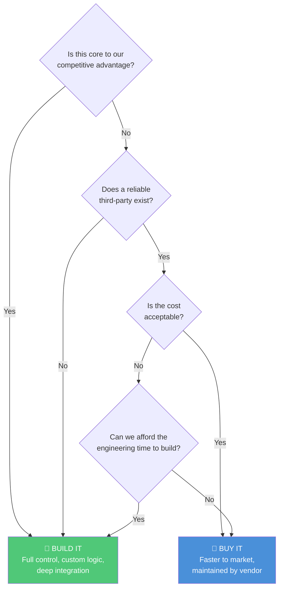

# Session 05 — APIs: Advanced Patterns & Integration Strategy

> **Key Insight:** The real PM skill with APIs is not knowing how to code them — it is knowing how to *evaluate*, *plan*, and *govern* them. Every integration is a long-term commitment with hidden costs.

---

## API Versioning Strategies

[[API-Versioning]] is one of the most consequential technical decisions a PM will encounter. Once an API is public, you cannot simply change it — hundreds or thousands of consumers depend on the contract you published.

### Why Versioning Matters

When your product evolves, the underlying data model and endpoints change. Without versioning, every change is a breaking change for existing consumers. Versioning lets you evolve without destroying trust. #definition

### Three Versioning Approaches

| Strategy | Example | Pros | Cons |
|----------|---------|------|------|
| **URL Path** | `api.example.com/v2/users` | Easy to understand, cacheable, visible | URL pollution, hard to deprecate cleanly |
| **Query Parameter** | `api.example.com/users?version=2` | Optional, backward-compatible | Easy to miss, not RESTful purists' choice |
| **Header-based** | `Accept: application/vnd.api+json;version=2` | Clean URLs, flexible | Hidden from browser, harder to test |

### PM Implication #pm-implication

- **URL Path versioning** is the industry default — use it unless there is a strong reason not to
- Always maintain at least **two active versions** during transitions
- Set a **sunset policy** (e.g., "v1 deprecated in 6 months, removed in 12")
- Communicate deprecation timelines via developer changelog, email, and dashboard warnings

---

## Rate Limiting and Throttling

[[Rate-Limiting]] controls how many API requests a consumer can make in a given time window. This is not just a technical concern — it is a **business model lever** and a **reliability safeguard**. #definition

### How Rate Limiting Works

```
Consumer sends request → API gateway checks counter
  → Under limit? → Process request, increment counter
  → Over limit?  → Return 429 Too Many Requests
```

### Common Rate Limiting Patterns

- **Fixed Window:** 1000 requests per hour (resets at the top of each hour)
- **Sliding Window:** 1000 requests in any rolling 60-minute period
- **Token Bucket:** Tokens refill at a steady rate; each request costs a token
- **Leaky Bucket:** Requests processed at a fixed rate; excess queued or rejected

### Why PMs Must Understand This #pm-implication

1. **Pricing tiers** are often defined by rate limits (free = 100/day, pro = 10,000/day)
2. **Partner integrations** may break silently if you hit their rate limits
3. **Your own API** needs rate limits to prevent a single consumer from degrading service for all
4. When consuming third-party APIs, always ask: "What happens when we hit the limit?"

### Real-World Example #case-study

**Twitter/X API (2023 rate limit changes):** When Twitter drastically reduced free-tier rate limits, thousands of third-party apps broke overnight. Apps like Tweetbot shut down entirely. This is a cautionary tale — rate limits are a business weapon, not just a technical dial.

---

## API Documentation: OpenAPI/Swagger & Postman

Good [[API-Documentation]] is the difference between an API that developers love and one they abandon. #definition

### OpenAPI/Swagger

- **OpenAPI Specification (OAS)** is the industry standard for describing REST APIs
- A machine-readable YAML/JSON file that describes every endpoint, parameter, request body, and response
- **Swagger UI** renders this spec into interactive documentation where developers can try endpoints live

### Postman

- A collaborative platform for API development
- PMs use Postman **collections** to understand and test API behavior without writing code
- Shareable — your engineering team can give you a Postman collection to explore an API yourself

### What PMs Should Look For in API Docs

1. **Authentication guide** — How do I get started? (API key, OAuth, etc.)
2. **Quick start** — Can I make my first call in under 5 minutes?
3. **Error reference** — What does each error code mean?
4. **Rate limit documentation** — What are the limits? How are they communicated?
5. **Changelog** — What changed recently? What is deprecated?
6. **SDKs/Libraries** — Are there pre-built libraries for common languages?

---

## API Lifecycle Management

[[API-Lifecycle]] spans from initial design to eventual deprecation. Every stage has PM decisions. #framework


### Stage-by-Stage PM Responsibilities

| Stage | PM Role |
|-------|---------|
| **Design** | Define use cases, write API requirements, review contracts |
| **Build** | Prioritize endpoints, negotiate scope with engineering |
| **Test** | Validate against real consumer scenarios, edge cases |
| **Deploy** | Coordinate rollout, update docs, notify consumers |
| **Monitor** | Track adoption, error rates, latency, usage patterns |
| **Iterate** | Add endpoints, fix pain points from developer feedback |
| **Deprecate** | Communicate sunset timeline, migrate consumers |
| **Retire** | Turn off old version, archive documentation |

---

## Build vs Buy for Integrations

[[Build-vs-Buy]] is a strategic decision that PMs face constantly. The guiding principle is simple but powerful: #framework

> **"Secret sauce = Build. Plumbing = Buy."**

### The Decision Framework



### Examples

| Scenario | Decision | Reasoning |
|----------|----------|-----------|
| Payment processing for an e-commerce app | **Buy** (Razorpay/Stripe) | Plumbing — PCI compliance alone would take months |
| Recommendation engine for a streaming platform | **Build** | Secret sauce — this *is* the product differentiator |
| Email sending for notifications | **Buy** (SendGrid/SES) | Plumbing — email deliverability is a solved problem |
| Search within your product | **Depends** | If search *is* the product (Google), build. If it is a feature (blog search), buy (Algolia) |

---

## 5 Questions Before Integrating a Partner API

Before committing to any third-party API integration, PMs must ask these five questions: #framework

1. **Reliability:** What is their uptime SLA? What happens when they go down?
2. **Scalability:** Can they handle our growth? What are the rate limits at scale?
3. **Cost trajectory:** How does pricing change as we grow? Are there volume discounts or cliffs?
4. **Lock-in risk:** How hard is it to switch to an alternative? Is data portable?
5. **Security & compliance:** Do they meet our data residency, encryption, and privacy requirements?

### The "Bus Factor" Test #pm-implication

> "If this API provider shut down tomorrow, how screwed are we?"

If the answer is "very," you need a mitigation plan: abstraction layers, fallback providers, or cached data strategies.

---

## The Hidden Work Behind Integrations

Every integration looks simple on the surface ("just call their API") but hides significant complexity underneath. Here is the 6-step breakdown of what integration actually involves: #framework

### Step 1: Discovery & Evaluation
- Read documentation, test in sandbox, evaluate reliability
- Check for SDKs, community support, case studies
- Estimate total cost (licensing + engineering + maintenance)

### Step 2: Contract & Authentication
- Negotiate terms of service, SLAs, data usage agreements
- Implement authentication (API keys, OAuth 2.0, mutual TLS)
- Set up secure credential management (never hardcode keys)

### Step 3: Error Handling
- Handle every possible failure: timeouts, rate limits, malformed responses, downtime
- Implement retry logic with exponential backoff
- Build circuit breakers to prevent cascading failures

### Step 4: Data Mapping & Transformation
- Map their data model to yours (field names, formats, enums)
- Handle edge cases: null values, unexpected types, missing fields
- Validate incoming data — never trust external data blindly

### Step 5: Testing
- Unit tests for each endpoint integration
- Integration tests with sandbox/staging environments
- Load tests to verify behavior under production traffic
- Chaos testing: what happens when the partner API is slow or down?

### Step 6: Monitoring & Maintenance
- Track latency, error rates, and usage metrics
- Set up alerts for anomalies (sudden spike in 5xx errors)
- Monitor for API version changes, deprecation notices
- Budget ongoing engineering time for maintenance (typically 20-30% of initial build effort per year)

### PM Takeaway #pm-implication

> When an engineer says "that integration will take 2 weeks," they usually mean *just step 2 and part of step 3.* The full lifecycle is 3-5x that estimate. Always ask: "Does that include error handling, testing, and monitoring?"

---

## API Myths vs Reality

| Myth | Reality |
|------|---------|
| "APIs are plug-and-play" | Every integration requires custom error handling, data mapping, and testing |
| "REST is the only API style" | GraphQL, gRPC, WebSocket, and event-driven APIs all have valid use cases |
| "Public API = stable API" | Public APIs change, deprecate, and sometimes break without warning |
| "More endpoints = better API" | A well-designed API with 10 endpoints beats a bloated one with 100 |
| "API documentation is engineering's job" | PM should own the *what* and *why*; engineering owns the *how* |

---

## India Context: API-Driven Ecosystems #india-context

### UPI — The World's Largest Open API Ecosystem

[[UPI]] (Unified Payments Interface) is a masterclass in API-driven platform strategy:

- **Open specification** published by NPCI — any bank or fintech can integrate
- **4-party model:** Payer PSP → NPCI Switch → Payee PSP → Bank
- **46B+ transactions/month** (2024) — the largest real-time payment network globally
- **API design choices that drove adoption:**
  - Simple collect/pay request model
  - VPA (Virtual Payment Address) abstraction — no need to share bank details
  - Mandate API for recurring payments
  - QR code standardization

### ONDC — Open Network for Digital Commerce

[[ONDC]] applies the UPI model to e-commerce:

- **Unbundled architecture:** Buyer apps, seller apps, logistics, and payments are separate
- **Beckn protocol** — open API specification for discovery, ordering, fulfillment, and post-order
- **PM implication:** Instead of building a marketplace, you build a *node* on the network
- Challenge: unlike UPI (simple payment), commerce has far more complex state machines (order → confirm → ship → deliver → return → refund)

### Aadhaar eKYC Flow

[[Aadhaar-eKYC]] is an API-first identity verification system:

1. User provides Aadhaar number + consent
2. Your app calls UIDAI's eKYC API
3. User authenticates via OTP or biometric
4. UIDAI returns verified demographic data (name, DOB, address, photo)
5. Your app receives structured, verified identity — no manual document checks

**Scale:** 1.4B enrolled, millions of authentications daily. This API replaced weeks of manual KYC for banks and fintechs.

---

## PM Playbook: Writing API Requirements

### How to Write API Requirements for Engineering #pm-implication

A PM should never write "we need an API." Instead, write requirements that answer:

1. **Who** is the consumer? (Internal team, partner, public developer)
2. **What** data or action do they need? (Read user profile, create order, trigger notification)
3. **How often** will they call it? (10/minute or 10,000/second)
4. **What latency** is acceptable? (Under 200ms for user-facing, under 5s for batch)
5. **What authentication** is required? (API key for internal, OAuth for partners)
6. **What happens on failure?** (Retry? Fallback? Queue for later?)

### How to Evaluate a Third-Party API

| Criteria | What to Check |
|----------|---------------|
| Documentation quality | Can a new developer get started in 30 minutes? |
| Sandbox/testing | Is there a free sandbox environment? |
| Uptime history | Check status page history (e.g., on StatusPage or DownDetector) |
| Community & support | Active forums? Responsive support? Stack Overflow presence? |
| Pricing transparency | Are costs clear? Any hidden overage charges? |
| Data portability | Can you export your data if you leave? |
| Security certifications | SOC 2, ISO 27001, GDPR compliance? |

---

## Key Takeaways

1. [[API-Versioning]] is a product decision — choose URL path versioning as default
2. [[Rate-Limiting]] is both a technical safeguard and a business model lever
3. "Secret sauce = Build, Plumbing = Buy" — the simplest [[Build-vs-Buy]] framework
4. Every integration hides 6 layers of work — factor this into estimates
5. India's [[UPI]], [[ONDC]], and [[Aadhaar-eKYC]] are world-leading examples of API-first public infrastructure
6. [[API-Lifecycle]] management is continuous — APIs are products, not features

---

## Discussion Questions

1. Your startup uses a third-party API for core functionality. They announce a 10x price increase. What do you do?
2. You are building the PM spec for ONDC integration. How would you structure the [[API-Lifecycle]] from discovery to monitoring?
3. A partner API has 99.5% uptime. Is that good enough for a payments product? Calculate the downtime.

---

*Next session: [[Session-06-Databases-Foundations]] — Why the database is the skeleton of every product*
