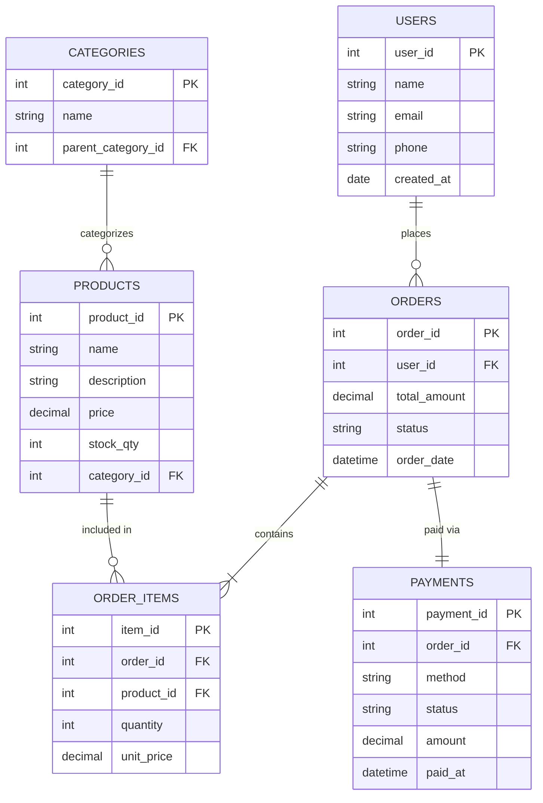
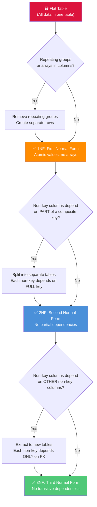

# Session 06 — Databases: Foundations for Product Managers

> **Key Insight:** The database schema is not a technical detail — it is a *product architecture decision*. What you can store determines what features you can build. What you cannot query efficiently determines what features will be slow, expensive, or impossible.

---

## What Is a Database?

A database is a structured system for storing, organizing, and retrieving data. Every product you use — every app, every website, every service — has at least one database behind it. #definition

### The Simplest Mental Model

Think of a database as a collection of **spreadsheets** (tables), where:
- Each **table** represents one type of thing (users, orders, products)
- Each **row** (record) represents one specific instance (user #4523)
- Each **column** (field) represents one attribute of that thing (name, email, created_at)

### Example: Users Table

| user_id (PK) | name | email | city | created_at |
|---|---|---|---|---|
| 1 | Priya Sharma | priya@email.com | Mumbai | 2024-01-15 |
| 2 | Rahul Verma | rahul@email.com | Delhi | 2024-02-20 |
| 3 | Aisha Khan | aisha@email.com | Bangalore | 2024-03-10 |

---

## Primary Keys and Foreign Keys

[[Primary-Keys]] and [[Foreign-Keys]] are the glue that holds a relational database together. #definition

### Primary Key (PK)

- A **unique identifier** for each row in a table
- No two rows can have the same primary key value
- Cannot be NULL (empty)
- Usually an auto-incrementing integer (`user_id: 1, 2, 3...`) or a UUID

### Foreign Key (FK)

- A column in one table that **references the primary key** of another table
- Creates a **relationship** between tables
- Enforces **referential integrity** — you cannot create an order for a user that does not exist

### How They Connect

```
USERS table                    ORDERS table
+-----------+--------+         +----------+-----------+---------+
| user_id   | name   |         | order_id | user_id   | total   |
| (PK)      |        |         | (PK)     | (FK→Users)| (INR)   |
+-----------+--------+         +----------+-----------+---------+
| 1         | Priya  |    ←──  | 101      | 1         | 1,299   |
| 2         | Rahul  |    ←──  | 102      | 2         | 3,499   |
| 3         | Aisha  |    ←──  | 103      | 1         | 899     |
+-----------+--------+         +----------+-----------+---------+
```

Priya (user_id=1) has two orders (101, 103). The `user_id` column in Orders is a **foreign key** pointing back to Users.

---

## SQL vs NoSQL: The Great Divide

[[SQL-Basics]] and [[NoSQL-Databases]] represent two fundamentally different philosophies about data storage. #framework

### SQL (Relational) Databases

- **Structured** data in tables with fixed schemas
- **ACID** guarantees: Atomicity, Consistency, Isolation, Durability
- Best for: structured data with clear relationships, financial transactions, any data where correctness matters more than speed
- Examples: PostgreSQL, MySQL, Oracle, SQL Server

### NoSQL (Non-Relational) Databases

- **Flexible** schemas — each record can have different fields
- **BASE** model: Basically Available, Soft state, Eventually consistent
- Best for: unstructured or semi-structured data, massive scale, rapid iteration
- Examples: MongoDB, Redis, Cassandra, Neo4j

### Side-by-Side Comparison

| Dimension | SQL | NoSQL |
|-----------|-----|-------|
| **Schema** | Fixed, defined upfront | Flexible, schema-on-read |
| **Data model** | Tables with rows & columns | Documents, key-value, graphs, wide-column |
| **Relationships** | JOINs across tables | Embedded/nested documents or manual references |
| **Scaling** | Vertical (bigger machine) | Horizontal (more machines) |
| **Consistency** | Strong (ACID) | Eventual (BASE) — tunable in some systems |
| **Query language** | SQL (standardized) | Varies by database |
| **Best for** | Banking, ERP, inventory | Social feeds, IoT, caching, content management |

### PM Decision Guide #pm-implication

> **Default to SQL (PostgreSQL)** unless you have a specific, justified reason to use NoSQL. Most products start with relational data, and PostgreSQL can handle far more scale than most startups will ever need.

---

## Types of NoSQL Databases

Not all NoSQL databases are the same. Each type is optimized for a different access pattern. #definition

### 1. Document Store — MongoDB

- Stores data as JSON-like **documents** (BSON)
- Each document can have a different structure
- Great for: content management, user profiles, product catalogs
- Think of it as: a filing cabinet where each folder can contain different forms

```json
{
  "user_id": "u_4523",
  "name": "Priya Sharma",
  "addresses": [
    {"type": "home", "city": "Mumbai", "pin": "400001"},
    {"type": "work", "city": "Pune", "pin": "411001"}
  ],
  "preferences": {"theme": "dark", "language": "en"}
}
```

### 2. Key-Value Store — Redis

- Simplest model: a key maps to a value
- Blazing fast because everything is stored in **memory**
- Great for: caching, session storage, leaderboards, rate limiting
- Think of it as: a dictionary or hash map

### 3. Wide-Column Store — Cassandra

- Tables with rows and columns, but each row can have **different columns**
- Designed for massive write throughput across many servers
- Great for: time-series data, IoT sensor data, activity logs
- Used by: Netflix (viewing history), Instagram (feed), Apple (iCloud)

### 4. Graph Database — Neo4j

- Stores data as **nodes** (entities) and **edges** (relationships)
- Queries traverse relationships, not scan tables
- Great for: social networks, recommendation engines, fraud detection
- Think of it as: LinkedIn's connection graph — "people you may know" is a graph query

---

## ER Diagrams: The Blueprint of Your Data

[[ER-Diagrams]] (Entity-Relationship Diagrams) are the architectural blueprints of a database. PMs should be able to read them fluently and sketch rough ones on a whiteboard. #framework

### Components

- **Entity (Box):** A thing you store data about (User, Order, Product)
- **Attribute (inside the box):** A property of the entity (name, email, price)
- **Relationship (Line):** How entities connect (User *places* Order)
- **Cardinality (symbols on the line):** How many of one entity relate to another

### Crow's Foot Notation

```
──────||──────   One and only one (1:1)
──────|<──────   One to many (1:N)
──────>|<─────   Many to many (M:N)

||  = exactly one
|<  = one to many
O|  = zero or one
O<  = zero or many
```

### E-Commerce ER Diagram



### Reading This Diagram #pm-implication

- One **User** can place many **Orders** (one-to-many)
- Each **Order** contains one or more **Order Items** (one-to-many)
- Each **Order Item** references one **Product** (many-to-one)
- Each **Order** has exactly one **Payment** (one-to-one)
- Each **Category** can contain many **Products** (one-to-many)
- Categories can be nested (parent_category_id references the same table)

**Why ORDER_ITEMS exists:** Users buy multiple products in one order. The ORDER_ITEMS table (a "junction table") breaks the many-to-many relationship between Orders and Products into two one-to-many relationships. This is a fundamental database pattern.

---

## Normalization: Eliminating Data Chaos

[[Normalization]] is the process of organizing data to reduce redundancy and prevent anomalies. #definition

### The Problem: A Flat Table

Imagine storing everything in one giant table:

| order_id | customer_name | customer_email | product_name | product_price | quantity | order_date |
|---|---|---|---|---|---|---|
| 101 | Priya Sharma | priya@email.com | Wireless Mouse | 899 | 1 | 2024-03-15 |
| 101 | Priya Sharma | priya@email.com | USB Cable | 199 | 2 | 2024-03-15 |
| 102 | Rahul Verma | rahul@email.com | Wireless Mouse | 899 | 1 | 2024-03-16 |

**Problems with this flat table:**

1. **Update anomaly:** If Priya changes her email, you must update *every row* with her data
2. **Insert anomaly:** You cannot add a new product without creating a fake order
3. **Delete anomaly:** If you delete order 102, you lose the information that Rahul exists
4. **Storage waste:** Priya's name and email are duplicated in every row of her orders

### Normalization Process Flow



### 1NF — First Normal Form

**Rule:** Each cell contains a single (atomic) value. No arrays, no comma-separated lists.

**Violation:** A "phone_numbers" column containing "9876543210, 9123456789"
**Fix:** Create a separate `phone_numbers` table with one row per phone number.

### 2NF — Second Normal Form

**Rule:** Already in 1NF + every non-key column depends on the *entire* primary key (not just part of a composite key).

**Violation:** In a table with composite key (order_id, product_id), the column `customer_name` depends only on order_id, not on product_id.
**Fix:** Move `customer_name` to the Orders table.

### 3NF — Third Normal Form

**Rule:** Already in 2NF + no non-key column depends on another non-key column.

**Violation:** In a table with columns (product_id, category_id, category_name), `category_name` depends on `category_id`, not on `product_id`.
**Fix:** Create a separate Categories table.

### The Normalized Result

The flat table above becomes four clean tables:
- **Users** (user_id, name, email)
- **Products** (product_id, name, price)
- **Orders** (order_id, user_id, order_date)
- **Order_Items** (item_id, order_id, product_id, quantity)

No data is duplicated. Every fact is stored exactly once.

---

## When to Denormalize

Normalization optimizes for **write correctness**. But sometimes you need to optimize for **read performance**. #framework

### Why Denormalize?

- JOINing 5 tables to display a product page is expensive at scale
- Pre-computing and storing aggregated data (e.g., `order_count` on the Users table) avoids repeated calculations
- Caching layers often store denormalized data

### When to Denormalize

| Scenario | Action |
|----------|--------|
| Dashboard showing user's total orders | Add `total_orders` column to Users table, update on each order |
| Product listing with average rating | Store `avg_rating` on Products table, recalculate periodically |
| Search results needing data from 4 tables | Create a denormalized "search index" table or use Elasticsearch |

### The PM Rule of Thumb #pm-implication

> **Start normalized. Denormalize only when you have measured a real performance problem.** Premature denormalization creates data consistency nightmares. Normalize first, measure, then selectively denormalize the hot paths.

---

## Schema Is a Product Decision

This is the single most important takeaway from this session: #pm-implication

> **The database schema determines what features are possible, what queries are fast, and what changes are expensive.**

### Examples of Schema-as-Product-Decision

1. **If you don't have a `tags` table for products,** you cannot build tag-based filtering or discovery
2. **If orders don't have a `status` field with defined states,** you cannot build order tracking
3. **If user addresses are stored as a single text field** (not structured city/state/pin), you cannot build location-based features
4. **If you don't track `created_at` and `updated_at` timestamps,** you cannot build "new arrivals" or audit trails

### The Cost of Getting It Wrong #case-study

Changing a schema in production is like renovating the foundation of an occupied building. It requires:
- Writing migration scripts
- Testing against production-scale data
- Coordinating downtime or zero-downtime migration strategies
- Updating every piece of code that touches the changed tables

This is why PMs must be involved in data modeling conversations *early* — not after the schema is built.

---

## Key Takeaways

1. A **database** is structured storage: tables, rows, columns — the skeleton of your product
2. **Primary keys** uniquely identify rows; **foreign keys** create relationships between tables
3. **SQL databases** give you structure and guarantees (ACID); **NoSQL** gives you flexibility and scale (BASE)
4. [[ER-Diagrams]] are the blueprints — learn to read crow's foot notation
5. [[Normalization]] eliminates redundancy: 1NF → 2NF → 3NF, each removing a type of dependency
6. Denormalize selectively and only when you have measured a real performance need
7. Schema is a **product decision** — it determines what you can and cannot build

---

## Discussion Questions

1. You are building a food delivery app. Sketch the [[ER-Diagrams]] for: restaurants, menus, orders, delivery partners, and users. What relationships exist?
2. Your engineering team proposes using MongoDB for everything. What questions would you ask before agreeing? When might you push back toward PostgreSQL?
3. A feature request comes in: "Let users add multiple delivery addresses." What schema change does this require? Why is it more complex than it sounds?

---

*Next session: [[Session-07-Databases-Analytics]] — SQL for PMs, tracking plans, and the data pipeline*
