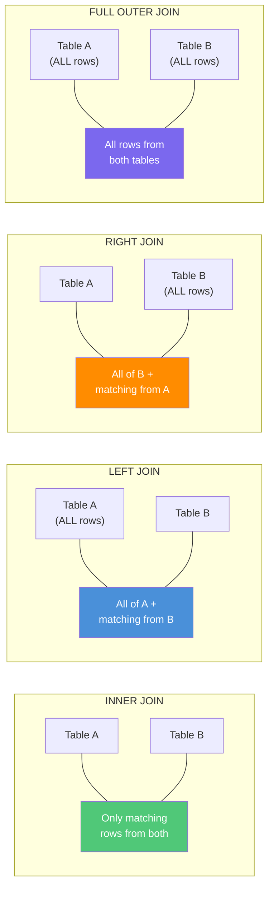
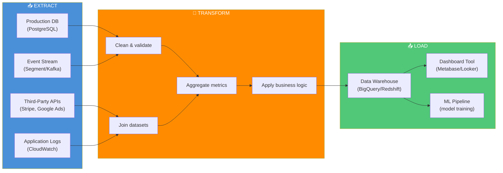
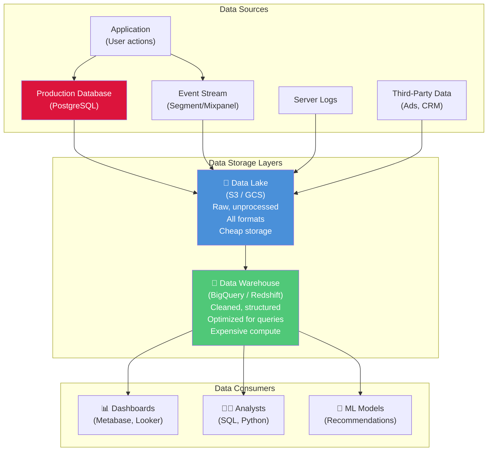

# Session 07 — Databases & Analytics: SQL, Tracking Plans, and Data Pipelines

> **Key Insight:** "If you didn't track it, you can't measure it. If you can't measure it, you can't improve it." Data does not magically appear in dashboards — someone has to decide what to track, instrument it correctly, and pipe it to the right place.

---

## SQL for PMs: The Essential Toolkit

[[SQL-Basics]] (Structured Query Language) is the universal language for talking to relational databases. PMs do not need to write production SQL, but they *must* be able to read queries and write basic analytical ones. #definition

### The Six Core Clauses

Every SQL query is built from these clauses, always in this order:

```sql
SELECT   -- What columns do you want?
FROM     -- Which table(s)?
WHERE    -- Which rows? (filter before grouping)
GROUP BY -- How to aggregate?
HAVING   -- Filter AFTER grouping
ORDER BY -- How to sort the result?
```

### Clause-by-Clause Explanation

| Clause | Purpose | Analogy |
|--------|---------|---------|
| **SELECT** | Choose which columns to display | "I want to see name and total" |
| **FROM** | Specify the table(s) to query | "Look in the orders table" |
| **WHERE** | Filter individual rows before aggregation | "Only rows where city = 'Mumbai'" |
| **GROUP BY** | Collapse rows into groups for aggregation | "Group all orders by customer" |
| **HAVING** | Filter groups after aggregation | "Only show customers with 5+ orders" |
| **ORDER BY** | Sort the final result | "Sort by total spend, highest first" |

### WHERE vs HAVING — The Key Difference #definition

- **WHERE** filters *individual rows* **before** grouping
- **HAVING** filters *groups* **after** aggregation

```sql
-- WHERE: Filter rows first, then count
SELECT city, COUNT(*) as user_count
FROM users
WHERE created_at > '2024-01-01'   -- Only users created this year
GROUP BY city;

-- HAVING: Count first, then filter groups
SELECT city, COUNT(*) as user_count
FROM users
GROUP BY city
HAVING COUNT(*) > 100;            -- Only cities with 100+ users
```

---

## Real SQL Query Walkthrough

Let us walk through progressively complex queries against an e-commerce database. #case-study

### Setup: Our Tables

- **users** (user_id, name, email, city, created_at)
- **orders** (order_id, user_id, total_amount, status, order_date)
- **order_items** (item_id, order_id, product_id, quantity, unit_price)
- **products** (product_id, name, category, price)

### Query 1: Basic — List all orders from Mumbai users

```sql
SELECT u.name, o.order_id, o.total_amount, o.order_date
FROM users u
JOIN orders o ON u.user_id = o.user_id
WHERE u.city = 'Mumbai'
ORDER BY o.order_date DESC;
```

**Reading this:** "Show me the name, order ID, amount, and date for all orders placed by users in Mumbai, most recent first."

### Query 2: Aggregation — Total revenue per city

```sql
SELECT u.city,
       COUNT(o.order_id) AS total_orders,
       SUM(o.total_amount) AS total_revenue,
       ROUND(AVG(o.total_amount), 2) AS avg_order_value
FROM users u
JOIN orders o ON u.user_id = o.user_id
GROUP BY u.city
ORDER BY total_revenue DESC;
```

**Result:**

| city | total_orders | total_revenue | avg_order_value |
|---|---|---|---|
| Mumbai | 12,450 | 45,67,890 | 366.90 |
| Delhi | 10,230 | 38,45,600 | 375.91 |
| Bangalore | 9,870 | 41,23,400 | 417.77 |

### Query 3: Advanced — Top 10 products by repeat purchase rate

```sql
SELECT p.name AS product_name,
       COUNT(DISTINCT oi.order_id) AS times_ordered,
       COUNT(DISTINCT o.user_id) AS unique_buyers,
       ROUND(COUNT(DISTINCT oi.order_id) * 1.0 / COUNT(DISTINCT o.user_id), 2) AS repeat_rate
FROM products p
JOIN order_items oi ON p.product_id = oi.product_id
JOIN orders o ON oi.order_id = o.order_id
WHERE o.status = 'delivered'
GROUP BY p.product_id, p.name
HAVING COUNT(DISTINCT o.user_id) > 50
ORDER BY repeat_rate DESC
LIMIT 10;
```

**PM Insight:** This query reveals which products drive repeat behavior — the foundation of a retention strategy. #pm-implication

---

## Types of JOINs

JOINs are how you combine data from multiple tables. Understanding them is critical for reading any analytical query. #framework

### Visual Representation



### JOIN Types Explained

| JOIN Type | Returns | Use When |
|-----------|---------|----------|
| **INNER JOIN** | Only rows that match in BOTH tables | "Show me users who HAVE placed orders" |
| **LEFT JOIN** | All rows from left table + matches from right | "Show me ALL users, including those with no orders" |
| **RIGHT JOIN** | All rows from right table + matches from left | Rarely used — just swap table order and use LEFT JOIN |
| **FULL OUTER JOIN** | All rows from both tables, matched where possible | "Show me everything, matched or unmatched" |

### Practical Example: Finding Users Who Never Ordered

```sql
SELECT u.name, u.email, u.created_at
FROM users u
LEFT JOIN orders o ON u.user_id = o.user_id
WHERE o.order_id IS NULL
ORDER BY u.created_at;
```

**Reading this:** "Show me all users, include their orders if any, but only keep the ones where order_id is NULL — meaning they never placed an order." This is the classic "find the missing" pattern.

### PM Tip #pm-implication

> LEFT JOIN + WHERE right_table.id IS NULL is the most useful analytical pattern for PMs. It answers: "Who signed up but never converted?" "Which products were viewed but never purchased?" "Which features exist but are never used?"

---

## Analytics Instrumentation

[[Analytics-Instrumentation]] is the practice of embedding tracking code into your product to capture user behavior. Without it, your analytics dashboard is empty. #definition

### Events + Properties Model

Modern analytics (Mixpanel, Amplitude, Segment, CleverTap) use an event-based model:

- **Event:** An action a user takes → `"button_clicked"`, `"order_placed"`, `"page_viewed"`
- **Properties:** Metadata about the event → `{page: "checkout", button_name: "pay_now", amount: 1299}`
- **User Properties:** Attributes of the user → `{plan: "premium", city: "Mumbai", signup_date: "2024-01-15"}`

### Event Taxonomy Example

```
Event: product_viewed
  Properties:
    - product_id: "SKU_4523"
    - product_name: "Wireless Mouse"
    - category: "Electronics"
    - price: 899
    - source: "search_results"

Event: add_to_cart
  Properties:
    - product_id: "SKU_4523"
    - quantity: 1
    - cart_value: 899

Event: checkout_started
  Properties:
    - cart_items_count: 3
    - cart_value: 2,597
    - coupon_applied: true
    - coupon_code: "SAVE10"

Event: order_placed
  Properties:
    - order_id: "ORD_10234"
    - total_amount: 2,337
    - payment_method: "UPI"
    - items_count: 3
```

---

## The Tracking Plan

[[Tracking-Plan]] is the single most important document a PM creates for analytics. It is the contract between product, engineering, and data teams. #framework

### The Golden Rule

> **"If you didn't track it, you can't measure it."**

Every metric on every dashboard traces back to an event someone decided to instrument. If nobody tracked `checkout_abandoned`, you cannot measure cart abandonment rate.

### Tracking Plan Structure

| Event Name | Trigger | Properties | Owner | Priority |
|---|---|---|---|---|
| `page_viewed` | Every screen load | page_name, referrer, load_time_ms | Engineering | P0 |
| `product_viewed` | Product detail page load | product_id, name, category, price, source | Engineering | P0 |
| `add_to_cart` | User taps "Add to Cart" | product_id, quantity, cart_value | Engineering | P0 |
| `checkout_started` | User enters checkout flow | cart_value, items_count, coupon_applied | Engineering | P0 |
| `payment_initiated` | User selects payment method | method, amount, order_id | Engineering | P0 |
| `order_placed` | Order confirmation received | order_id, total, payment_method, items | Engineering | P0 |
| `search_performed` | User submits search | query, results_count, category_filter | Engineering | P1 |

### Naming Conventions #framework

**Use a consistent naming convention across your entire product:**

- **Format:** `object_action` (noun_verb in past tense)
- **Examples:** `product_viewed`, `order_placed`, `button_clicked`, `search_performed`
- **Never:** `viewProduct`, `View Product`, `product-viewed`, `productViewed`

**Why this matters:** Inconsistent naming leads to fractured analytics. If one engineer tracks `cart_added` and another tracks `addToCart`, you have two incomplete funnels instead of one complete one.

### Five Rules for a Good Tracking Plan #pm-implication

1. **Track the funnel, not everything** — Start with your core conversion funnel, then expand
2. **Name consistently** — Use `object_action` format, always lowercase with underscores
3. **Include properties that enable segmentation** — A bare `button_clicked` event with no properties is useless
4. **Document the trigger precisely** — "When the user sees the confirmation screen" not "when the order is placed" (these may differ)
5. **Version your tracking plan** — As the product evolves, the plan evolves. Track changes.

---

## Data Pipelines: ETL

[[Data-Pipelines]] move data from where it is generated to where it is analyzed. [[ETL]] (Extract, Transform, Load) is the most common pattern. #definition

### ETL Pipeline Flow



### ETL in Plain English

1. **Extract:** Pull raw data from multiple sources (your database, event trackers, third-party APIs, logs)
2. **Transform:** Clean it (remove duplicates, handle nulls), standardize it (date formats, currency), and reshape it (join tables, calculate metrics)
3. **Load:** Put the cleaned, structured data into a warehouse where analysts and dashboards can query it fast

---

## Batch vs Streaming Processing

| Dimension | Batch Processing | Stream Processing |
|-----------|-----------------|-------------------|
| **How it works** | Process large chunks of data at scheduled intervals | Process each event as it arrives in real-time |
| **Latency** | Minutes to hours | Milliseconds to seconds |
| **Cost** | Lower (scheduled compute) | Higher (always-on compute) |
| **Use cases** | Daily reports, nightly aggregations, ETL pipelines | Fraud detection, live dashboards, real-time recommendations |
| **Tools** | Apache Spark, AWS Glue, dbt | Apache Kafka, Apache Flink, Amazon Kinesis |
| **When to use** | When "yesterday's data" is good enough | When stale data costs money or creates risk |

### PM Decision Framework #pm-implication

> **Start with batch. Move to streaming only for specific, justified use cases.** Streaming infrastructure is 3-5x more expensive to build and maintain. Most product analytics work perfectly well with data that is a few hours old.

**Exceptions that justify streaming:**
- Fraud detection (must block transactions in real-time)
- Live pricing (ride-hailing surge pricing, stock trading)
- Operational dashboards (delivery tracking, system health)
- Real-time personalization (homepage recommendations during the session)

---

## Data Architecture: Warehouse vs Production DB vs Data Lake



### Three Storage Systems Compared

| Aspect | Production DB | Data Lake | Data Warehouse |
|--------|--------------|-----------|----------------|
| **Purpose** | Run the application | Store everything cheaply | Serve analytical queries |
| **Optimized for** | Fast reads & writes (OLTP) | Cheap bulk storage | Complex queries (OLAP) |
| **Data format** | Structured (tables) | Any (JSON, CSV, Parquet, images) | Structured (tables, views) |
| **Query speed** | Fast for single records | Slow without processing | Fast for aggregations |
| **Cost** | High (always-on compute) | Low (storage only) | Medium (pay per query) |
| **Who uses it** | Your application code | Data engineers | Analysts, PMs, dashboards |
| **Example** | PostgreSQL, MySQL | Amazon S3, Google Cloud Storage | BigQuery, Redshift, Snowflake |

### The Critical Rule #pm-implication

> **Never run analytical queries on the production database.** Heavy analytical queries (GROUP BY millions of rows) will slow down the application for real users. Always use the data warehouse for analytics.

---

## Case Studies #case-study

### Amazon DynamoDB

Amazon built DynamoDB because existing databases could not handle Black Friday-scale traffic. Key design decisions:
- **Key-value and document model** — optimized for simple, high-speed lookups
- **Single-digit millisecond latency** at any scale
- **Auto-scaling** — capacity adjusts to traffic patterns
- **PM lesson:** When your scale breaks existing tools, you build your own. But most companies are not Amazon — use managed services.

### Instagram's PostgreSQL Journey

Instagram famously ran on **PostgreSQL** far longer than people expected:
- Served 1B+ users with PostgreSQL as the primary database
- Used **sharding** (splitting data across multiple PostgreSQL instances) to scale horizontally
- Added **Redis** for caching and **Cassandra** for the feed
- **PM lesson:** PostgreSQL can take you very, very far. Do not over-engineer your database choices early.

### Flipkart's Data Platform

Flipkart processes massive data volumes for India's e-commerce:
- **MySQL** for transactional data (orders, payments)
- **Apache Kafka** for real-time event streaming
- **Apache Hive** on Hadoop for batch analytics
- Custom ML pipeline for product recommendations
- **PM lesson:** Large platforms always end up with [[Polyglot-Persistence]] — different databases for different jobs.

---

## PM Playbook: Writing Good Tracking Plans

### Step-by-Step Process #pm-implication

1. **Start with your metrics** — What KPIs does your team own? (Conversion rate, retention, ARPU)
2. **Map metrics to events** — What user actions produce those metrics?
3. **Define properties for each event** — What context enables segmentation?
4. **Validate with engineering** — Are these technically feasible? What is the effort?
5. **Review with data/analytics** — Can they build the dashboards from these events?
6. **Document and version** — The [[Tracking-Plan]] is a living document

### Understanding Data Latency

| Layer | Typical Latency | Impact |
|-------|----------------|--------|
| Event capture (client-side) | <1 second | User interacts, event fires immediately |
| Event delivery (Segment/Kafka) | 1-30 seconds | Events buffered and batched |
| ETL processing | 15 min - 6 hours | Depends on batch frequency |
| Warehouse availability | 1-24 hours | When analysts can query it |
| Dashboard refresh | 5-60 minutes | When PM sees updated metrics |

**Total: from user action to PM seeing the metric in a dashboard can be anywhere from 30 minutes to 24+ hours.**

> This is why "I launched the feature an hour ago, why don't I see data?" is the most common PM frustration. Understand the latency of your pipeline. #pm-implication

---

## Key Takeaways

1. [[SQL-Basics]] is a PM superpower — learn SELECT, JOIN, GROUP BY, and the LEFT JOIN + IS NULL pattern
2. The [[Tracking-Plan]] is the most important analytics document — "if you didn't track it, you can't measure it"
3. [[Analytics-Instrumentation]] uses events + properties — name consistently, track the funnel first
4. [[ETL]] pipelines move data from production to warehouse — Extract, Transform, Load
5. [[Data-Pipelines]] come in batch (cheaper, delayed) and streaming (expensive, real-time) flavors
6. Never run analytics on the production database — that is what the data warehouse is for
7. Data latency is real — understand the delay between user action and dashboard metric

---

## Discussion Questions

1. You just launched a new checkout flow. Write the [[Tracking-Plan]] — what 8 events would you track to measure its success?
2. Your CEO asks "Why did revenue drop 15% yesterday?" Write the SQL query (conceptually) to investigate.
3. The data team says switching from batch to streaming ETL would cost 3x more. Under what circumstances would you approve it?

---

*Next session: [[Session-08-Databases-Scale]] — Scaling databases for 1.4 billion people*
