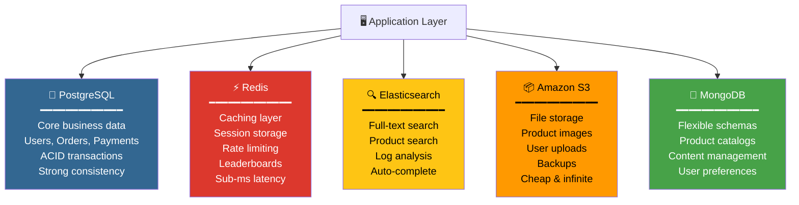
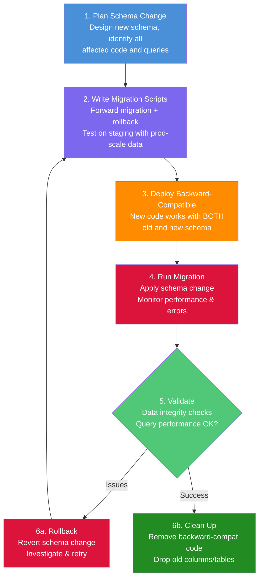
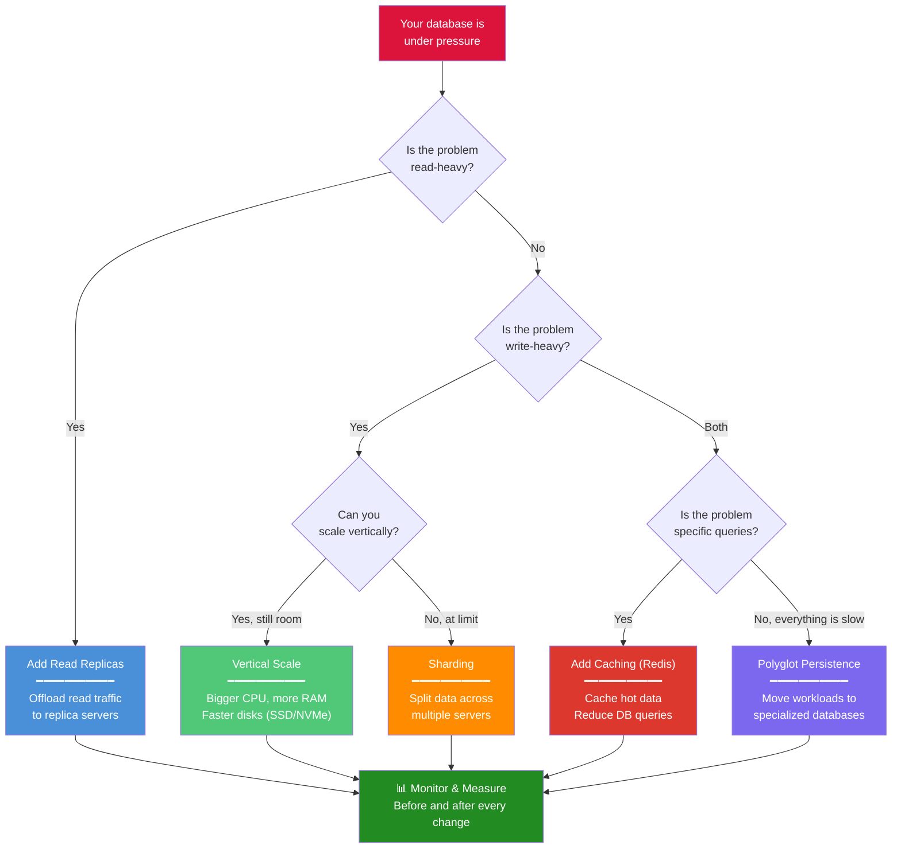

# Session 08 — Databases at Scale: Sharding, Polyglot Persistence, and India's Infrastructure

> **Key Insight:** At India's scale — 1.4 billion people, 46 billion+ UPI transactions per month — "which database?" is the wrong question. The right question is: "Which database for which part of the system?" This is [[Polyglot-Persistence]], and it is how every serious tech company operates.

---

## Database Scaling: Vertical vs Horizontal

[[Database-Scaling]] is what happens when your product succeeds and a single database server can no longer handle the load. You have two fundamental strategies. #definition

### Vertical Scaling (Scale Up)

**Definition:** Make the existing server bigger — more CPU, more RAM, faster disks.

- **Pros:** Simple, no code changes, database stays on one machine
- **Cons:** There is a ceiling (you cannot buy a server with 10TB RAM), increasingly expensive, single point of failure
- **Analogy:** Moving from a sedan to an SUV to a bus. Eventually, there is no bigger vehicle.

### Horizontal Scaling (Scale Out)

**Definition:** Add more servers and distribute the data and load across them.

- **Pros:** Theoretically unlimited scale, built-in redundancy, cost-effective commodity hardware
- **Cons:** Complex to implement, data consistency challenges, requires application changes
- **Analogy:** Instead of one giant bus, use a fleet of cars that coordinate with each other.

### When to Use Which

| Metric | Vertical | Horizontal |
|--------|----------|------------|
| **Users** | < 100K | > 100K |
| **Data size** | < 1 TB | > 1 TB |
| **Writes/second** | < 10K | > 10K |
| **Reads/second** | < 50K | > 50K (with read replicas even lower thresholds justify it) |
| **Budget** | Higher per unit, simpler ops | Lower per unit, complex ops |

### PM Implication #pm-implication

> Most startups should **start vertical** (simpler) and plan for horizontal. The day your single database reaches 70-80% CPU consistently is the day to start planning the horizontal migration. That planning takes months — do not wait until it is at 100%.

---

## Sharding, Replication, and Read Replicas

These three techniques are the building blocks of horizontal scaling. #framework

### Sharding

**Definition:** Splitting your database into multiple smaller databases (**shards**), each holding a subset of the data. #definition

```
Before sharding (1 database):
┌─────────────────────────────────┐
│     ALL USERS (100M rows)       │
└─────────────────────────────────┘

After sharding (4 shards):
┌──────────┐ ┌──────────┐ ┌──────────┐ ┌──────────┐
│ Shard 1  │ │ Shard 2  │ │ Shard 3  │ │ Shard 4  │
│Users A-F │ │Users G-L │ │Users M-R │ │Users S-Z │
│ 25M rows │ │ 25M rows │ │ 25M rows │ │ 25M rows │
└──────────┘ └──────────┘ └──────────┘ └──────────┘
```

**Shard Key Selection:** The most critical decision. Common strategies:
- **By user ID** — All of a user's data on one shard (most common)
- **By geography** — Indian users on Indian servers, US users on US servers
- **By tenant** — In B2B SaaS, each company gets a shard
- **By time range** — Recent data on fast storage, old data on cheap storage

**Danger:** A bad shard key creates "hot shards" — one shard gets disproportionate traffic. If you shard by first letter of name and 40% of users have names starting with S, Shard 4 is on fire.

### Replication

**Definition:** Copying data from one database server (primary) to one or more copies (replicas).

- **Purpose:** Redundancy (if primary dies, a replica takes over) and read scaling
- **Synchronous replication:** Replica confirms write before primary acknowledges — strong consistency, higher latency
- **Asynchronous replication:** Primary writes and moves on, replica catches up later — lower latency, brief inconsistency

### Read Replicas

**Definition:** Database copies that handle only read queries, reducing load on the primary.

```
                 ┌─── Read Replica 1 ←── Dashboard queries
                 │
Primary DB ──────┼─── Read Replica 2 ←── API read requests
(writes only)    │
                 └─── Read Replica 3 ←── Search/analytics
```

**PM Consideration:** Data on read replicas may be a few seconds behind the primary. This means a user might place an order (write to primary) and immediately check their order history (read from replica) and not see their order. This is called **replication lag**, and PMs must decide which features can tolerate it. #pm-implication

---

## Polyglot Persistence

[[Polyglot-Persistence]] means using multiple database technologies within a single system, each optimized for its specific use case. This is how every large-scale product actually works. #framework

### Architecture Diagram



### Why Not Just Use One Database for Everything?

| Need | Wrong Tool | Right Tool | Why |
|------|-----------|------------|-----|
| Full-text product search | PostgreSQL LIKE queries | Elasticsearch | PostgreSQL scans every row; Elasticsearch uses inverted indexes |
| Session caching | PostgreSQL | Redis | Disk I/O for every page load vs. in-memory microsecond lookups |
| Product images | PostgreSQL BLOB | S3 | Databases are not file systems; S3 is built for unlimited object storage |
| Real-time leaderboards | PostgreSQL ORDER BY | Redis Sorted Sets | Sorted sets are O(log N) for insert and rank lookup |
| Flexible content | PostgreSQL | MongoDB | Frequent schema changes are expensive in relational databases |

### The PM Rule #pm-implication

> **Always ask: "Which database for which part of the system?"** Accept that the answer will usually be "at least three."

---

## India at Scale #india-context

India's technology infrastructure operates at a scale that most countries never encounter. Understanding this context is essential for any PM building for the Indian market.

### The Numbers

| Metric | Scale |
|--------|-------|
| Population | 1.4 billion |
| Internet users | 900M+ |
| Smartphone users | 750M+ |
| UPI transactions/month | 46B+ (as of 2024) |
| Aadhaar enrollments | 1.38B+ |
| Daily UPI transaction value | Rs. 20+ lakh crore/month |
| IRCTC peak bookings | 25 lakh+ tickets/day |

### What "India Scale" Means for Databases

1. **Burst traffic:** Diwali sales, IPL matches, exam results create 10-100x normal traffic
2. **Language diversity:** 22 official languages — your database must handle Unicode and multi-script text
3. **Network variability:** Users on 2G, 3G, 4G, 5G — your system must handle partial failures and retries
4. **Cost sensitivity:** Infrastructure costs must stay low — cannot throw money at the problem like a Silicon Valley startup
5. **Data localization:** RBI mandates that payment data must be stored in India

---

## Indian Company Database Choices #case-study

### PhonePe — CockroachDB

- **Problem:** Needed ACID transactions across distributed infrastructure for payments
- **Choice:** CockroachDB — a distributed SQL database
- **Why:** SQL compatibility (engineers already know it) + horizontal scaling + strong consistency across data centers
- **PM Lesson:** For financial data, consistency is non-negotiable. CockroachDB gives PostgreSQL-level guarantees at distributed scale.

### Ola Maps — PostGIS

- **Problem:** Geospatial queries — "find all drivers within 2km of this location"
- **Choice:** PostgreSQL with PostGIS extension
- **Why:** PostGIS adds geographic data types and spatial indexes to PostgreSQL. A query like "find points within a polygon" runs in milliseconds.
- **PM Lesson:** Sometimes the right answer is not a new database but an extension to one you already run.

### Zerodha — PostgreSQL + TimescaleDB

- **Problem:** Stock market data — millions of price ticks per second, must be stored and queried as time-series
- **Choice:** PostgreSQL for core data + TimescaleDB (a PostgreSQL extension) for time-series
- **Why:** TimescaleDB handles time-series partitioning and compression natively. Zerodha processes 15M+ orders/day.
- **PM Lesson:** Zerodha is famously lean — 30 engineers for India's largest brokerage. They chose boring, reliable technology over trendy alternatives.

### Dream11 — Redis + MongoDB

- **Problem:** Fantasy sports — millions of users making team selections simultaneously before match deadline
- **Choice:** Redis for real-time contest management + MongoDB for flexible contest configurations
- **Why:** Redis handles the burst (everyone submitting at 7:29 PM before a 7:30 PM deadline). MongoDB handles the variety (every contest has different rules and structures).
- **PM Lesson:** [[Polyglot-Persistence]] in action — Redis for speed where it matters, MongoDB for flexibility where it matters.

### IRCTC — Oracle (Modernizing)

- **Problem:** Legacy Oracle system struggling with 25 lakh+ bookings/day during Tatkal
- **Current state:** Modernizing with microservices, caching layers, and CDN
- **PM Lesson:** Technical debt is real. The cost of *not* modernizing grows every year. But migration from a legacy system at this scale is a multi-year project with enormous risk.

---

## Swiggy Reorder Feature: A Case Study #case-study

### The Feature

"Reorder" — a user taps one button and their previous order is added to cart. Sounds simple. It is not.

### The Database Challenge

To power "Reorder," you need to answer quickly:
1. What did this user order last from this restaurant?
2. Are those items still available on the current menu?
3. Have the prices changed?
4. Is the restaurant currently open?
5. Can the restaurant deliver to the user's current location?

### The Data Architecture

| Query | Database | Why |
|-------|----------|-----|
| User's order history | PostgreSQL (or sharded equivalent) | Relational, transactional data |
| Restaurant menu | MongoDB or similar | Menus change frequently, flexible schema |
| Restaurant availability | Redis | Real-time status, must be fast |
| Location/delivery check | PostGIS or geo-service | Spatial query |
| Price verification | Menu service (live API call) | Prices must be current |

### PM Takeaway

A single "Reorder" button tap triggers queries across at least 4 different data systems. The feature is simple for the user and complex for the system. **PMs must understand this gap between user simplicity and system complexity.** #pm-implication

---

## Database Myths vs Reality

| Myth | Reality |
|------|---------|
| "NoSQL is always faster than SQL" | PostgreSQL with proper indexing often outperforms poorly designed NoSQL. Speed depends on schema design and query patterns, not database category. |
| "We need to scale horizontally from day one" | Vertical scaling takes you much further than you think. Instagram served 1B users on PostgreSQL before sharding. |
| "MongoDB is good for everything" | MongoDB sacrificed transactions and JOINs for flexibility. For financial data, you need ACID — use a relational database. |
| "More data = better decisions" | More *clean, relevant* data = better decisions. Most companies drown in data they never use while missing the 5 metrics that matter. |
| "Database choice is purely a technical decision" | Database choice determines what features are feasible, what queries are fast, and what migrations will cost in the future. It is a product decision. |

---

## Top 5 PM Mistakes with Data

### Mistake 1: Not Being Involved in Data Modeling

**The mistake:** "Schema design is an engineering decision."
**The reality:** The schema determines what features you can build. If the schema does not have a `referral_source` field on the users table, you will never know which marketing channel brought each user. Get involved early.

### Mistake 2: Assuming Data Exists

**The mistake:** "For the quarterly review, show me conversion by device type."
**The reality:** Nobody tracked device type in the event properties. The data does not exist. This is why [[Tracking-Plan]] documents are essential. #pm-implication

### Mistake 3: Ignoring Data Quality

**The mistake:** Building dashboards on dirty data.
**The reality:** If 15% of orders have `NULL` city values, your "revenue by city" dashboard is wrong by at least 15%. Data quality is a feature, not a nice-to-have.

### Mistake 4: Underestimating Migration Costs

**The mistake:** "Let's just switch from MySQL to PostgreSQL, how hard can it be?"
**The reality:** Database migrations at scale involve months of dual-writing, data validation, performance testing, and rollback planning. See [[Schema-Migration]] below.

### Mistake 5: Optimizing for the Wrong Bottleneck

**The mistake:** "Our site is slow, we need a faster database."
**The reality:** 90% of the time, the slowness is missing indexes, unoptimized queries, or lack of caching — not the database itself. Investigate before migrating.

---

## Schema Migration: The Hardest Thing Nobody Talks About

[[Schema-Migration]] is the process of changing your database structure in production. It is one of the most expensive and risky operations in software engineering. #definition

### What Triggers a Schema Migration

- Adding a new feature that requires new tables or columns
- Splitting a monolith into microservices (each service needs its own database)
- Switching database technologies (MySQL to PostgreSQL, SQL to NoSQL)
- Performance optimization (adding indexes, partitioning tables, denormalizing)
- Compliance requirements (data residency, encryption at rest)

### Why It Is Expensive

1. **Data volume:** Migrating 500M rows takes hours, not seconds
2. **Zero downtime requirement:** Users cannot see an "under maintenance" page for 6 hours
3. **Dual-write period:** During migration, both old and new systems must stay in sync
4. **Rollback plan:** If something goes wrong at 3 AM, you must be able to undo everything
5. **Code changes:** Every query, every ORM model, every API response that touches the changed schema must be updated
6. **Testing:** Production-scale testing requires a copy of production data (anonymized) and production-like infrastructure

### The Migration Process



### PM Implication #pm-implication

> **Every time you request a new feature, ask: "Does this require a schema change?"** If yes, add 2-4 weeks to the estimate for migration planning and execution. Schema changes are the hidden cost of "simple" features.

### How to Plan for It

1. **Design schemas to be extensible** — Use JSONB columns for flexible metadata
2. **Version your schemas** — Track every migration with tools like Flyway or Alembic
3. **Plan for the migration before building v1** — Ask "What might change in 6-12 months?"
4. **Budget engineering time** — Schema migrations are not bugs or features; they are infrastructure work that needs dedicated sprint time

---

## Database Scaling Strategies: Summary Diagram



---

## Key Takeaways

1. **Vertical scaling** is simpler; **horizontal scaling** is more powerful — start vertical, plan for horizontal
2. **Sharding** splits data across servers; choose your shard key carefully to avoid hot shards
3. **Read replicas** offload read traffic but introduce replication lag — decide which features can tolerate it
4. [[Polyglot-Persistence]] is not optional at scale — "which database for which part of the system?"
5. India operates at extraordinary scale — 46B+ UPI transactions/month, and companies like PhonePe, Zerodha, and Dream11 have made deliberate, thoughtful database choices
6. [[Schema-Migration]] is expensive and risky — factor it into every feature estimate
7. The five PM data mistakes are all avoidable with early involvement and a good [[Tracking-Plan]]

---

## The PM's Database Cheat Sheet

| When You Need... | Use... | Example |
|---|---|---|
| Transactions and consistency | PostgreSQL / CockroachDB | Payments, orders, inventory |
| Blazing-fast reads/caching | Redis | Sessions, leaderboards, rate limits |
| Full-text search | Elasticsearch | Product search, log analysis |
| Flexible documents | MongoDB | Product catalogs, CMS content |
| Time-series data | TimescaleDB / InfluxDB | Stock prices, IoT, server metrics |
| Graph relationships | Neo4j | Social connections, fraud detection |
| Geospatial queries | PostGIS | Ride-hailing, delivery radius |
| Massive file storage | Amazon S3 / GCS | Images, videos, backups |
| Massive write throughput | Cassandra / ScyllaDB | Activity feeds, IoT sensors |

---

## Discussion Questions

1. You are building a food delivery app for tier-2 Indian cities. Design the [[Polyglot-Persistence]] architecture — which databases for which parts of the system, and why?
2. Your team wants to add a "Favorites" feature. Does this require a [[Schema-Migration]]? What are the options (new table vs. JSONB column vs. separate service)?
3. IRCTC handles 25 lakh bookings/day with a legacy Oracle system. If you were the PM tasked with modernization, what would your 3-year migration roadmap look like?

---

*Module 1 database sessions complete. Next: [[Session-09-Cloud-Computing]] — Where all these databases actually live*
