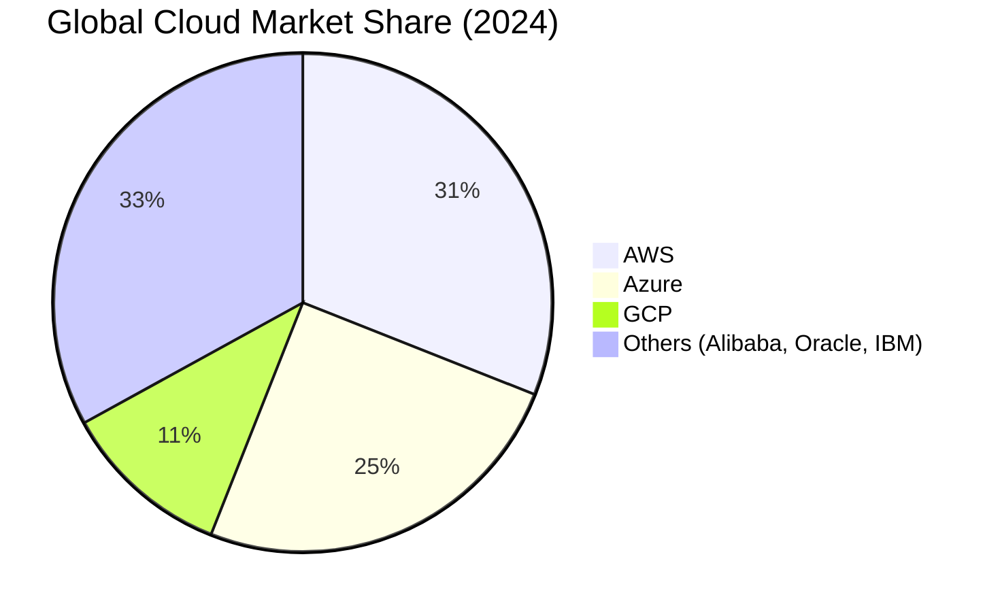
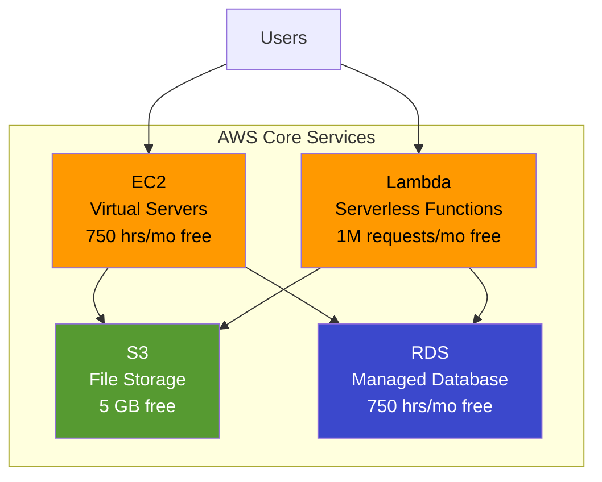
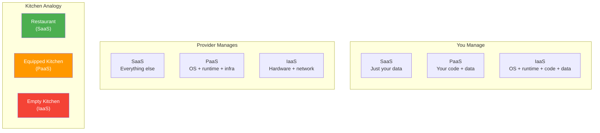
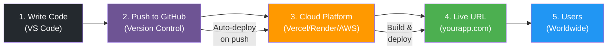

# Session 09 - Cloud & Deployment: Renting the Infrastructure

## What Is the Cloud?

### The Electricity Analogy #definition

The simplest way to understand [[Cloud-Computing]] is through an analogy every household understands: **electricity**.

Before the electrical grid existed, every factory had to build and maintain its own power generator. This meant:
- Massive upfront investment in generator equipment
- Hiring engineers to maintain the generator
- Paying for fuel whether you used the power or not
- If demand spiked, you were stuck unless you bought a bigger generator

Then the **electrical grid** arrived. Factories could simply plug in, pay for what they used, and let the power company worry about generation, maintenance, and scaling.

**The cloud is the electrical grid for computing.** #framework

| Aspect | Electricity | Cloud Computing |
|--------|------------|-----------------|
| Old model | Own generator | Own servers |
| New model | Plug into grid | Plug into cloud |
| Payment | Pay per kWh | Pay per hour/GB |
| Scaling | Buy bigger generator | Click a button |
| Maintenance | Your problem | Provider's problem |

> **Key insight:** The cloud is not a place. It is not a fluffy thing in the sky. It is simply **someone else's computer** that you rent by the hour, minute, or second.

### Three Things the Cloud Gives You #definition

At its core, every [[Cloud-Computing]] provider sells three fundamental resources:

1. **Computing Power** -- Virtual machines, containers, serverless functions. This is the "brain" that runs your code. Example: [[AWS]] EC2 instances, Azure Virtual Machines.

2. **Storage** -- Places to keep files, images, videos, databases. From simple file storage to sophisticated database engines. Example: [[AWS]] S3 buckets, Google Cloud Storage.

3. **Network** -- The pipes connecting your app to users worldwide. Content delivery networks, load balancers, DNS services. Example: AWS CloudFront, Azure CDN.

Everything else -- machine learning services, analytics, IoT platforms -- is built on top of these three primitives.

---

## Before Cloud vs. With Cloud

### The Cost Revolution #pm-implication

Understanding the economics of cloud computing is critical for every PM making build-vs-buy decisions.

**Before Cloud (Traditional IT):**
- $10,000 - $50,000 upfront for servers
- 3-6 months to procure and set up hardware
- Hire system administrators ($80K-$150K/year)
- Over-provision for peak capacity (waste money 90% of the time)
- Hardware depreciates; obsolete in 3-5 years
- Your responsibility when things break at 3 AM

**With Cloud (Pay-as-you-go):**
- $0 upfront (most providers offer free tiers)
- Minutes to spin up a server
- Provider handles maintenance, security patches, hardware failures
- Scale up for peak, scale down when quiet
- Always running latest hardware
- Provider's team handles infrastructure 24/7

> **PM math:** A startup that would have spent $30K on servers + $120K/year on a sysadmin can now launch on cloud for under $100/month and scale only when revenue justifies it. #pm-implication

---

## Top Cloud Platforms

### The Big Three #framework

The cloud market is dominated by three hyperscalers. Their combined market share exceeds 67%:

| Provider | Market Share | Parent Company | Strength |
|----------|-------------|----------------|----------|
| [[AWS]] (Amazon Web Services) | **31%** | Amazon | Most services, largest ecosystem |
| [[Azure]] (Microsoft Azure) | **25%** | Microsoft | Enterprise integration, Windows/.NET |
| [[GCP]] (Google Cloud Platform) | **11%** | Google | AI/ML, data analytics, Kubernetes |

### Developer-Friendly Platforms

For startups, student projects, and MVPs, the Big Three can be overwhelming. These platforms abstract away complexity: #framework

| Platform | Best For | Free Tier |
|----------|----------|-----------|
| **Vercel** | Frontend/Next.js apps | Generous free hobby plan |
| **Render** | Full-stack apps | Free web services (with sleep) |
| **Railway** | Quick backend deploys | $5 free credit/month |
| **Supabase** | Backend-as-a-service (Firebase alternative) | 500MB database, 1GB storage free |

> **When to use what:** Big Three for production enterprise apps. Developer platforms for MVPs, prototypes, and learning. Many startups start on Vercel/Render and graduate to AWS/GCP as they scale. #pm-implication

---

## AWS Deep Dive

### Core Services Every PM Should Know #definition

[[AWS]] offers 200+ services. A PM needs to understand these four:

**1. EC2 (Elastic Compute Cloud) -- Servers**
- Virtual machines you rent by the hour
- Choose CPU, RAM, storage like configuring a laptop
- You manage the operating system, software, and security
- Free tier: 750 hours/month of t2.micro (1 vCPU, 1 GB RAM) for 12 months

**2. S3 (Simple Storage Service) -- Storage**
- Unlimited file storage: images, videos, backups, static websites
- "Buckets" hold your files; each file gets a unique URL
- 99.999999999% durability (11 nines -- you will not lose files)
- Free tier: 5 GB storage, 20,000 GET requests/month for 12 months

**3. RDS (Relational Database Service) -- Databases**
- Managed databases: PostgreSQL, MySQL, SQL Server, Oracle
- AWS handles backups, patching, replication
- Free tier: 750 hours/month of db.t2.micro for 12 months

**4. Lambda -- Serverless Functions**
- Run code without managing servers at all
- Upload a function; it runs when triggered (API call, file upload, schedule)
- Pay only when code executes (per 100ms)
- Free tier: 1 million requests + 400,000 GB-seconds/month -- **forever**

---

## Azure vs. GCP Comparison

### Side-by-Side #framework

| Feature | [[Azure]] | [[GCP]] |
|---------|-----------|---------|
| **Compute** | Virtual Machines | Compute Engine |
| **Serverless** | Azure Functions | Cloud Functions |
| **Storage** | Blob Storage | Cloud Storage |
| **Database** | Azure SQL, Cosmos DB | Cloud SQL, Firestore |
| **AI/ML** | Azure AI Services | Vertex AI, BigQuery ML |
| **Free tier** | $200 credit (30 days) + always-free services | $300 credit (90 days) + always-free services |
| **India regions** | 3 (Central, South, West) | 2 (Mumbai, Delhi) |
| **Best for** | Enterprise, Microsoft shops | AI/data, Kubernetes |

### The Quick Decision Rule #framework

> **Your company runs Microsoft?** --> [[Azure]]
> **Heavy AI/data workloads?** --> [[GCP]]
> **Most options and ecosystem?** --> [[AWS]]
> **Learning or building MVP?** --> Developer platforms (Vercel, Render, Railway)

This is a simplification, but it is the right starting heuristic for 80% of decisions. #pm-implication

---

## Cloud Service Types -- The Kitchen Analogy

### IaaS, PaaS, SaaS Explained #definition

[[IaaS-PaaS-SaaS]] is one of the most important frameworks in cloud computing. The kitchen analogy makes it intuitive:

**IaaS (Infrastructure as a Service) -- Empty Kitchen** #definition
- You get: bare walls, plumbing, electricity (raw servers, storage, network)
- You bring: appliances, ingredients, recipes, cooking skills
- You control: everything from OS to application code
- Examples: AWS EC2, Azure VMs, Google Compute Engine
- Analogy: renting an empty commercial kitchen -- maximum control, maximum responsibility

**PaaS (Platform as a Service) -- Equipped Kitchen** #definition
- You get: fully equipped kitchen with ovens, fridges, utensils (runtime, database, deployment tools)
- You bring: ingredients and recipes (your code and data)
- You control: application code and data only
- Examples: Heroku, Render, Railway, Google App Engine, Azure App Service
- Analogy: renting a professional kitchen -- focus on cooking, not plumbing

**SaaS (Software as a Service) -- Ordering from a Restaurant** #definition
- You get: the finished dish (complete application)
- You bring: your appetite and credit card (configuration and data)
- You control: settings and your own data
- Examples: Gmail, Slack, Salesforce, Notion, Figma
- Analogy: dining at a restaurant -- no cooking, no cleaning, just consume

### Where Most Startups Sit: The PaaS Sweet Spot #pm-implication

Most startups and growth-stage companies operate in the **PaaS zone** because:

1. **Speed:** Deploy in minutes, not days
2. **Cost:** No infrastructure team needed
3. **Focus:** Engineers write features, not server configs
4. **Scaling:** Platform handles traffic spikes automatically

> **The graduation path:** Most successful products start at PaaS (Heroku/Render), graduate to IaaS (AWS/GCP) as they hit scale, and their users consume the product as SaaS.

---

## The Deployment Journey

### From Code to Users #framework

The modern [[Deployment-Pipeline]] follows a predictable path:

**Step-by-step:**
1. **Write code** locally on your laptop (VS Code, terminal)
2. **Push to [[GitHub]]** -- your code goes to a central repository
3. **Cloud platform detects the push** and automatically builds your app
4. **App goes live** at a URL (e.g., `myapp.vercel.app` or `myapp.onrender.com`)
5. **Users access** the app from anywhere in the world

### Why GitHub in the Middle? #definition

[[GitHub]] (or GitLab, Bitbucket) sits at the center of the deployment pipeline for four critical reasons:

1. **Single Source of Truth** -- Everyone on the team works from the same codebase. No "which version is the latest?" confusion.

2. **Collaboration** -- Multiple developers can work on different features simultaneously using branches, then merge their work.

3. **Auto-Deploy (CI/CD)** -- Cloud platforms watch your GitHub repo. When you push new code, they automatically build and deploy. This is [[CI-CD]] -- Continuous Integration / Continuous Deployment.

4. **Rollback** -- Something broke in production? Roll back to the previous version in seconds. GitHub keeps every version of your code forever.

> **PM insight:** When your engineering team says "we pushed to production," what actually happened is: a developer merged code into the main branch on GitHub, which triggered an automatic deployment to the cloud platform, which built and replaced the running application -- all in 2-5 minutes. #pm-implication

---

## India Context #india-context

### Flipkart Big Billion Days -- Cloud Scaling in Action #case-study

During the **Big Billion Days** sale, Flipkart handles:
- **10x normal traffic** in the first hour
- Millions of concurrent users
- Thousands of orders per second

Flipkart uses a **hybrid cloud strategy** (own data centers + AWS/Azure) to:
- Pre-provision extra capacity days before the sale
- Auto-scale during peak hours
- Scale back down after the sale ends (pay only for what was used)

**Without cloud:** Flipkart would need to buy servers for peak capacity and leave them idle 360 days a year. **With cloud:** They rent extra capacity for 5 days and return it.

### Data Residency Requirements #india-context

India's regulatory landscape increasingly requires data to stay within Indian borders:
- **RBI mandate:** Payment data must be stored in India
- **DPDP Act 2023:** Personal data processing has localization preferences
- All three major cloud providers have India regions (Mumbai, Hyderabad, Delhi)

> **PM consideration:** When choosing a cloud provider for an Indian product, verify that the required services are available in Indian regions. Not all services launch in India simultaneously. #pm-implication

---

## PM Implications: Cloud Decisions Are Product Decisions #pm-implication

### What Every PM Must Understand About Cloud

1. **Cost Structure** -- [[Cloud-Billing]] is usage-based. A viral feature can spike your cloud bill overnight. PMs must understand cost implications of product decisions.

2. **Service Tier Selection** -- Choosing between IaaS, PaaS, and SaaS affects team size, speed, and flexibility. This is a product strategy decision, not just a technical one.

3. **Vendor Lock-in** -- Moving from AWS to GCP is not trivial. The initial cloud choice has long-term implications. PMs should be part of this decision.

4. **Global Availability** -- Cloud regions determine latency for users. An app hosted only in US-East will be slow for Indian users. PMs must specify performance requirements by geography.

5. **Compliance** -- Data residency, industry regulations, and privacy laws constrain cloud choices. PMs must know these constraints before writing requirements.

### Questions a PM Should Ask #framework

- [ ] What is our monthly cloud budget, and what triggers cost alerts?
- [ ] Which cloud services are we using, and is there a cheaper alternative?
- [ ] Where is our data physically stored? Does it meet regulatory requirements?
- [ ] What happens if our cloud provider has an outage?
- [ ] Can we scale to 10x traffic without re-architecting?
- [ ] Are we using any services outside the free tier that we could optimize?

---

## Key Takeaways

1. **Cloud = renting computing** instead of buying it. Pay for what you use.
2. **Three resources:** compute, storage, network. Everything else is built on top.
3. **Big Three:** AWS (most options), Azure (Microsoft ecosystem), GCP (AI/data).
4. **Service models:** IaaS (empty kitchen), PaaS (equipped kitchen), SaaS (restaurant).
5. **Deployment pipeline:** Code --> GitHub --> Cloud --> Live URL --> Users.
6. **GitHub** is the single source of truth enabling collaboration, auto-deploy, and rollback.
7. **For PMs:** Cloud costs, vendor lock-in, data residency, and scaling are product decisions.

---

## Related Concepts

- [[Cloud-Computing]] | [[IaaS-PaaS-SaaS]] | [[AWS]] | [[Azure]] | [[GCP]]
- [[Deployment-Pipeline]] | [[CI-CD]] | [[GitHub]]
- [[Cloud-Billing]] | [[Serverless-Computing]] | [[Auto-Scaling]]
- [[Data-Residency]] | [[Vendor-Lock-In]]

---

*Module 1 -- Product Management II: Technology & Agile Execution | HSB | Dr. Anand Fadte*
