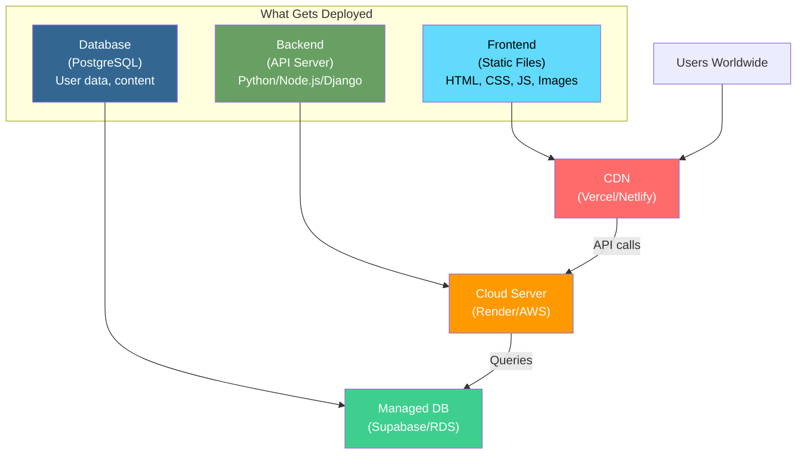
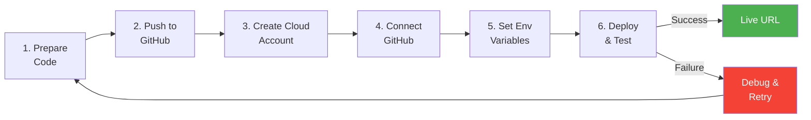
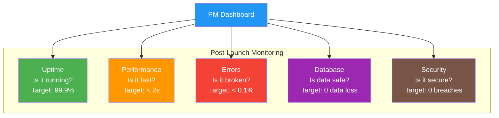

# Session 10 - Cloud: Going Live & Running in Production

## What Gets Deployed?

### Understanding the Pieces #definition

Not everything in your application stack goes to the cloud in the same way. Understanding what gets deployed -- and how -- is fundamental to making smart PM decisions about architecture and cost.

**1. Frontend (Static Files)**
- HTML, CSS, JavaScript, images
- These are "static" -- they do not change per user request
- Served from a CDN (Content Delivery Network) for speed
- Deployed to: Vercel, Netlify, AWS CloudFront + S3, Azure Static Web Apps
- Cost: Often free or very cheap (pennies per GB of bandwidth)

**2. Backend (API Server)**
- Your application logic: user authentication, business rules, database queries
- Runs as a long-lived process on a server (or as serverless functions)
- Deployed to: Render, Railway, AWS EC2/Lambda, Azure App Service, GCP Cloud Run
- Cost: Based on compute hours and memory used

**3. Database (Data Storage)**
- In development: often [[SQLite]] (a simple file-based database)
- In production: [[PostgreSQL]], MySQL, or managed services
- Deployed to: Supabase, Neon, AWS RDS, Azure Database, GCP Cloud SQL
- Cost: Based on storage size, compute, and number of connections

### Mobile Apps: A Special Case #definition

Mobile apps (iOS/Android) are **not deployed to the cloud**. They follow a different path:

- **Distribution:** Uploaded to App Store (Apple) or Play Store (Google)
- **Installation:** Downloaded and installed on the user's device
- **Communication:** The app talks to your **backend API** over the internet
- **Updates:** New versions go through app store review (1-7 days)

> **PM insight:** This is why many teams build "thin" mobile apps that are mostly a shell calling backend APIs. Updating the backend is instant; updating the app requires store approval. #pm-implication

---

## Going Live -- 6 Simple Steps

### The Deployment Checklist #framework

Taking your application from localhost to a live URL follows these six steps:

**Step 1: Prepare Your Code**
- Ensure all features work locally
- Run tests (unit, integration)
- Remove debug/console.log statements
- Set up environment variable references (not hardcoded values)

**Step 2: Push to GitHub**
- Create a repository on [[GitHub]]
- Push your code using `git push`
- Ensure `.gitignore` excludes sensitive files (`.env`, `node_modules/`, `__pycache__/`)

**Step 3: Create a Cloud Account**
- Sign up for your chosen platform (Vercel, Render, Railway, etc.)
- Most offer GitHub OAuth -- sign in with your GitHub account
- Verify free tier limits match your needs

**Step 4: Connect GitHub to Cloud Platform**
- Authorize the cloud platform to access your GitHub repository
- Select the repository and branch to deploy (usually `main`)
- Platform auto-detects framework (React, Django, Flask, etc.)

**Step 5: Set Environment Variables**
- Add all secrets through the cloud platform's dashboard
- Database URL, API keys, secret keys, third-party credentials
- Never put these in code -- see [[Environment-Variables]] section below

**Step 6: Deploy & Test**
- Trigger the first deployment (usually automatic on connection)
- Test the live URL: check all pages, forms, API endpoints
- Monitor logs for errors
- Share the URL with testers

---

## Common First-Deploy Problems #framework

Almost every first deployment fails. Here are the most common issues and their fixes:

| Problem | Symptom | Likely Cause | Fix |
|---------|---------|--------------|-----|
| **App crashes on start** | Platform shows "deploy failed" | Missing environment variables | Add all required env vars in dashboard |
| **500 Internal Server Error** | White error page for users | Database connection failed | Check DATABASE_URL env var; ensure DB is provisioned |
| **Build fails** | Deploy never completes | Missing dependencies in `requirements.txt` or `package.json` | Ensure all packages are listed; run locally first |
| **Static files not loading** | Page loads without CSS/images | Incorrect static file configuration | Configure static file serving for production |
| **CORS errors** | Frontend cannot reach backend | Backend not configured for cross-origin requests | Add frontend URL to CORS allowed origins |
| **"Module not found"** | Import errors in logs | Case sensitivity (macOS vs Linux) | Linux is case-sensitive; fix filenames |
| **Timeout errors** | Pages load forever | Free tier server sleeping | Upgrade plan or implement health checks |

> **PM takeaway:** When your team says "deployment is blocked," it is usually one of these seven issues. Understanding them helps you ask the right questions instead of just waiting. #pm-implication

---

## Environment Variables & Security

### Never Put Passwords in Code #definition

[[Environment-Variables]] are configuration values stored **outside your code** that change between environments. They are the standard way to handle secrets in modern applications.

**What goes in environment variables:**
- Database connection strings (`DATABASE_URL`)
- API keys for third-party services (`STRIPE_SECRET_KEY`, `RAZORPAY_KEY`)
- Application secrets (`SECRET_KEY`, `JWT_SECRET`)
- Feature flags (`ENABLE_NEW_CHECKOUT=true`)
- Environment identifiers (`NODE_ENV=production`)

**Why not just put them in code?**
1. **Security:** Code goes to GitHub. If your password is in code, anyone with repo access (and hackers if the repo leaks) has your password.
2. **Flexibility:** Different values for development, staging, and production without changing code.
3. **Compliance:** Security audits flag hardcoded credentials as critical vulnerabilities.

### Development vs. Production Settings #framework

| Setting | Development | Production |
|---------|------------|------------|
| **Database** | SQLite (local file) | PostgreSQL (cloud-hosted) |
| **Debug mode** | ON (detailed errors) | OFF (generic error pages) |
| **Secret key** | `"dev-secret-123"` | Long random string |
| **API URLs** | `localhost:8000` | `api.yourapp.com` |
| **Email** | Console output | Real SMTP/SendGrid |
| **HTTPS** | Not required | Required |
| **Logging** | Verbose | Structured (JSON) |

> **Critical rule for PMs:** If an engineer ever says "I'll just hardcode the API key for now," treat it as a security incident waiting to happen. Insist on environment variables from day one. #pm-implication

---

## SQLite to PostgreSQL Migration

### Why You Must Migrate #definition

[[Database-Migration]] from SQLite to PostgreSQL is one of the most common steps when going to production.

**SQLite (Development):**
- Single file on your computer
- No server needed
- Perfect for development and prototyping
- Cannot handle multiple simultaneous connections well
- Not suitable for production web applications

**PostgreSQL (Production):**
- Client-server database running on dedicated infrastructure
- Handles thousands of concurrent connections
- ACID compliant with advanced features (JSON, full-text search, spatial data)
- Supported by every cloud provider
- Industry standard for production applications

### Free PostgreSQL Providers #framework

You do not need to pay for a production database when starting out:

| Provider | Free Tier | Best For |
|----------|-----------|----------|
| **Supabase** | 500 MB, 2 projects | Full backend-as-a-service |
| **Neon** | 512 MB, branching | Serverless PostgreSQL |
| **Render** | 1 GB, 90-day limit | Simple managed Postgres |
| **Vercel Postgres** | 256 MB | Vercel-deployed apps |

### Migration Steps (Simplified) #framework

1. **Add PostgreSQL driver** to your project dependencies (`psycopg2` for Python, `pg` for Node.js)
2. **Update database configuration** to read from `DATABASE_URL` environment variable
3. **Run migrations** on the new database (`python manage.py migrate` or equivalent)
4. **Seed initial data** if needed (admin users, configuration records)
5. **Test thoroughly** -- some SQL syntax differs between SQLite and PostgreSQL

> **PM note:** Database migration is a one-time effort during first deployment, but it can surface bugs. Budget 1-2 days for migration and testing in your sprint plan. #pm-implication

---

## Monitoring After Launch

### 5 Things That Go Wrong in Production #framework

Launching is not the finish line -- it is the starting line. Here are the five categories of production issues every PM should watch for:

**1. Downtime (App is unreachable)**
- Server crashes, cloud provider outages, DNS issues
- Impact: Users see error pages; revenue stops
- Monitor: Uptime monitoring (UptimeRobot, Pingdom, Better Uptime)

**2. Slow Performance**
- Pages take >3 seconds to load; API responses are sluggish
- Impact: Users abandon the app; SEO ranking drops
- Monitor: Application Performance Monitoring (New Relic, Datadog)

**3. Errors in Production**
- Unhandled exceptions, failed API calls, broken features
- Impact: Users experience bugs that did not appear in testing
- Monitor: Error tracking (Sentry, Bugsnag, LogRocket)

**4. Database Issues**
- Connection pool exhaustion, slow queries, disk space running out
- Impact: App slows down or crashes under load
- Monitor: Database monitoring dashboards (built into most managed DB services)

**5. Security Incidents**
- Unauthorized access attempts, data breaches, DDoS attacks
- Impact: Data loss, regulatory fines, brand damage
- Monitor: Security monitoring, WAF (Web Application Firewall) logs

---

## Cloud Billing: What You Pay For

### The Four Cost Buckets #definition

[[Cloud-Billing]] breaks down into four main categories:

**1. Compute**
- CPU and memory usage for running your application
- Charged per hour, per second, or per invocation (serverless)
- Biggest lever: right-sizing instances (do not pay for 8 GB RAM if you use 1 GB)

**2. Storage**
- Database storage, file storage (S3/Blob), backups
- Charged per GB per month
- Grows over time as data accumulates; set retention policies

**3. Bandwidth (Egress)**
- Data transferred OUT of the cloud to users
- Ingress (data in) is usually free
- Video/image-heavy apps pay more; use CDNs to reduce costs
- This is where bills can surprise you during viral moments

**4. API Calls / Requests**
- Third-party APIs (maps, payments, AI services) charge per call
- Internal AWS service calls (Lambda invocations, SQS messages) have costs
- Monitor usage; implement caching to reduce redundant calls

> **The $72,000 lesson:** A startup went viral on Reddit. Their image-heavy app served unoptimized 5MB images directly from S3. In one weekend, bandwidth costs hit $72,000. Compress images, use CDNs, set billing alerts. #case-study

---

## PM's Role After Launch #pm-implication

### What a PM Does Not Do

A PM does not SSH into servers, read log files, or debug code. That is engineering's job.

### What a PM Must Know

A PM must have answers to four questions at all times:

**1. Uptime: "Is our app available?"**
- What is our uptime target? (99.9% = 8.7 hours downtime/year)
- What is our actual uptime this month?
- What is the escalation process when the app goes down?

**2. Speed: "Is our app fast?"**
- What is our p50 and p95 response time? (median and worst-case)
- Are any pages consistently slow?
- Have we set performance budgets?

**3. Errors: "Is our app working correctly?"**
- What is our error rate?
- What are the top 5 errors this week?
- Are errors trending up or down?

**4. Costs: "Are we spending wisely?"**
- What is our monthly cloud bill?
- What is our cost per user? (cloud bill / active users)
- Are there any cost anomalies?

> **The PM's dashboard:** Set up a simple dashboard (even a Google Sheet) tracking uptime %, p95 latency, error rate, and monthly cloud cost. Review weekly with engineering. #framework

---

## Real Stories from India #india-context

### Flipkart: Cloud Scaling for Big Billion Days #case-study
Flipkart provisions **10x additional cloud capacity** before every Big Billion Days sale. Their platform team works with AWS and their private cloud to ensure zero downtime during peak traffic. After the sale, they scale back down, paying only for what was used. This elastic scaling model saves Flipkart crores in infrastructure costs annually.

### IRCTC Tatkal: The 10 AM Rush #case-study
IRCTC handles **15 lakh+ concurrent sessions** during Tatkal booking (10 AM daily). Their migration to cloud infrastructure (from legacy on-premise systems) dramatically improved booking success rates. However, the system still struggles during peak festival seasons, demonstrating that cloud alone does not solve all scaling problems -- application architecture matters too.

### Zomato: Multi-Cloud Migration #case-study
Zomato migrated from a single cloud provider to a **multi-cloud architecture** (AWS + custom infrastructure) to reduce costs and avoid vendor lock-in. This reduced their infrastructure costs by ~25% while improving reliability. The migration took over 18 months and was a major engineering initiative.

### Razorpay: Born Cloud-Native #case-study
[[Razorpay]] was built cloud-native from day one on AWS. Processing millions of transactions daily, they use auto-scaling, managed databases, and serverless functions extensively. Their cloud-native architecture enables them to onboard new merchants in minutes rather than weeks.

---

## India-Specific Deployment Considerations #india-context

### RBI Data Residency
- **Mandate:** All payment data must be stored on servers in India
- **Impact:** Cloud providers had to set up India regions; Visa/Mastercard set up local data centers
- **PM action:** If your app handles payments, verify your database and backups are in Indian regions

### Cloud Regions in India

| Provider | Indian Regions | Key Services Available |
|----------|---------------|----------------------|
| **AWS** | Mumbai (ap-south-1), Hyderabad (ap-south-2) | Full service catalog |
| **Azure** | Central India, South India, West India | Most services |
| **GCP** | Mumbai (asia-south1), Delhi (asia-south2) | Most services |

> **Latency matters:** Hosting in US-East and serving Indian users adds 200-300ms latency per request. Always deploy to the region closest to your primary user base. #pm-implication

---

## Key Takeaways

1. **Three things get deployed:** Frontend (static files), Backend (API server), Database (PostgreSQL). Mobile apps go to app stores, not cloud.
2. **6 steps to go live:** Prepare code, push to GitHub, create cloud account, connect GitHub, set env variables, deploy and test.
3. **Environment variables** keep secrets out of code. Never hardcode passwords or API keys.
4. **SQLite --> PostgreSQL** is a required migration for production. Free tiers exist (Supabase, Neon).
5. **Monitor five things:** Uptime, performance, errors, database health, security.
6. **Cloud billing** has four components: compute, storage, bandwidth, API calls. Set billing alerts.
7. **PMs must know** uptime, speed, error rate, and costs -- even if they do not fix the problems directly.

---

## Related Concepts

- [[Deployment-Pipeline]] | [[CI-CD]] | [[Environment-Variables]]
- [[Database-Migration]] | [[PostgreSQL]] | [[SQLite]]
- [[Cloud-Billing]] | [[Auto-Scaling]] | [[CDN]]
- [[Monitoring]] | [[Uptime]] | [[Error-Tracking]]
- [[Cloud-Computing]] | [[IaaS-PaaS-SaaS]]

---

*Module 1 -- Product Management II: Technology & Agile Execution | HSB | Dr. Anand Fadte*
