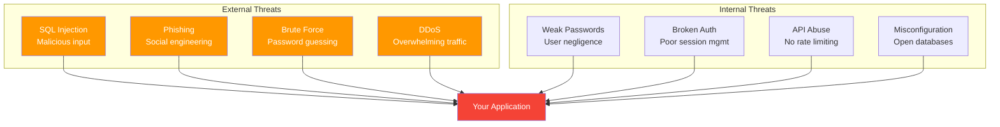
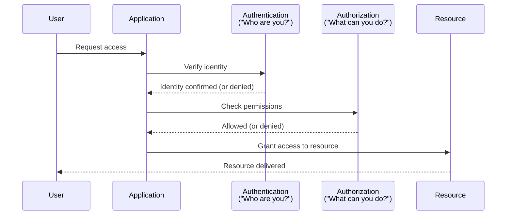
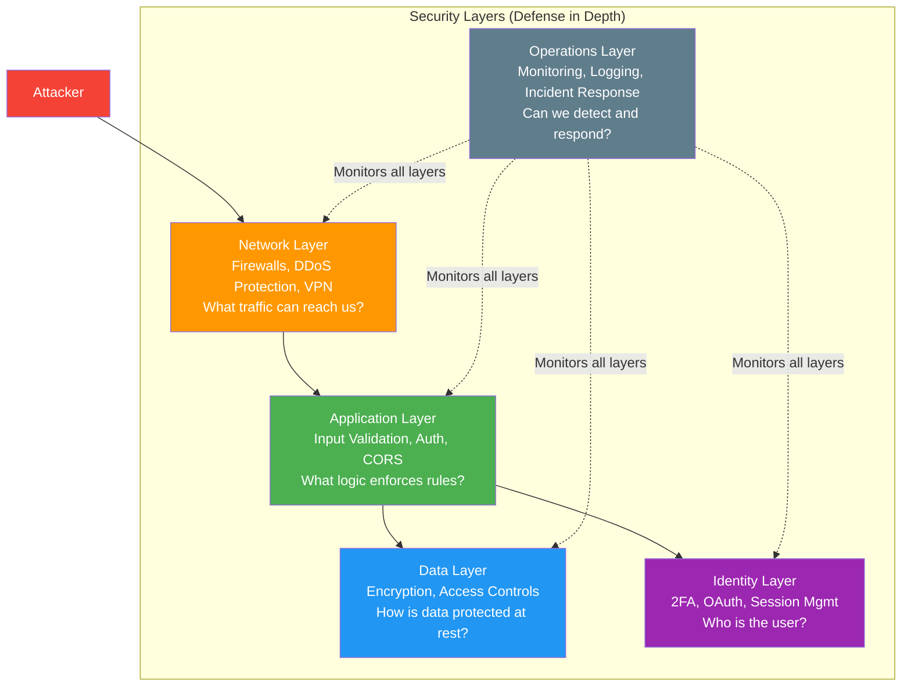

# Session 11 - Security: A PM's Guide to Protecting Users

## Why Security Is a PM's Problem Too

### Security Is Not Just Engineering's Job #pm-implication

Many PMs think security is "an engineering thing." This is dangerous. Security decisions are product decisions because:

1. **PMs decide what data to collect** -- Every field on a sign-up form is data you must protect. Collecting a user's Aadhaar number creates a fundamentally different security obligation than collecting their email.

2. **PMs define access rules** -- Who can see what? Can a regular user access admin features? These are product requirements, not engineering details.

3. **PMs own the user trust relationship** -- When a breach happens, users do not blame the engineer who wrote the SQL query. They blame the product and the company.

4. **PMs set priorities** -- If security work keeps getting deprioritized for feature work, that is a PM decision with real consequences.

> **The uncomfortable truth:** In most breach post-mortems, the root cause was not a sophisticated hack. It was a known vulnerability that was deprioritized because "we have features to ship." #pm-implication

---

## What Happens When Security Fails

### The Four Consequences #framework

When a security breach occurs, the impact cascades across four dimensions:

**1. Users Leave**
- Trust takes years to build and seconds to destroy
- Users migrate to competitors who feel "safer"
- Churn accelerates; acquisition cost increases as reputation suffers

**2. Heavy Fines**
- [[GDPR]]: Up to 20 million euros or 4% of global annual revenue
- [[DPDP-Act]] (India): Up to 250 crore rupees
- RBI penalties for payment data mishandling
- Industry-specific fines (healthcare, financial services)

**3. Legal Action**
- Class-action lawsuits from affected users
- Regulatory investigations
- Personal liability for officers (in some jurisdictions)

**4. Brand Damage**
- Media coverage amplifies the breach
- "Company X leaked data" becomes the top Google result
- Years of positive brand building undone in days

---

## Real Breach Examples from India #case-study

### BigBasket -- 20 Million Records (2020) #case-study

**What happened:** A database containing 20 million user records (names, emails, phone numbers, addresses, hashed passwords) was found for sale on the dark web.

**How it happened:** Reported to be a database misconfiguration -- the database was accessible from the internet without proper access controls.

**Impact:** User data sold online, loss of consumer trust, regulatory scrutiny.

**PM lesson:** Database access controls are a product requirement. PMs should ask: "Who can access our production database, and how is it secured?" #pm-implication

### Air India -- 4.5 Million Passengers (2021) #case-study

**What happened:** Personal data of 4.5 million passengers -- including names, dates of birth, contact information, passport details, ticket information, and credit card data -- was compromised.

**How it happened:** A cyber-attack on SITA, Air India's data processor (third-party vendor).

**Impact:** Exposed the risk of third-party data processing. Your security is only as strong as your weakest vendor.

**PM lesson:** When selecting third-party vendors, security posture must be an evaluation criterion, not an afterthought. Ask for SOC 2 reports and data processing agreements. #pm-implication

### Dominos India -- 180 Million Orders (2021) #case-study

**What happened:** Data from 180 million orders was leaked, including customer names, emails, phone numbers, delivery addresses, and payment details. A searchable portal was created allowing anyone to look up any customer by phone number.

**How it happened:** Suspected API vulnerability that allowed unauthorized data extraction.

**Impact:** Massive public exposure of personal ordering data. Imagine anyone being able to see your complete Dominos order history and home address.

**PM lesson:** APIs must be secured and rate-limited. PMs should include API security requirements in every specification. #pm-implication

---

## Common Security Threats Simplified

### The Threat Landscape #definition

[[Security-Threats]] can feel overwhelming, but most attacks fall into a few well-understood categories:

**1. Data Breach** #definition
- Unauthorized access to stored data
- Can be external (hackers) or internal (employees)
- Prevention: Encryption at rest and in transit, access controls, monitoring

**2. SQL Injection** #definition
- Attacker inserts malicious SQL through input fields
- Example: Typing `'; DROP TABLE users; --` in a login form
- Can delete databases, extract all records, bypass authentication
- Prevention: Parameterized queries, input validation, ORM usage

**3. Weak Passwords** #definition
- Users choose "password123" or "123456"
- Attackers use automated tools to try millions of passwords
- Prevention: Password strength requirements, [[Two-Factor-Authentication]], rate limiting

**4. Broken Authentication** #definition
- Session tokens that do not expire, predictable session IDs
- Password reset links that do not expire or can be reused
- Prevention: Secure session management, token expiration, HTTPS everywhere

**5. API Abuse** #definition
- APIs called without proper authentication or rate limiting
- Automated scripts scraping data or abusing functionality
- Prevention: API keys, rate limiting, monitoring, authentication on all endpoints

**6. Phishing** #definition
- Fake emails or websites tricking users into revealing credentials
- The "human vulnerability" that no firewall can fix
- Prevention: User education, email verification, 2FA (mitigates even if password is stolen)

---

## What a PM Should Do About Security #pm-implication

### Three Actions, Not Zero #framework

A PM does not write security code. But a PM has three responsibilities:

**1. Ask Questions**
- "How is user data encrypted?"
- "Who has access to the production database?"
- "What happens if this API is called without authentication?"
- "How do we handle a user reporting a vulnerability?"

**2. Set Requirements**
- Include security requirements in every PRD/specification
- Define data sensitivity levels for each feature
- Specify authentication and authorization requirements
- Require security testing before launch

**3. Review with Engineering**
- Participate in security reviews before major launches
- Review third-party vendor security assessments
- Ensure security debt is visible on the backlog
- Block launches that do not meet minimum security standards

---

## Authentication vs. Authorization

### Two Different Questions #definition

[[Authentication]] and [[Authorization]] are frequently confused, but they address fundamentally different concerns:

**Authentication: "Who are you?"** #definition
- Verifying identity -- proving you are who you claim to be
- Mechanisms: password, biometrics, OTP, security keys
- Example: Logging into your bank app with username and password
- Failed authentication: "I don't know who you are. Access denied."

**Authorization: "What can you do?"** #definition
- Verifying permissions -- determining what an authenticated user is allowed to access
- Mechanisms: roles, permissions, access control lists
- Example: A bank employee can view accounts but cannot approve loans (requires manager role)
- Failed authorization: "I know who you are, but you're not allowed to do that."

**Real-world analogy:**
- **Authentication** = Your office ID badge proving you work at the company
- **Authorization** = Your badge giving you access to the 5th floor but not the server room

> **PM pitfall:** Many apps authenticate users correctly but fail on authorization. A user logs in (authenticated) and then can access admin pages, other users' data, or restricted features by simply changing the URL. This is "Broken Access Control" -- the #1 vulnerability on the [[OWASP-Top-10]]. #pm-implication

---

## Security Features Every App Needs

### The Essential Four #framework

**1. Two-Factor Authentication (2FA)** #definition
[[Two-Factor-Authentication]] requires two forms of verification:
- Something you **know** (password)
- Something you **have** (phone for OTP) or something you **are** (fingerprint)

Why it matters: Even if a password is stolen, the attacker cannot access the account without the second factor. Google reported that 2FA blocks 99.9% of automated attacks.

**2. OAuth / Social Login** #definition
- "Sign in with Google/Facebook/Apple"
- Delegates authentication to trusted providers
- Users do not create yet another password to forget (or reuse)
- Reduces your liability -- you never store their password

**3. Role-Based Access Control (RBAC)** #definition
[[RBAC]] assigns permissions based on roles, not individual users:

| Role | Permissions |
|------|------------|
| Viewer | Read content |
| Editor | Read + create + edit content |
| Admin | Everything + manage users |
| Super Admin | Everything + manage settings + delete data |

Why it matters: Without RBAC, everyone has the same access. A customer support agent should not have the same permissions as a database administrator.

**4. Session Timeout** #definition
- Automatically log users out after inactivity
- Banking apps: 5-10 minutes
- Social media: days to weeks
- Enterprise tools: 30-60 minutes

Why it matters: If someone walks away from a logged-in computer, session timeout limits the window of unauthorized access.

---

## OWASP Top 10 Simplified

### The Top 5 Every PM Must Know #framework

The [[OWASP-Top-10]] is the most authoritative list of web application security risks, maintained by the Open Web Application Security Project. Here are the top five:

**#1 Broken Access Control** #definition
- Users accessing data or features they should not have
- Example: Changing `/user/myprofile` to `/user/admin` in the URL and seeing admin data
- PM action: Define access control rules in every feature spec; test them explicitly

**#2 Cryptographic Failures** #definition
- Sensitive data stored or transmitted without encryption
- Example: Passwords stored in plain text; credit card numbers transmitted over HTTP
- PM action: Require HTTPS everywhere; ask how sensitive data is encrypted at rest

**#3 Injection** #definition
- Malicious input that gets executed as code (SQL, JavaScript, OS commands)
- Example: SQL injection via a search box that drops the user table
- PM action: Ensure engineering uses parameterized queries and input validation

**#4 Insecure Design** #definition
- Security flaws in the design itself, not just the implementation
- Example: Password reset that asks "What is your mother's maiden name?" (publicly knowable)
- PM action: Include threat modeling in the design phase; ask "how could this be abused?"

**#5 Security Misconfiguration** #definition
- Default passwords, unnecessary features enabled, overly verbose error messages
- Example: Leaving the database admin panel accessible on the public internet
- PM action: Require security configuration reviews before launch; disable defaults

> **The pattern:** Notice that most of these are not sophisticated attacks. They exploit laziness, oversight, and deprioritization. A PM who asks the right questions catches most of these before they become vulnerabilities. #pm-implication

---

## Security by Layer

### Defense in Depth #framework

Security is not a single wall -- it is multiple layers, each providing protection even if another layer fails. This is the principle of **defense in depth**.

**1. Network Layer**
- Firewalls, VPNs, DDoS protection
- Controls what traffic can reach your servers
- Analogy: The walls and gates of a fort

**2. Application Layer**
- Input validation, output encoding, authentication, authorization
- The logic that enforces security rules in your code
- Analogy: The guards checking credentials at each room

**3. Data Layer**
- Encryption at rest and in transit, access controls on databases
- Protects data even if the application is compromised
- Analogy: The vault where valuables are locked

**4. Identity Layer**
- User authentication, 2FA, OAuth, session management
- Ensures only verified users interact with the system
- Analogy: The ID verification at the entrance

**5. Operations Layer**
- Monitoring, logging, incident response, patching
- Detects and responds to breaches in progress
- Analogy: The security cameras and alarm systems

---

## India Context: Security in Practice #india-context

### Razorpay -- 2FA for Merchant Dashboards #case-study

[[Razorpay]] mandates [[Two-Factor-Authentication]] for all merchant dashboard access. Given that merchant dashboards handle sensitive financial data (transaction records, bank account details, settlement information), this is a critical security layer.

**Implementation:**
- Email + OTP for every login
- IP-based session restrictions for high-value accounts
- Activity logs for all dashboard actions
- Auto-logout after 15 minutes of inactivity

**PM takeaway:** For any application handling financial or sensitive data, 2FA should not be optional -- it should be the default. The friction it adds is far outweighed by the security it provides. #pm-implication

### UPI Fraud Prevention #india-context

India's UPI ecosystem processes billions of transactions monthly. Security measures include:
- **Device binding:** UPI works only on registered devices
- **Multi-factor auth:** PIN + device + phone number
- **Transaction limits:** Per-transaction and daily caps
- **Real-time fraud detection:** ML models flagging suspicious patterns

> **Design lesson:** UPI demonstrates that security and user experience can coexist. The PIN entry adds 2 seconds to a transaction but prevents billions in fraud. Good security design makes the user feel safe, not frustrated. #pm-implication

---

## PM Implication: Security Questions Are Product Decisions #pm-implication

### The Three Questions That Matter

Every feature you build as a PM involves three security questions:

**1. What data do we collect?**
- Collect only what you need (data minimization principle)
- More data = more liability
- Every data field is a potential breach exposure point

**2. Where do we store it?**
- Encrypted at rest? Which region/data center?
- Who has access? Is access logged?
- How long do we keep it? What is the retention policy?

**3. Who can access it?**
- Authentication requirements (password only? 2FA?)
- Authorization rules (roles and permissions)
- Audit trail (who accessed what, when?)

> **The golden rule:** If you cannot answer these three questions for every feature you ship, you are not ready to ship. #framework

---

## Key Takeaways

1. **Security is a PM problem.** PMs decide what data to collect, who can access it, and how it is protected.
2. **Breaches have four consequences:** User churn, heavy fines, legal action, and brand damage.
3. **Indian breaches are real:** BigBasket (20M records), Air India (4.5M passengers), Dominos India (180M orders).
4. **Authentication vs Authorization:** "Who are you?" vs "What can you do?" -- both must be correct.
5. **Every app needs:** 2FA, OAuth, RBAC, and session timeouts.
6. **OWASP Top 5:** Broken access control, cryptographic failures, injection, insecure design, misconfiguration.
7. **Defense in depth:** Five security layers -- network, application, data, identity, operations.
8. **PM action:** Ask questions, set requirements, review with engineering.

---

## Related Concepts

- [[Security-Threats]] | [[Authentication]] | [[Authorization]]
- [[OWASP-Top-10]] | [[Two-Factor-Authentication]] | [[RBAC]]
- [[SQL-Injection]] | [[Encryption]] | [[OAuth]]
- [[Data-Privacy]] | [[GDPR]] | [[DPDP-Act]]
- [[Compliance-Frameworks]] | [[Incident-Response]]

---

*Module 1 -- Product Management II: Technology & Agile Execution | HSB | Dr. Anand Fadte*
